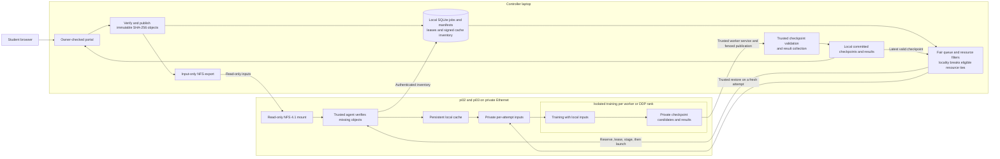
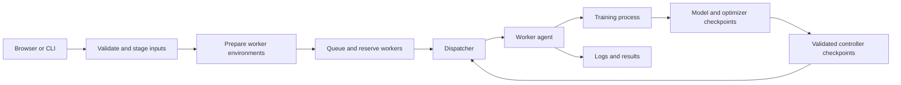

# Architecture and code reading order

The controller owns submission records, input snapshots, scheduling and recovery.
Two profiles share the job and checkpoint models. The v8 hybrid pilot uses an
explicit protected runtime. The legacy profile is the default for a fresh checkout.

## Deployed hybrid pilot v8

Both DDP ranks must stage their authorized input set and have valid leases before
launch. The sandbox receives private projected inputs and outputs. Trusted host
services own the NFS mount, cache and credentials. The `root_squash` export is
restricted to the two verified LAN workers. Application authorization and the
worker isolation boundary enforce student access. The controller, its local DB
and its NFS service remain a single point of failure.

See the [v8 deployment evidence](storage/64-v8-pilot-deployment.md) and
[supervisor demo](storage/14-supervisor-demo.md). The
[Phase 1 design](storage/01-hybrid-architecture.md) records the original proposal.

## Legacy job lifecycle

In the legacy profile, the worker HTTP agent launches training in a separate
process group. Browser submissions and CLI tools share controller job state.

1. **Submission — `controller/submit_job.py`, `job_store.py`.** Validate the
   request and insert its type, configuration and QUEUED state in one SQLite
   transaction. This prevents the dispatcher seeing a partly defined job.
2. **Placement — `controller/scheduler.py`.** Filter unavailable, busy and
   temporarily unhealthy workers. Among eligible workers, prefer lower CPU
   usage, using available RAM as the tie-breaker. Comparison jobs can constrain
   eligible nodes to keep hardware consistent with the reference experiment.
3. **Dispatch — `controller/dispatcher.py`.** Persist SCHEDULED before contacting
   a worker. An attempt token makes repeated start requests identifiable. If a
   start response is lost, reconcile with that worker before launching again.
4. **Execution — `agent/agent.py`.** Validate supported workloads and keep a single
   worker slot under a lock. Launch a separate process group, track its exit,
   expose logs/results through job state, and transfer checkpoint bytes.
5. **Learning — `training/pytorch_job.py`.** Regenerate deterministic data, build
   an MLP, run forward propagation, compute cross-entropy, backpropagate and
   update Adam. Save model/optimizer state and the next unprocessed batch using
   atomic file replacement. On resume, skip only already-processed batches.
6. **Recovery — dispatcher and trainer.** Sync checkpoints to the controller,
   detect repeated lost contact, record the failed attempt, and temporarily
   exclude that worker. Upload the checkpoint before starting the replacement.
   Record RESUMED only when that process confirms both state dictionaries loaded.
   Require a valid final controller checkpoint before marking PyTorch COMPLETED.
7. **Measurements — `recovery_metrics.py`, `recovery_report.py`.** Append events
   and calculate timing differences. Use the latest central checkpoint before
   the injected failure, rather than a checkpoint from the replacement worker.
8. **Reference comparisons — `training/benchmark_job.py`.** Run fixed, bundled
   scripts using their original model/dataset settings. Keep reference compute
   time separate from controller wall time. These jobs do not checkpoint or
   retry; two-node DDP comparison is not fault-tolerant DDP.

## Submitted projects and DDP

Custom submissions use `job_spec.py`, `job_storage.py`, `prepare_job.py` and
`queue_job.py` before reaching the dispatcher. `agent/custom_runner.py` verifies
the prepared inputs and launches the submitted entrypoint. Student trainers use
`agent/dl_checkpoint.py` to save and restore their complete training state.

`distributed_dispatch.py` coordinates worker groups. `group_checkpoints.py`
validates complete rank bundles; `execution_leases.py` and the worker watchdog
prevent expired attempts from publishing results.

## Where to start reading

1. `controller/student_portal.py` for the browser workflow, or `submit_job.py` for CLI submission.
2. `controller/job_spec.py`, `job_storage.py` and `job_store.py` for declarations and durable state.
3. `controller/scheduler.py` and `dispatcher.py` for placement and recovery.
4. `agent/agent.py`, `custom_runner.py` and `dl_checkpoint.py` for execution.
5. `examples/checkpoint_project/train.py` and `examples/ddp_project/train.py` for trainer integration.

The [file guide](project-map.md) lists every source file and distinguishes the
core services from optional diagnostics, examples and reference workloads.
