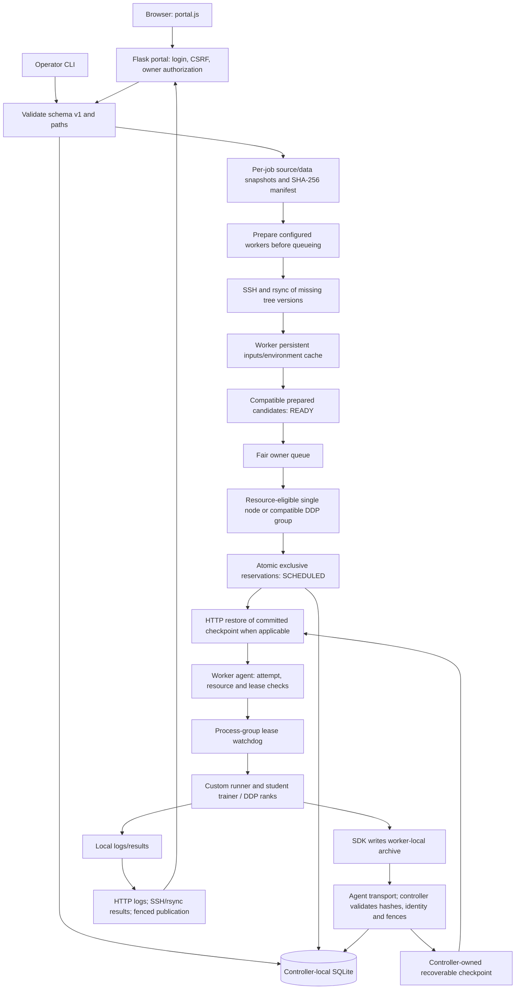
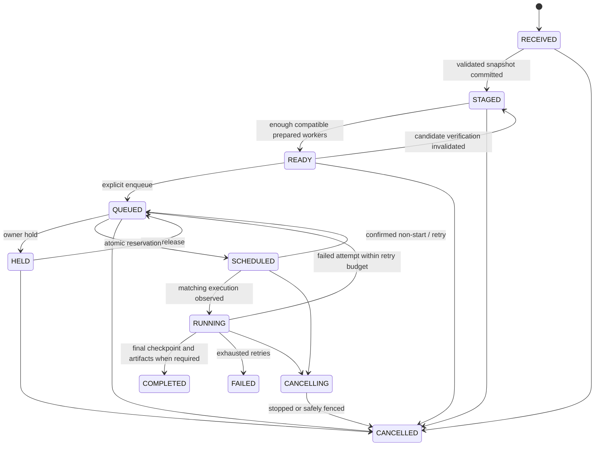

# Phase 0 — hybrid storage audit and integration plan

Audit date: **7 November 2026**, Asia/Dhaka. This document consolidates subphases
0.1–0.3 and the 0.4 read-only readiness probes. It is an implementation plan,
not an implementation, deployment approval or claim that the cluster is ready.

**Audit result: PASS, subject to the documented verification below. Infrastructure
readiness: NOT PASSED for the proposed architecture.** pi01 was unreachable; the
existing NFS configuration and process isolation do not meet the requested security
boundary. No corrective infrastructure action was taken.

Machine-readable observations, exact test selections/commands/logs, API versions,
source fingerprints and probe program text are preserved in
[00-audit-evidence.json](00-audit-evidence.json). Runtime values are point-in-time
observations, not capacity or performance guarantees.

## 1. Repository baseline and scope

| Item | Evidence |
|---|---|
| Git root | `/home/rana/Projects/System Project/System_Development_Project` |
| Application root (APP below) | `/home/rana/Projects/System Project/System_Development_Project/distributed-dl-system` |
| Branch / HEAD | `main` / `f6e56603f100f3b7620b8d736725d0b9fc20b4ed` |
| Pre-existing staged tracking removals | 943: virtual environment 938, four checkpoint JSONs, one job DB; all remained on disk during 0.1 |
| Other pre-existing changes | 13 modified files, 10 deleted old tool paths, 24 untracked files |
| First-party baseline | 128 source/config/example/document files fingerprinted before new storage work |
| Applicable AGENTS.md | None found in the application/ancestor paths inspected |

The source snapshot includes the earlier uncommitted cleanup; it was not stashed,
reset, committed, discarded or mistaken for hybrid implementation. The main README,
current tool paths and existing `docs/storage.md` were inspected. The latter is an
older feature guide, not this hybrid audit.

0.1 identified the repository/environment; 0.2 traced code and ownership; 0.3 ran
only the safe local baseline. The user authorized each continuation. Completion
reports are evidence of work, not a fabricated later acceptance record. No phase
beyond this audit has been implemented or accepted in the inspected repository.
`01-hybrid-architecture.md`, `implementation-progress.md` and the proposed
`hybrid_storage/` package remain absent at this audit boundary.

The intended repository changes in 0.4 are this Markdown file, its JSON evidence
companion, and anchoring the existing `.gitignore` rule `storage/` as `/storage/`.
The unanchored runtime rule also ignored docs/storage; the correction keeps runtime
data ignored while making the audit documents visible to Git. All other existing
ignore edits are preserved. No application code, schema, configuration, job data, checkpoint,
export, mount, fstab, firewall, SSH setting or systemd unit was changed. There was
no worker deployment, package installation, service start/stop/restart or benchmark.

## 2. Current system, traced from code



### Exact code interfaces

Paths are relative to APP; links open the current source. Line numbers identify
this baseline and will change when future implementation edits are approved.

| Area | Exact files/functions/interfaces |
|---|---|
| Browser/API | [portal.js](../../controller/portal_static/portal.js): `api`, FormData submission; `POST /api/jobs` |
| Portal authorization | [student_portal.py](../../controller/student_portal.py): `create_app:240`, nested `access:253`, `login:294`, `owned:278`, `checked_upload:91`, `submit:345` |
| Submission | [job_spec.py](../../controller/job_spec.py): `validate_spec:128`, `load_spec:241`; [submit_job.py](../../controller/submit_job.py): `create_custom_job:25`; [job.schema.json](../../config/job.schema.json) |
| Controller snapshots | [job_storage.py](../../controller/job_storage.py): `storage_root:26`, `copy_file:103`, `unpack_zip:136`, `inventory:175`, `verify_workspace:208`, `stage_job:295` |
| Worker preparation | [student_portal.py](../../controller/student_portal.py): `PreparationQueue.run_one:141`; [prepare_job.py](../../controller/prepare_job.py): `Worker:27`, `prepare_on_worker:144`, `verify_on_worker:187` |
| Existing cache | [environment_worker.py](../../agent/environment_worker.py): `read_request:131`, `input_location:154`, `plan:168`, `publish_input:212`, `prepare:290`, `verify:445` |
| Job state/DB | [job_store.py](../../controller/job_store.py): `initialize_database:41`, `mark_staged:260`, `record_environment:316`, `enqueue_custom_job:460`, `mark_scheduled:488`, `mark_running:529`, `mark_completed:592`, `requeue_after_failure:649` |
| Fairness/controls | [queue_policy.py](../../controller/queue_policy.py): `fair_order:42`; [job_store.py](../../controller/job_store.py): `fair_queue:760`, `control_job:784`, `finish_cancellation:815` |
| Single placement | [scheduler.py](../../controller/scheduler.py): `resources_fit:29`, `select_best_node:39`; [dispatcher.py](../../controller/dispatcher.py): `dispatch_one_job:623` |
| Single recovery | [dispatcher.py](../../controller/dispatcher.py): `monitor_running_jobs:810`, `handle_running_job_failure:993`, `reconcile_scheduled_jobs:1149`, `reconcile_cancellations:1047` |
| DDP placement/lifecycle | [distributed_dispatch.py](../../controller/distributed_dispatch.py): `select_group:58`, `dispatch:83`, `progress:215`, `reconcile_stop:176`, `restore_confirmed:350` |
| Launch | [agent.py](../../agent/agent.py): `start_job:414`, `POST /jobs/start`; [custom_runner.py](../../agent/custom_runner.py): `validate_execution:13`, `run:50` |
| SDK/validation | [dl_checkpoint.py](../../agent/dl_checkpoint.py): `CheckpointManager.save:62` / `load:118`, `DistributedCheckpointManager.save:273` / `load:338`; [checkpoint_protocol.py](../../agent/checkpoint_protocol.py): `validate:21`, `validate_group:62` |
| Checkpoint transport | [agent.py](../../agent/agent.py): `custom_checkpoint:998`, `GET/POST /jobs/<id>/custom-checkpoint`; [custom_checkpoints.py](../../controller/custom_checkpoints.py): `sync:31`, `restore:76`; [group_checkpoints.py](../../controller/group_checkpoints.py): `sync:29`, `resume_metadata:116`, `restore:141` |
| Fencing | [execution_leases.py](../../controller/execution_leases.py): `ensure:45`, `safe_to_replace:83`, `current:106`, `checkpoint:122`, `renew:143`; [execution_lease.py](../../agent/execution_lease.py): `accept:83`, `sdk_fence:119`, `reap_previous:151`; [lease_runner.py](../../agent/lease_runner.py): `main:30` |
| Results/logs | [job_artifacts.py](../../controller/job_artifacts.py): `collect:12`; [student_portal.py](../../controller/student_portal.py): `logs:443` and `download_results:489` |
| Deployment | [cluster_setup.py](../../tools/cluster_setup.py): `bundle:130`, `probe:145`, `install_worker:268`, embedded `REMOTE_INSTALL`, `controller_units:278`, `install_controller:296` |
| Monitoring | [agent.py](../../agent/agent.py): `health:326`, `resources:341`; [student_portal.py](../../controller/student_portal.py): `ClusterView.get:220`; [recovery_metrics.py](../../controller/recovery_metrics.py): `log_event:48`; [recovery_report.py](../../controller/recovery_report.py): `build_report:86`; [job_timing.py](../../controller/job_timing.py): `build_report:22`, `write_report:71` |

### Input, execution and ownership facts

- Portal mutations require CSRF; protected API requests require login; per-job
  access uses the session owner. CLI `--owner` is a trusted operator assertion.
- Portal upload limit is 256 MiB; ZIP expansion is bounded to 10,000 members /
  512 MiB. Unsafe members, links and special files are rejected. These checks are
  not an OS sandbox against a hostile process with the same UID.
- Controller snapshots are per-job copies. Inventories include paths, file bytes,
  sizes, executable flags and directories. Tree versions and manifest hashes bind
  storage, prepared records, job configuration and checkpoints.
- Worker transfer is SSH/rsync, not an HTTP dataset-upload endpoint. A verified hit
  skips an entire source/data tree. There is no per-file global artifact registry,
  cache pin/eviction policy or missing-byte placement interface yet.
- Preparation normally visits every configured worker before queueing. READY
  requires enough compatible prepared records. Dispatch currently selects only
  those workers; a retry does not discover and prepare a fresh replacement node.
- Worker source is copied into a per-job directory, but `DL_DATASET_PATH` points
  into the shared persistent data cache. This is not a private per-job dataset.
- `resources_fit` preserves CPU/RAM/GPU admission and idle status; reservations,
  cooldowns, allowed/prepared nodes and resume compatibility further constrain
  placement. Single-worker ranking is CPU ascending, free RAM descending. DDP has
  its own group-selection implementation, which must also be integrated.
- Each worker has one exclusive managed slot. CPU affinity/thread pools are set;
  RAM is admission accounting, not a cgroup hard limit.
- The DDP example reads the complete CSV on each rank, then applies
  `DistributedSampler`. Logical sample sharding does not imply file-level locality.
- `job_store.py:867` initializes the DB on import. Other module imports create
  runtime directories, and even some GET handlers write reports. Audit tooling
  must not assume an application import or CLI is read-only.

## 3. Existing state and recoverable checkpoints



This is a high-level view, not every error edge. Built-in jobs can enter QUEUED
without custom-input staging. DDP attempt phases include STARTING, RUNNING,
STOPPING, COMPLETED, FAILED and CANCELLED; rank records include RESERVED and
observed/final states such as STOPPED/FENCED. They are distinct from job status.

| Checkpoint lane | Current format/path | Compatibility rule |
|---|---|---|
| Dummy | JSON; APP/checkpoints/<job>.json | Retain legacy behavior |
| Built-in PyTorch | `.pt`, checkpoint_version 2; APP/checkpoints/<job>.pt | Preserve model/Adam, epoch/next-batch resume and older epoch-only loading |
| Custom single worker | Uncompressed ZIP: metadata.json + state.pt; worker latest.dlckpt; controller job/checkpoints/latest.dlckpt | format_version 1; manifest/attempt/environment/hash checks; tensor-safe SDK loading |
| Custom DDP | Metadata + one rank-N.pt per rank; worker rank-zero latest.dlckpt; controller job/checkpoints/latest.ddpckpt | format_version 2/kind ddp; complete rank hashes/acknowledgments, rendezvous identity, fences and fixed world size |

Single-worker and DDP collectors stage into temporary files, validate identity,
progress and producer fences, and atomically publish committed controller copies.
DDP recovery transfers the same frozen bundle to all reserved ranks before launch,
then checks collective restore acknowledgment. Old ranks must stop or be fenced
before releasing/retrying the group. Current launches are sequential HTTP requests;
there is no explicit future all-inputs-staged/all-leases-ready barrier yet.

Known static compatibility caveat: custom single-worker `metadata()` returns None
for a missing central file and `restore()` can then return None, whereas DDP
explicitly rejects a known missing checkpoint. The 0.3 selection did not establish
this missing-file single-worker behavior through a new runtime test. Do not silently
broaden that behavior during new storage integration. Some single-worker/legacy
monitoring URLs also hard-code port 5000 despite configurable inventory ports.

Checkpoint ZIP hashes establish byte integrity and execution identity, not caller
authentication. The custom collector validates without unpickling student state;
the separate built-in PyTorch loader uses `weights_only=False`. Do not merge those
trust boundaries or rewrite checkpoint formats to introduce shared storage.

## 4. Filesystem and process ownership

| Location | Writer/authority | Consumer / observed boundary |
|---|---|---|
| APP/controller/jobs.db, WAL/SHM | Controller SQLite modules | Local ext4; rana UID/GID 1000; DB mode 0644; must never move to NFS |
| APP/storage/jobs/<job>/submission.json, manifest.json, source/, data/ | Controller ingestion | Managed input copies, hash-verified; storage directories mode 0775 |
| Job checkpoints/, logs/, results/ | Trusted controller collectors | Mutable outputs, separate from authoritative input export |
| APP/storage/portal/ | Portal/operator | Directory 0700; users.json/session.key 0600; never export |
| Worker inputs/{source,data}/<tree-sha>/content | Preparation helper | Shared persistent tree cache; worker service and trainer are not privilege-separated |
| Worker environments/<key>/ | Preparation/pip | Native environment/build tree; source/runtime/profile-bound |
| Worker jobs/<job>/source, request.json, prepared.json | Preparation helper | Per-job paths/identity; no mount namespace or distinct job UID enforced |
| Worker jobs/<job>/checkpoints, results | SDK/agent restore / student code | Controller later validates/collects; retries reuse job directories |
| Worker leases/, execution-authority.json, cancellations/ | Agent/guardian ownership functions | Durable generation/deadline/tombstone state; not protected from a hostile same-UID trainer |
| Existing /mnt/nfs_share on pi02/pi03 | Existing NFS server on pi02 | RW client mount visible in the same mount namespace as the agent; untouched |

Worker paths above are under `/home/pi/distributed-dl-system/worker-storage` on the
reachable Pis. pi02 uses numeric UID/GID 1000, pi03 1002, despite both being named
`pi`. NFS AUTH_SYS uses numeric identities; names alone do not establish access.
Actual controller and reachable worker UIDs/modes are recorded in the evidence.

## 5. Safe local test and API baseline

0.3 copied all 128 first-party files, including existing user changes, into an
isolated `/tmp` source tree, excluding real databases/runtime data. Every selected
test file ran in its own process. Pip indexes were disabled and live/infrastructure
commands were rejected by PATH guards. No guard was invoked.

| Regression file | Available unittest methods | Passed in 0.3 | Deferred |
|---|---:|---:|---:|
| test_cluster_setup.py | 8 | 8 | 0 |
| test_custom_checkpoint.py | 4 | 3 | 1 |
| test_distributed_dispatch.py | 7 | 6 | 1 |
| test_execution_ownership.py | 12 | 9 | 3 |
| test_group_checkpoint.py | 8 | 1 | 7 |
| test_group_recovery.py | 7 | 0 | 7 |
| test_job_environments.py | 6 | 1 | 5 |
| test_job_storage.py | 9 | 9 | 0 |
| test_job_submission.py | 6 | 6 | 0 |
| test_job_timing.py | 4 | 4 | 0 |
| test_queue_controls.py | 10 | 9 | 1 |
| test_resource_allocation.py | 6 | 6 | 0 |
| test_student_portal.py | 17 | 17 | 0 |
| **Total unittest methods** | **104** | **79** | **25** |

`test_checkpoint_recovery.py` is an additional standalone assertion script and
was deferred. Fresh result: **79 passed, 0 failures/errors, 0 framework skips**.
Deferred is not the same as passed or a framework skip. Exact method selections,
argv, return codes and verbose logs are preserved in the JSON evidence.

Deferred work includes repeated real training/interruption equivalence, real
multi-process DDP/group checkpoint recovery, fixture process-group killing,
repeated venv/pip installation, all live demos, image/reference benchmarks and
installation commands. The live demo default `--failure process` still stops real
training. No such command was run in this audit.

Historical pre-hybrid logs recorded socket PermissionError in the three real DDP
suites (1, 7 and 7 errors); a later historical loopback-enabled rerun recorded all
three passing. These are earlier environment-restriction observations, not fresh
0.3 coverage or proof of current Pi recovery. No new failure occurred in the safe
local selection. No hybrid-specific tests exist yet.

| Component | Local controller environment |
|---|---|
| Python / architecture | 3.12.3 / x86_64 |
| Torch actual runtime | 2.14.1+cu130; CUDA build 13.0, hardware/GPU execution untested |
| Flask / Werkzeug | 3.1.3 / 3.1.9 |
| requests / psutil / waitress | 2.34.2 / 7.2.2 / 3.0.2 |
| NumPy / torchvision | 2.5.3 / absent |

The API smoke passed one tiny CPU forward/backward/Adam step, model/optimizer/
scheduler `weights_only=True` serialization, Python/NumPy/Torch RNG round trips
and two logical DistributedSampler partitions. DDP/Gloo build support and the
collective API symbols are available; no process group or collective was run.
This is not a throughput or training-equivalence benchmark.

## 6. Read-only infrastructure observations

All three configured Pi aliases were probed, initially inside the sandbox and
then using approved network access after socket creation was denied. SSH used
BatchMode, bounded timeouts, StrictHostKeyChecking=yes, UpdateHostKeys=no and no
connection multiplexing. No remote probe script/file was installed; Python source
was sent over stdin with `python3 -I -B -`. No sudo was used on workers.

The SSH/health/resource probe began **7 November 2026 at 18:55:29 Asia/Dhaka**
(12:55:29 UTC). Later configuration observations are in the timestamped evidence.
A timeout does not identify its cause or prove that a Pi is powered off.

| Check | pi01 | pi02 | pi03 |
|---|---|---|---|
| Configured API/SSH address | 100.101.90.46 | 100.91.135.18 | 100.64.202.71 |
| SSH alias user | pi | pi | pi |
| Network-enabled SSH result | Timed out | Successful | Successful |
| GET /health and /resources | Both timed out | Both HTTP 200, identity matched | Both HTTP 200, identity matched |
| Agent runtime | Unknown | aarch64, Python 3.11.16, protocol 1 | aarch64, Python 3.11.16, protocol 1 |
| Agent state at sample | Unknown | active/running, IDLE, one free slot | active/running, IDLE, one free slot |
| Ethernet IPv4 | Unknown | 192.168.10.150 | 192.168.10.101 |
| Reported eth0 link speed | Unknown | 100 Mb/s | 100 Mb/s |
| Local cache filesystem | Unknown | ext4 on /dev/mmcblk0p2 | ext4 on /dev/mmcblk0p2 |
| Available cache-volume space | Unknown | About 11.64 GiB | About 8.67 GiB |
| Worker service UID/GID | Unknown | 1000/1000 | 1002/1002 |
| Eight sampled source/config SHA-256 hashes | Unknown | All matched controller files | All matched controller files |
| Existing NFS mount | Unknown | /mnt/nfs_share, nfs4, client rw | /mnt/nfs_share, nfs4, client rw |
| New-architecture readiness | Unverified/unreachable | Security/storage changes needed | Security/storage changes needed |

Worker base `python3` is 3.11.2; the agent-reported environment Python is 3.11.16.
Both reachable `.venv` package inventories report torch 2.14.1, torchvision 0.29.1,
NumPy 2.4.6, Flask 3.1.3, requests 2.34.2, psutil 7.2.2 and waitress 3.0.2.
Package metadata was read without importing worker Torch or running training.
Per-job environments/compatibility keys were not enumerated or assumed equivalent.

### Existing NFS is not the proposed controller backend

Both mounts point to `192.168.10.150:/srv/nfs/cifar10_data`, on pi02. On pi02 the
configured `/etc/exports` line is:

```text
/srv/nfs/cifar10_data *(rw,sync,no_subtree_check,no_root_squash)
```

This configured wildcard/RW/no_root_squash policy violates the requested new
input-export policy. It was **not changed, re-exported, reused or write-tested**.
The effective active export table is not established: `exportfs -v` emitted a
permission error opening its lock despite exit status zero. No privileged retry
was attempted; exit status alone must not be interpreted as successful inspection.

The existing client mounts use NFSv4.2, TCP, `hard`, `sec=sys`, and client rw.
Both fstab files contain the old share with `defaults,_netdev`. That does not prove
server-side write authorization; the unsafe server rule above is configured state,
not a verified active export table. The mount and NFS server on pi02 are real
observations, but are not application-managed hybrid storage.

The agents share the probe's mount namespace on both reachable Pis. Their units
report PrivateMounts=no, ProtectHome=no, ProtectSystem=no, NoNewPrivileges=no and
empty ReadOnlyPaths/InaccessiblePaths. Current trainers inherit that view and UID;
hiding only a newly added mount would leave the old share visible. A future secure
job namespace must exclude all unauthorized NFS/host paths. Existing share policy
remediation needs its own reviewed plan and explicit approval.

`nfs-common` is installed on both workers; mount.nfs/nfsstat exist under /usr/sbin.
They were absent from the unprivileged SSH PATH, so an initial which result was not
mistaken for package absence. pi03 has no observed NFS server service/listener;
pi02 has an active/exited nfs-server unit and TCP 2049 listeners.

### Controller readiness

- Controller DB and default storage/checkpoint/log paths are on local ext4
  `/dev/nvme0n1p4`, with about 40.95 GiB available at observation time.
- Controller dispatcher and portal user services were active/running. Their
  working directory is APP; the portal unit binds 127.0.0.1:8080. They were not
  restarted, stopped or reconfigured.
- nfs-kernel-server and nfs-common are reported not installed; exportfs/mount.nfs
  were not found, /etc/exports is absent, no NFS mount/TCP 2049 listener was
  observed, and NFS server units have no fragment and are inactive/dead.
- The currently addressed LAN interface is **Wi-Fi wlo1, 192.168.10.214**;
  wired enp4s0 is down/unaddressed. Tailscale is 100.73.90.91. Do not describe this
  observation as an end-to-end wired Ethernet deployment or infer measured NFS
  bandwidth from worker link speed.
- Sandbox systemd/netlink/socket reads were initially denied; network-enabled
  read-only retries supplied the observations above. These restrictions are
  recorded separately, not reported as stopped services or offline workers.

No mounts, exports, firewall rules, host keys, credentials, packages or services
were changed. No NFS file was opened for a write test. pi01, time-sync guarantees,
controller-to-worker NFS reachability, sustained throughput and new UID/isolation
policy remain unverified. **All-three-Pi deployment validation is still required.**

## 7. Target boundaries and isolated implementation folder — proposed only

NFS supplies mature shared files; this project should not implement a filesystem.
The new application-managed components belong in one identifiable package:

```text
hybrid_storage/              proposed; not created by Phase 0
  config.py                  strict flags and validated local paths
  manifests.py               immutable artifact/rank requirement manifests
  artifacts.py               controller publication and content verification
  registry.py                local SQLite schema, authorized bindings, advisory cache reports
  cache.py                   verified worker objects, locks, pins and bounded managed eviction
  staging.py                 missing-object staging and persisted attempt/rank receipts
  workspace.py               authorized private local source/data materialization
  locality.py                opt-in placement tie-breakers and measured-cost hooks
  control.py                 authenticated controller/stager channel adapter
  nfs.py                     read-only backend access/readiness checks; no automatic mounts
```

Names are concrete proposed responsibilities, not existing APIs or a shipped
feature. Existing upload, checkpoint and result APIs remain the integration seams;
new module names can be finalized by the separately approved architecture work.

```mermaid
flowchart LR
    Upload[Existing authorized upload] --> Publish[Trusted controller artifact publication]
    Publish --> InputStore[Immutable input-only store exported RO via NFS]
    Publish --> Registry[(Controller-local SQLite registry)]
    Registry --> Select[Existing fair/resource-eligible selection plus opt-in locality]
    Select --> Reserve[Existing atomic worker/group reservation]
    Reserve --> Stager[Authenticated trusted staging service]
    InputStore --> Stager
    Stager --> Cache[Protected persistent verified local cache]
    Cache --> Workspace[Private authorized local job workspace]
    Workspace --> Train[Isolated trainer: NFS mount hidden]
    Train --> Publisher[Existing checkpoint format through trusted authenticated publisher]
    Publisher --> Recovery[Committed controller-local checkpoints and existing recovery]
```



Required boundaries before new mode can be enabled:

1. NFS exports only the new immutable input root, never APP, all of storage/,
   jobs/, SQLite, portal credentials, logs, results or checkpoints. Export clients
   are explicit verified worker addresses, read-only, with root_squash retained.
   Client flags include ro/nosuid/nodev/noexec as appropriate; noexec does not
   replace process isolation. No wildcard or no_root_squash template is acceptable.
2. Controller authorization resolves a job/owner/manifest into permitted objects.
   A student-supplied SHA-256 is not access authorization. Do not expose global
   object/cache enumeration or permit arbitrary staging paths.
3. The stager/cache publisher is privilege-separated from student code, with a
   protected control interface and stable numeric service UID/GID plan across
   all nodes. Jobs receive separate protected local workspaces and a namespace
   without the new or old NFS mounts, cache root, authority files or other jobs.
   Same-UID path permissions alone cannot supply the required boundary.
4. Existing worker HTTP requests are not authenticated in this baseline. New mode
   must require an authenticated controller channel for staging and checkpoint/
   execution control; proposed control.py centralizes a mutually authenticated
   transport adapter while retaining the existing endpoint payloads. Certificate/
   endpoint provisioning and isolation mechanism must be reviewed before any
   deployment; do not silently claim the legacy protocol already provides this.
5. Checkpoint data remains outside NFS. The trusted validator/publisher authenticates
   the controller channel and checks manifest, attempt and lease fences before
   committing. Trainers never get arbitrary RW shared checkpoint access.
6. Per-file no-follow/containment checks, bounded downloads, size+SHA verification,
   same-filesystem temporary publication and pins protect cache use. Private
   materialization must not hard-link a mutable student file to a cached object.
   Disk admission accounts for object, private-copy, temporary and checkpoint space.
7. No runtime Internet dependency: prepare an approved per-architecture offline
   wheelhouse/locked environment beforehand. Missing dependencies fail clearly;
   persistent pip cache and a CPU index URL are not an offline guarantee.

## 8. Flags, compatibility and scheduling contract — proposed only

Future `config/storage.json` follows the existing JSON configuration style:

```json
{
  "storage_backend": "legacy",
  "storage_aware_staging": "off",
  "worker_cache": "off",
  "scheduler_policy": "resource"
}
```

The file and parser do not exist yet. Missing configuration must preserve those
defaults and the exact legacy call paths. New worker_cache=off disables the new
cache subsystem, not the already-existing legacy input cache. Persist each new
job's chosen backend/manifest/options; a later global flag change must not reroute
an old job or reinterpret a committed checkpoint. Unsupported/incomplete enabled
combinations fail validation rather than partially bypass verification.

| Integration issue | Concrete required adaptation / invariant |
|---|---|
| Publish authoritative bytes | Extend stage_job after existing validation/publication to register artifacts and a sidecar hybrid manifest. Preserve the original storage_version=1 snapshot/hash and submission for compatibility. Never regenerate missing committed bytes from a changed original upload. |
| Separate queue eligibility from data readiness | Add backend-specific readiness records/adapters in PreparationQueue.run_one, record_environment and enqueue_custom_job. Keep legacy READY meaning unchanged. For enrolled new-mode jobs, persist a separate input-preparation phase; reserve before materializing datasets and verify native environment compatibility before start. Never fabricate a fully prepared legacy record to bypass the gate. |
| Environment ordering | Existing preparation couples source, dependency builds and data. Split capability/native-environment planning from reserved input staging; arbitrary local dependencies may require source bytes. Offline build inputs remain explicitly authorized. Final native compatibility must be validated on every selected worker before launch; no compatibility assumption from base package metadata. |
| Single-worker dispatch | Adapt dispatch_one_job after mark_scheduled: authenticated staging request, receipt verification, checkpoint restore and current-lease check before POST /jobs/start. Stage errors retain tracked cancellation/retry ownership, not an untracked background transfer. |
| DDP dispatch | Adapt select_group and progress: persist each rank's required files and staging state; stage/verify every selected rank and all leases before releasing a common launch permit. Recheck cancellation/fences after slow I/O. No rank starts early while another is missing input or a valid lease. Preserve existing whole-group rollback. |
| Local runner | Adapt start_job/custom_runner verification to require the committed staging receipt and local-only paths for new-mode jobs. Keep legacy descriptors and argv handling accepted unchanged. |
| Replacement workers | After safe fencing/requeue, select an eligible compatible replacement, restage only its verified misses and restore the exact central checkpoint. Current get_job_environments-only placement cannot supply an unprepared replacement automatically. |
| Placement policy | Change both select_best_node and select_group through the shared opt-in locality helper. Resource eligibility, owner order, quota, reservations, cooldowns and lease compatibility remain mandatory. |
| Monitoring | Append preparation/cache bytes, verification/staging durations, failures and receipts to new structured records/events. Preserve existing recovery and wall-time definitions. |
| Deployment | Extend cluster_setup.bundle's explicit allowlist for the new package/config and reviewed service integration. A new top-level folder is not currently deployed automatically. No installer execution is authorized by this plan. |

The staging state is persisted separately from top-level job status, keyed by
job/retry/rank/node: RESERVED → STAGING → VERIFIED → ARMED → LAUNCH_PERMITTED,
with tracked ERROR/CANCELLING/CANCELLED exits. Persist identity/receipt transitions
before sending external requests, and reconcile them after controller restarts.
A common permit means every required rank is ready; it does not promise physically
simultaneous HTTP requests. Partial start still uses the existing gang rollback.

**Lease coupling requires an explicit adapter:** current agent
`renew_execution_lease:1060` requires an already-started `current_job`. Calling the
existing `ensure` once and then staging for minutes would not provide a renewable
pre-launch execution. Use a separate authenticated, bounded staging grant while
inputs/environments are prepared; after every rank verifies, install/acknowledge
execution leases in a trusted ARMED state without starting student code. Extend
pending-owner renewal/cancellation handling explicitly before the common launch
permit. A stale stage grant, receipt or armed lease cannot authorize a later retry.
The existing watchdog/collector fences remain mandatory after launch. This is a
required design/test seam, not functionality present in the baseline.

Locality v1 is strictly a tie-breaker: retain the current resource-policy primary
ordering and configured/stable order when information is unavailable; only break
resource-equal choices using verified-observation missing bytes. DDP must preserve
its existing group/resource ordering, not merely reuse the single-node selector.
Unknown/stale cache entries cannot count as verified hits. Registry observations
are advisory; stage-time hashing is mandatory even after a reported hit. Tests
must prove that locality cannot change feasibility, fairness, quotas or fencing.

Bandwidth policy is a later measured-cost step: missing bytes divided by measured
usable transfer rate plus verification/staging overhead, accounting for concurrent
transfers and the single server link. Neither idle interface counters nor the
reported 100 Mb/s link is calibrated staging throughput. Do not enable or invent
bandwidth scores before approved measurements.

Required rank data is explicit. For existing CSV/DDP trainers, every rank requires
the whole file. Future shard manifests may name only the files actually needed by
each rank when the trainer supports that declaration. Do not infer file subsets
from DistributedSampler or silently change training/recovery semantics.

## 9. Idempotent job/DB migration plan — no migration executed

Use additive side tables in **controller-local SQLite**, behind an explicit
migration entrypoint in hybrid_storage.registry; do not add new import-time writes.
The following are proposed table responsibilities, not existing schema:

| Proposed table | Key / contents |
|---|---|
| hybrid_schema_migrations | Version and applied-at marker; one transactional, repeatable migration |
| storage_artifacts | SHA-256 primary key, size, validated relative authoritative path, publication status |
| storage_manifests | Immutable digest, version, canonical JSON and parent legacy manifest digest |
| storage_manifest_files | Manifest + role + safe relative path; digest/size/mode and explicit rank requirements |
| job_storage_bindings | Job ID, immutable backend/options and hybrid manifest reference; owner authorization remains authoritative in jobs |
| worker_cache_entries | Node/cache identity, object digest/size, verified state/time and cache epoch; advisory only |
| job_staging | Job/retry/rank/node, manifest, generation/lease ID, persisted phase and receipt/error |

Migration invariants and order:

1. Review schema changes on isolated copies and repeat the migration twice; use
   BEGIN IMMEDIATE, CREATE IF NOT EXISTS, checked schema versions, indexes and
   foreign keys. Preserve original tables, histories, queue times and reservations.
2. Before any future live migration, obtain approval, finish/quiesce active work
   deliberately and take a consistent SQLite backup plus managed-input/checkpoint
   inventory. Do not copy a running WAL database as an arbitrary loose file.
3. Legacy jobs with no binding remain legacy; no bulk content rehash or historical
   path rewrite occurs at service import/startup. Native worker environments remain
   native; never copy x86 virtual environments to ARM workers.
4. New hybrid jobs register a sidecar manifest referencing the original
   jobs.storage_manifest_sha256. Preserve that original digest as the checkpoint
   identity and prepared-record binding; do not mutate manifest bytes or append
   unknown fields to strict schema v1. Per-rank extensions need explicit versioned
   validation, not fields silently discarded by existing validation.
5. Publish objects into a separate input-only root using verified copy, fsync and
   atomic rename before marking them usable in SQLite. Initial duplication with
   per-job legacy snapshots is intentional for compatibility. Do not hard-link
   authoritative objects to writable legacy/user files. Crash reconciliation accepts
   only matching complete bytes; it must not overwrite known-good committed data.
6. Keep mutable job paths and all existing checkpoint formats/central paths. No
   checkpoint conversion, checkpoint re-hashing rewrite or DB-on-NFS migration is
   part of this feature. A missing known committed checkpoint fails closed in the
   new path; the noted legacy single-worker gap needs its own tested change.
7. Cache reboot/path/identity changes invalidate advisory observations, not persistent
   cache bytes; reverify and republish inventory. Pins prevent eviction while staging
   or running. Future eviction/temporary cleanup is restricted to positively identified
   subsystem-owned unreferenced cache objects, never jobs, DBs or checkpoints.

For an in-flight NFS job, loss of NFS leaves it tracked with a bounded staging error;
a fully verified pinned local cache may serve an authorized hit. Never silently
switch to different authoritative input bytes. Any approved transport fallback must
preserve the frozen manifest and authorization exactly.

Rollback design: set new-job defaults to legacy/resource and stop enrolling new
hybrid jobs; retain handlers/bindings for already-enrolled jobs until they finish
or are deliberately held/cancelled under the normal rules. Do not downgrade to an
older dispatcher while it could misinterpret an active/queued hybrid job. Additive
schema can remain; do not drop new tables or delete authoritative/cache bytes as an
automatic rollback. Live service/config rollback commands need separate approval.

## 10. Experiment baseline and later validation gates

The established baseline is the code fingerprint + 79 safe local tests + API smoke
+ read-only infrastructure observations. **There is no measured NFS/cache/locality
performance baseline yet.** Historical comparison reports are not controlled data
for this architecture. No timing improvement or bandwidth number is claimed.

Before live validation, add Pi-less tests for:

- Default/missing flags and old job/manifest/checkpoint compatibility; migration
  re-entry, interrupted publication and simulated restarts on temporary DBs.
- Authorized per-job artifact access; traversal, symlinks, unexpected file types,
  corrupted/truncated/wrong-size objects, same-ID replacement and stale receipts.
- Cache hit/miss/reboot/corruption, concurrent staging, pins, bounded eviction,
  disk-full/ENOSPC and read-only backend/network-outage behavior using fake backends.
- Resource-equal locality ties, unknown/stale inventory, DDP required-file sums,
  fairness/quota/cancellation/reservation invariance and current execution fences.
- No launch before all selected ranks have verified inputs/environment and valid
  leases; failures/cancellation during staging; exact committed checkpoint reuse.
- No NFS/cache/authority/other-job access from the actual job isolation boundary;
  unauthenticated control/publish requests rejected. Mocked path checks alone cannot
  establish OS isolation and therefore cannot complete this acceptance gate.
- Offline environment preparation: missing wheels fail without external network
  attempts; dependencies/build backends are explicitly provisioned per architecture.

Only after review and explicit deployment approval, validate **all three** pi01,
pi02 and pi03 with a common code/config manifest and a verified time-sync budget:

1. Recover pi01 reachability without assuming its cause; verify identities, current
   worker code, native environments, addresses, disks, clocks and service users on
   every node. Resolve the existing unsafe NFS/share-visibility policy deliberately.
2. Test the new controller-hosted read-only export and protected cache/workspace on
   each Pi. Check denied mount/host/cache paths from a real untrusted job process;
   verify checkpoint publication still uses the trusted channel and local SQLite.
3. Exercise concurrent single-worker jobs across all three, a two-rank DDP job plus
   independent work on the third, then a three-rank DDP job. Keep resource/owner
   limits, cancellation and reservation accounting unchanged.
4. Run separately approved failure tests after committed checkpoints: single-node
   failure/replacement and whole-group stop/fence/resume. One-worker failure isolation
   is allowed for that experiment, not as a substitute for all-three-node validation.
5. Use test-owned cache namespaces/workspaces for cold/warm/partial-hit trials; never
   erase existing student caches or results to manufacture a cold run. Compare the
   same immutable data/model/environment/seed/resource requests with resource policy,
   locality tie-breaker and later measured bandwidth policy. Alternate/repeat trials.
6. Record expected logical missing bytes, actual bytes staged, hits revalidated,
   transfer/hash/private-copy time, retry/restaging bytes, server/worker bottlenecks,
   queue fairness and end-to-end training/recovery correctness. Distinguish logical
   object bytes from network/protocol bytes and training time from queue/staging time.

The controller is currently on Wi-Fi and the workers report 100 Mb/s Ethernet.
Record the real network path/medium for each experiment; arrange a stable approved
wired setup if required rather than changing networking during this audit.

## 11. Commands, evidence and manual verification

Original test invocation (0.3; only the audited safe selection):

```bash
PYTHONDONTWRITEBYTECODE=1 .controller-venv/bin/python -B /tmp/hybrid-storage-0-3-y8eqvk3f/run_selected.py
PYTHONDONTWRITEBYTECODE=1 OMP_NUM_THREADS=1 MKL_NUM_THREADS=1 OPENBLAS_NUM_THREADS=1 XDG_CACHE_HOME=/tmp/hybrid-storage-0-3-y8eqvk3f/cache TORCH_HOME=/tmp/hybrid-storage-0-3-y8eqvk3f/cache/torch .controller-venv/bin/python -B /tmp/hybrid-storage-0-3-y8eqvk3f/check_apis.py
```

The evidence embeds both program texts, the safe selection and all original argv/
logs; `/tmp` paths are historical locations and need reconstruction if removed.
Never run all test modules against the live checkout merely to repeat this audit.

Original 0.4 probe invocations (read-only; no training/service action):

```bash
PYTHONDONTWRITEBYTECODE=1 python3 -B /tmp/hybrid-storage-0-4-wcvtttlu/probe_cluster.py
PYTHONDONTWRITEBYTECODE=1 python3 -B /tmp/hybrid-storage-0-4-wcvtttlu/probe_controller.py
PYTHONDONTWRITEBYTECODE=1 python3 -B /tmp/hybrid-storage-0-4-wcvtttlu/probe_existing_nfs.py
```

Their full source is embedded under probe_scripts, including SSH flags, stdin-only
remote Python and GET-only filtered HTTP responses. Direct manual read-only probes:

```bash
# Run from APP. These reads do not install, mount, reload exports or restart services.
for node in pi01 pi02 pi03; do
  ssh -T -o BatchMode=yes -o ConnectTimeout=5 -o ConnectionAttempts=1 \
    -o StrictHostKeyChecking=yes -o UpdateHostKeys=no -o ControlMaster=no \
    -o ControlPath=none "$node" \
    'hostname; id; findmnt -t nfs,nfs4; systemctl show dl-node-agent.service --no-pager -p ActiveState -p SubState -p User -p WorkingDirectory -p PrivateMounts'
done
systemctl --user show dl-dispatcher dl-student-portal --no-pager -p ActiveState -p SubState
findmnt -T controller/jobs.db -o SOURCE,TARGET,FSTYPE,OPTIONS
ip -j address show
GIT_OPTIONAL_LOCKS=0 git status --short --untracked-files=all
```

Observed expectations are in section 6; future reruns may change. A denied bus or
socket is a tool/environment limitation, not proof that a service is stopped. Do
not add sudo or relax host-key checking to force a result without separate review.
`exportfs -v` on pi02 could not read the effective table; its stderr is part of the
evidence even though its return code was zero.

## 12. Acceptance, intended diff and stop

| Phase 0 criterion | Result |
|---|---|
| Preserve existing changes; no unintended source/runtime/infrastructure mutation | PASS after final verification; two document additions and one runtime-ignore anchoring correction are intended |
| Exact code-grounded integration surfaces and compatibility hazards | PASS; sections 2–4 and 7–9 |
| Existing safe-local test status and API versions recorded | PASS; 79 passed, 25 methods + one standalone deferred, historical failures distinguished |
| Current system diagram, states/checkpoints, migration and experiment plan | PASS; sections 2–3 and 7–10 |
| Read-only readiness probes cover pi01, pi02, pi03 | PASS for attempted coverage; pi01 timed out, two workers observed |
| All-three-Pi hybrid deployment/security/performance readiness | NOT PASSED / not a Phase 0 implementation claim |

Intended additions: `docs/storage/00-audit.md` and
`docs/storage/00-audit-evidence.json`. The existing `.gitignore` has exactly one
additional change: `storage/` → `/storage/`, keeping APP/storage ignored while
allowing docs/storage. The other 127 original first-party files remain byte-for-byte
unchanged; the original .gitignore changes are retained except for this intentional
one-line correction. No application diff, schema migration or feature flag was
introduced. No application/infrastructure rollback is needed. To undo this subphase,
first preserve notes, remove only the two new documents, and optionally reverse only
that single ignore-rule anchoring change. Do not reset the existing cleanup.

Residual blockers/unknowns: pi01 reachability; actual active export policy; reviewed
remediation of wildcard/RW/no_root_squash and existing mount visibility; protected
stager/job UIDs and authenticated controller channel; new controller NFS service;
offline wheelhouse; per-job environment compatibility; all-three-node clock and
runtime checks; and every new cache/NFS/locality acceptance test/measurement.

**STOP at 0.4.** No architecture document, progress ledger, runtime package,
installation, migration, deployment or Phase 1 work is authorized by this file.
