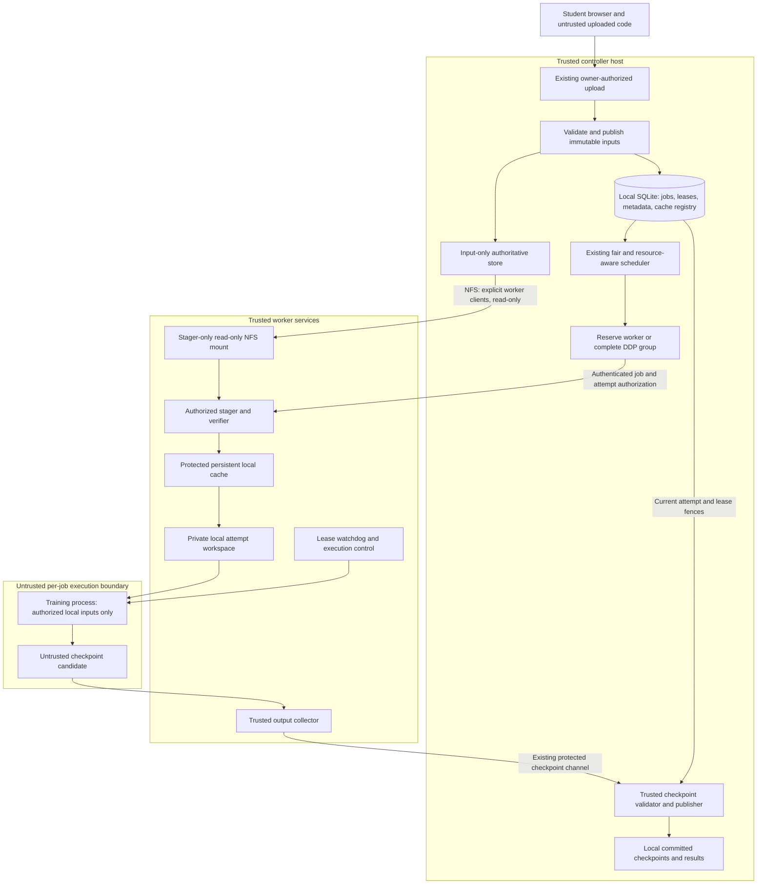

# Hybrid storage architecture — Phase 1.1

Date: 7 November 2026. Status: **proposed architecture for review; not implemented
or deployed**. This subphase adds documentation only. Protocol interfaces,
schemas/migrations and configuration validation belong to subphases 1.2–1.4.

This page records the Phase 1.1 design at the time of review. See the
[deployed v8 diagram](../architecture.md#deployed-hybrid-pilot-v8) and
[two-worker acceptance evidence](64-v8-pilot-deployment.md) for the implementation.

The [Phase 0 audit](00-audit.md) and its
[recorded evidence](00-audit-evidence.json) distinguish existing behavior from
the design below. The audit's historical observation that this file was absent
describes the Phase 0 boundary. No separate implementation progress file exists
at the start of 1.1, and no later implementation acceptance is inferred.

## Purpose and compatibility

Use standard NFS for authoritative shared input files, a protected persistent
worker cache for verified local copies, and controller-local SQLite for metadata
and advisory cache inventory. Keep the website, upload authorization, job queue,
training APIs, checkpoint formats and recovery model. This is application-managed
storage integration, not a new filesystem or a new default transport protocol.

Put future storage-specific code in the identifiable `hybrid_storage/` package,
with small adapters at existing controller and agent integration points. That
package does not exist yet. Continue using the existing HTTP checkpoint/control
payloads and SSH/rsync preparation where appropriate; NFS supplies input reads
only. Authentication and process isolation are prerequisites for enabling the new
mode, not features already supplied by the current HTTP endpoints.

Default configuration must retain the existing execution paths. Planned controls
are `storage_backend=legacy`, `worker_cache_enabled=false`,
`storage_aware_staging=false`, and `scheduler_policy=resource`. The current request's
`worker_cache_enabled` name supersedes the earlier audit draft's `worker_cache`.
Actual parsing, types and combination validation are deferred to 1.4. Disabling
the new cache must not disable the legacy worker input cache. Record a job's
storage choice so later configuration changes cannot silently reroute an existing
job, change its manifest digest or reinterpret its checkpoint.

## Trust boundaries and data flow

The trusted computing base includes the controller, its local disk and NFS
service, worker kernel/administration, and privileged staging/execution/collection
services. Student code, uploaded archives, dependency build scripts and checkpoint
payloads are untrusted. A compromised worker administrator/kernel is outside this
boundary; SHA-256 verification does not prove honesty of a compromised host.

The portal authorizes the submitting owner and validates input paths before
registration. The controller then binds an immutable input inventory to that job.
Knowing a SHA-256 digest is never sufficient authority to stage an object. Only
the authenticated controller may authorize a stager to materialize the exact
objects allowed for a job, attempt and rank. Do not expose other owners' objects
through cache listing, arbitrary digest fetches, path selection or error details.

NFS `AUTH_SYS` trusts client numeric credentials; it is **not a per-student
security boundary**. Protect the NFS network endpoint from training processes as
well as hiding mounts: an untrusted process must not bypass the stager by sending
its own NFS requests. `root_squash` is necessary but does not create tenant
isolation. Use explicit service identities and verify numeric UID/GID mappings
on every host; the audit observed different `pi` UIDs on pi02 and pi03.

## Export topology and ownership

The laptop controller is the authoritative NFS server for this design. Export a
new, dedicated immutable **input-only** root to separately listed, verified
addresses for pi01, pi02 and pi03. Later lab PCs require deliberate enrollment.
Use read-only exports with `root_squash`; prohibit wildcard clients and
`no_root_squash`. Do not export the repository, all of `storage/`, job workspaces,
SQLite, credentials, checkpoints, logs or results. Do not add a writable ancestor
or alternate export that bypasses the read-only boundary.

Illustrative paths below are design roles, not selected deployment paths or
commands to modify a running host:

| Host/path role | Trusted access | Training access |
|---|---|---|
| Controller `/srv/distributed-dl/inputs/` | Publisher writes; NFS exports committed inputs read-only | None directly |
| Controller existing `controller/jobs.db` and WAL/SHM | Controller metadata/lease services only | None |
| Controller existing `storage/jobs/<job>/checkpoints/`, logs and results | Authorized collectors publish; owner-scoped portal reads | No shared writable mount |
| Worker `/run/distributed-dl/nfs-inputs/` | Read-only mount in stager namespace | Hidden and unreachable |
| Worker `worker-storage/hybrid-cache/` | Stager owns verified objects, temporary files and pins | Hidden and unwritable |
| Worker private attempt workspace | Materializer provisions authorized files | Only that attempt's inputs and bounded outputs |

Keep these roots distinct from existing runtime data. Validate canonical paths,
reject symlinks and nested/aliased authority roots, and never repurpose or migrate
existing directories implicitly. A controller-owned export layout must prevent
guessable temporary files from becoming readable before publication. The publisher
writes and verifies in a non-exported staging area on the same filesystem, then
atomically exposes only complete objects; ownership and mode forbid later edits
by workers or students. Do not follow symlinks in exported input trees.

Client mounts are administratively prepared read-only, with `nosuid`, `nodev` and
`noexec` as appropriate. `noexec` does not prevent an interpreter from reading a
Python script and is not a sandbox. NFS version, verified client addresses, service
UIDs, routing, capacity and mount policy require a separately reviewed deployment
plan. No live `/etc/exports`, `/etc/fstab`, firewall, SSH or systemd changes are
authorized by this document.

The Phase 0 probes found a different existing share served by pi02 and mounted on
pi02/pi03 at `/mnt/nfs_share`. Its configured wildcard/RW/`no_root_squash` policy
does not meet this design; its effective export table was not established. Do not
reuse it as the new backend. All unauthorized old and new mounts must be hidden
from training. This document leaves that installation untouched.

## Immutable and mutable data

| Data | Mutability and authority |
|---|---|
| Uploaded source/dataset artifact | SHA-256 identity and size bind immutable bytes. Changed content gets a new identity; no overwrite under an old digest. Controller publication is authoritative. |
| Job/dataset input manifest | Immutable version and authorized input selection; binds the existing job identity. Retain old manifest digests used by recovery. Detailed schema is deferred to 1.3. |
| Worker cache object | Immutable verified replica, never authoritative. A protected service may replace a corrupt replica safely; student code cannot modify it. |
| Cache inventory, verification observations, pins and staging records | Mutable advisory/control metadata in local SQLite or protected worker state. A report is neither proof of current bytes nor authorization. |
| Private workspace, logs and result candidates | Mutable attempt-local data, isolated from other jobs and authoritative inputs. Validate before controller publication. |
| Checkpoint candidate | Untrusted and incomplete until collected and validated by trusted services. Never recover from it merely because a file exists. |
| Committed checkpoint | Logically immutable validated snapshot. The existing `latest` path/index may atomically advance to a newer committed snapshot; formats and recovery paths remain compatible. |
| Jobs, reservations, attempts, leases, owner accounts | Mutable authoritative controller-local state; never exported through NFS. |

SQLite remains on the controller's local filesystem, including its WAL and SHM
files. The existing job store uses WAL. Its locking/shared-memory coordination
must not be moved onto NFS as a shortcut to shared metadata. NFS shares input
files; it does not provide database coordination or controller failover. Local
metadata also contains ownership and fencing decisions that must not be exposed
to workers. A central cache registry is centralized metadata, not a database
file mounted by every node. Later schema work must be additive and idempotent;
1.1 performs no migration or import of modules that initialize the live DB.

## Staging, scheduling and execution

Keep owner fairness, resource eligibility, environment compatibility, concurrency
limits, atomic reservations, cancellation and lease fencing authoritative.
Locality is strictly opt-in and only breaks otherwise equivalent resource-policy
choices within the fair scheduling rules. Verified missing bytes are the first
cost signal; a bandwidth policy needs later measured throughput. A 100 Mb/s link
observation is not an NFS benchmark. Cache inventory cannot make an ineligible
worker eligible or select a node reserved for another job.

For a new-mode job, select and reserve a compatible worker, authorize the exact
input set, recheck local cache objects, and fetch only verified misses from NFS.
Check size and SHA-256, containment and file type on opened files; reject traversal,
absolute input paths, unsafe symlinks, special files and archive escape attempts.
Publish cache entries atomically from service-owned temporary files. Serialize
duplicate downloads and pin objects during materialization. Account for cache,
temporary download, private copy, outputs and checkpoint space; fail cleanly on
full disks without advertising a partial object as verified.

Give training private local copies or supported copy-on-write clones. Never
hard-link a writable student file to a shared cache object. Read-only input mounts
inside a private local workspace may be used only if they do not expose the cache
root or permit cache mutation. Student output directories are separate.

Training must run with different OS credentials from the trusted services and a
protected execution boundary that excludes NFS mounts, cache, controller secrets,
lease authority and other jobs. Prevent escape through inherited file descriptors,
procfs access, privileges, namespaces and exposed control sockets. Dependency
installation/build steps need the same untrusted-code treatment; never run them
as the cache publisher. Workers use preprovisioned, architecture-compatible offline
dependencies, with clear failure on a missing package rather than an Internet
download at job runtime.

For DDP, reserve the complete group and stage each rank's declared actual input
requirements. Do not infer physical dataset shards from rank numbers: the current
CSV example reads the whole input on every rank. All ranks must have matching
verified readiness, valid ownership and acknowledged execution leases before a
common launch authorization. Failure/cancellation of one rank aborts the pending
group and fences outstanding work before resources are released.

This requires future integration: the current lease-renewal endpoint expects an
already started job, so it cannot simply renew arbitrarily long prelaunch staging.
Design a bounded, authenticated staging authorization separate from execution
lease arming, then validate every rank again immediately before launch. Preserve
top-level job states (`RECEIVED`, `STAGED`, `READY`, `QUEUED`, `HELD`, `SCHEDULED`,
`RUNNING`, `CANCELLING`, `COMPLETED`, `FAILED`, `CANCELLED`); detailed staging and
checkpoint state machines are deferred to 1.3.

## Trusted checkpoint publication and recovery

Keep the existing custom single-worker ZIP format version 1 and DDP format version
2, including model/optimizer/scheduler progress and RNG state. Preserve built-in
PyTorch and legacy checkpoint compatibility too. NFS provides no writable
checkpoint directory to training code.

The trainer produces a candidate in its local output area through the existing
SDK. A privilege-separated worker collector and the controller's trusted validator
mediate collection through the existing protected protocol. Authenticate the
controller/worker channel, bind publication to the authorized job, manifest,
attempt, worker generation and current lease, and reject stale or canceled
producers. Hashes and attempt tokens alone do not authenticate a caller.

Validate bounded sizes, archive structure, checkpoint identity, compatibility and
progress before commit. For DDP, require the complete expected rank set, rank
digests/acknowledgments, group identity, world size and consistent shared state;
partial rank uploads never become recoverable. Preserve existing format checks
and tensor-safe loading in the custom lane. Do not deserialize arbitrary student
pickle in a trusted publisher. Structural checks cannot prove that malicious
student code performed honest training.

The controller writes to a local temporary file, verifies, flushes and atomically
publishes before advancing recoverable metadata. Filesystem publication and SQLite
updates are not a single atomic transaction: future reconciliation must distinguish
an orphan valid candidate from a recorded committed checkpoint. Never silently
claim a missing known checkpoint is recoverable or restart that job from scratch.
Detailed crash/commit transitions belong to 1.3. A replacement worker restages
authorized missing inputs and restores only the controller-committed checkpoint
after old-attempt fencing. DDP restores a compatible complete group with the
required rank/world-size binding.

## Failure and adversarial behavior

**The central server is a single point of failure.** The laptop hosts scheduling,
authoritative NFS inputs, committed checkpoints and local SQLite metadata. Worker
failure recovery does not make the controller highly available. Persistent caches
are replicas of inputs, not an independent controller or checkpoint authority.

| Event | Required behavior and availability limit |
|---|---|
| NFS outage, controller still available | Fully staged training can continue from private local files while execution leases remain valid. A fully verified authorized cache hit can stage without NFS. A miss waits/retries within bounded tracked ownership; never substitute different bytes, start partially staged ranks or fetch from the Internet. Checkpoint transport remains independent of NFS. |
| Central controller failure or local authoritative disk loss | Stop lease renewal; watchdogs stop jobs by the existing expiry policy. Do not schedule autonomously from cache or start a second unfenced controller. Preserve worker candidates, but recovery uses only committed authoritative state. Disk loss requires a consistent backup restore or causes data loss; caches alone are insufficient. |
| Stale inventory or corrupt cache | Reverify at stage time. Treat a missing/corrupt/changed-generation report as a miss, protect active readers and repair only through the trusted stager. With no valid replica and NFS unavailable, fail closed. A reboot may invalidate inventory trust while persistent bytes can be reverified and reused. |
| Crashed or partitioned worker | Retain reservation/attempt ownership until the old producer is stopped or its lease expires with existing safety margins. Select an eligible replacement, restage only its verified misses and restore the committed checkpoint. For DDP, fence and recover the group; never mix stale and replacement ranks. |
| Malicious student code or dependency build | Restrict it to its authorized private workspace and bounded output protocol. Deny cache/NFS/control/other-job access and prevent privilege escalation. Reject path escapes and forged or stale publication. Current same-UID execution and unauthenticated worker HTTP do not satisfy these requirements; enabling the new mode is blocked until boundaries are implemented and tested. |
| Full disk or interrupted publication | Do not expose partial artifacts/cache entries/checkpoints as complete. Keep the last valid committed checkpoint and report an actionable capacity/staging error. Cleanup may touch only identified subsystem-owned temporary/unreferenced data, never existing jobs or checkpoints. |

A Python timeout does not reliably interrupt a kernel-blocked read on a hard NFS
mount. Isolate NFS I/O from Flask handlers, scheduling and lease/watchdog renewal
threads, bound admission, and track delayed producers. Do not assume killing a
thread cancels its I/O or release ownership while it can later publish. Fence
publication after cancellation; choose and validate operational outage handling
before deployment. Do not silently choose soft mounts to conceal this problem.

Controller restart must reconcile durable attempts, leases, reservations and
committed checkpoint records before dispatch. Never discard the lease DB to
accelerate restart. Plan consistent local SQLite backups with the referenced
immutable inputs/manifests and committed checkpoint inventory, kept off the
controller. Backups reduce data loss; they do not provide automatic failover.
Any future standby needs a separate fenced authority-transfer design.

## Existing seams, enablement gates and remaining work

Use the existing code as the integration boundary:

| Responsibility | Current code to preserve/adapt in later subphases |
|---|---|
| Authorized upload and immutable job staging | [student_portal.py](../../controller/student_portal.py) `create_app`/submission route; [job_storage.py](../../controller/job_storage.py) `stage_job`, `verify_workspace` |
| Environment preparation and existing cache | [prepare_job.py](../../controller/prepare_job.py) `prepare_on_worker`; [environment_worker.py](../../agent/environment_worker.py) `prepare`, `verify` |
| Eligibility, fairness and reservations | [scheduler.py](../../controller/scheduler.py) `resources_fit`, `select_best_node`; [queue_policy.py](../../controller/queue_policy.py) `fair_order`; [job_store.py](../../controller/job_store.py) `mark_scheduled` |
| Single-worker and DDP launch/recovery | [dispatcher.py](../../controller/dispatcher.py) `dispatch_one_job`, `handle_running_job_failure`; [distributed_dispatch.py](../../controller/distributed_dispatch.py) `dispatch`, `progress` |
| Checkpoint formats and collection | [dl_checkpoint.py](../../agent/dl_checkpoint.py) checkpoint managers; [custom_checkpoints.py](../../controller/custom_checkpoints.py) and [group_checkpoints.py](../../controller/group_checkpoints.py) `sync`, `restore` |
| Attempt ownership and watchdog | [execution_leases.py](../../controller/execution_leases.py), [execution_lease.py](../../agent/execution_lease.py), [lease_runner.py](../../agent/lease_runner.py) |

Current preparation stages configured workers before queueing and can download
dependencies from the Internet; the new reserved-worker/offline staging path must
be explicit, not disguised as a fully prepared legacy record. Current source
workspaces are copied, but dataset paths point to the legacy cache. Do not claim
they already provide private data isolation. The deployment bundle currently has
an explicit allowlist, so a future package also needs deliberate packaging work.

Before any new mode is enabled, require tested authorization/authentication,
privilege separation, private workspaces, safe exports and endpoint access,
path/digest checks, disk admission, cancellation/fencing and recovery. The precise
OS sandbox and protected existing-channel configuration remain deployment design
decisions; no new custom RPC transport is selected here.

Run fake/Pi-less backend and compatibility tests first in subsequent implementation
subphases. Demonstrate missing/default flags preserve legacy behavior in 1.4;
documentation alone cannot prove this acceptance criterion. Later deployment and
validation must include **all three Pis: pi01, pi02 and pi03**, with an expressly
isolated one-worker failure test as the only allowed narrower case. The Phase 0
probe could not reach pi01, found unsafe existing share visibility on the other
two, and did not establish a fully wired controller network or NFS throughput.
Those are unresolved readiness gaps, not completed tests. Do not rerun disruptive
tests, install packages or deploy services without the separately approved plan.

Subphase 1.1 ends with this architecture document. No runtime interface, schema,
flag, DB, input, checkpoint, service or infrastructure change is included.
