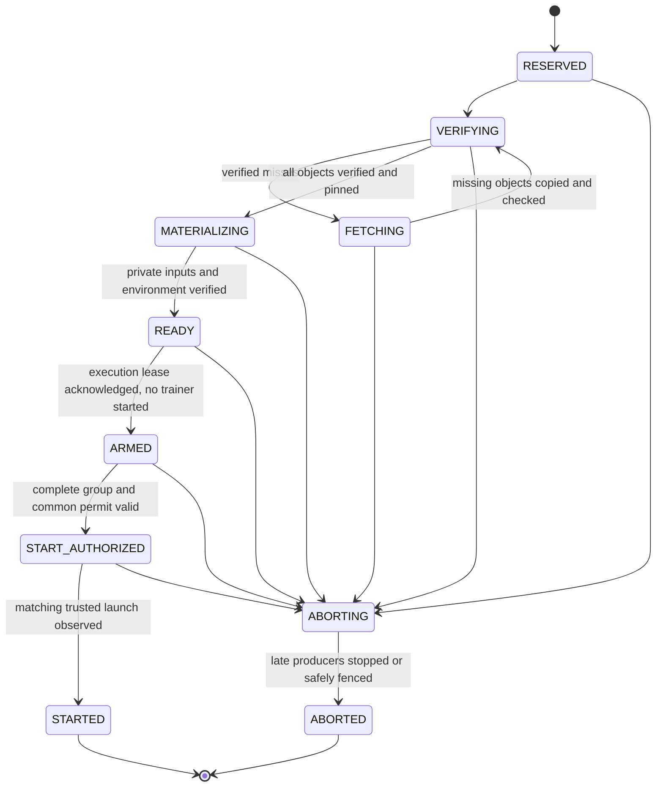
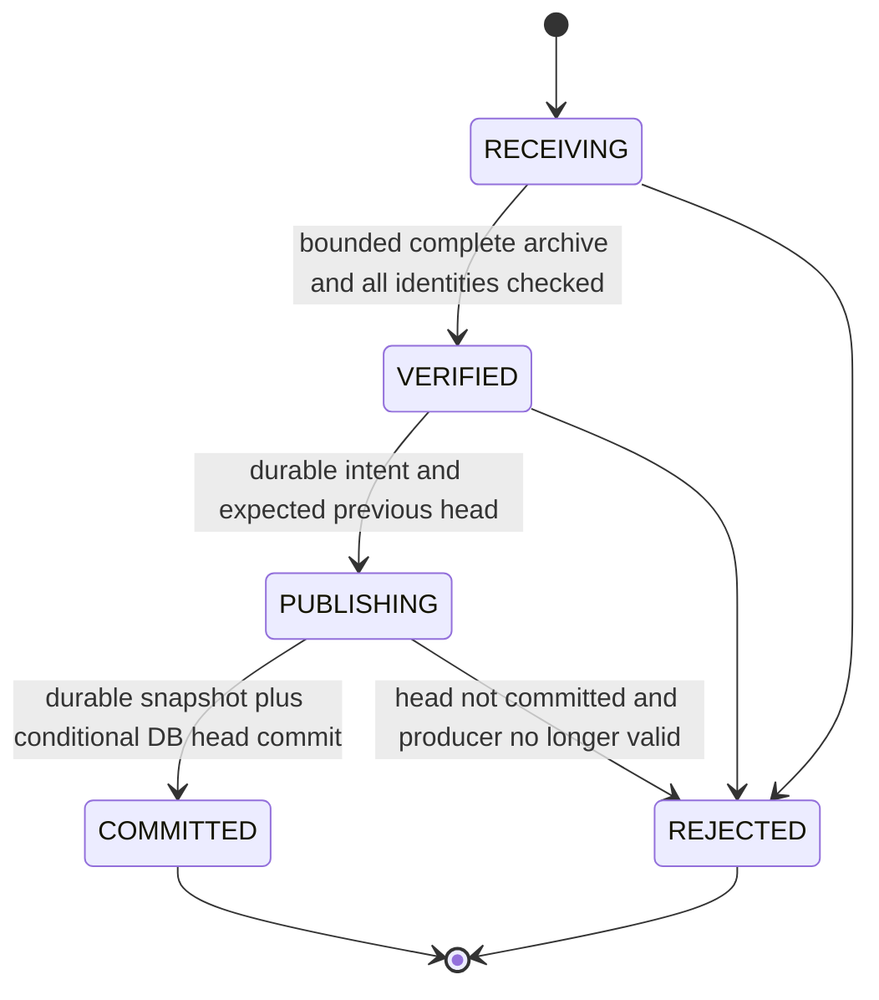

# Manifest and lifecycle design — Phase 1.3

Date: 7 November 2026. Status: **draft contracts, not a runtime implementation**.
This document refines the [architecture](01-hybrid-architecture.md) against the
current code and [audit](00-audit.md). No migration, registry service, staging
endpoint, launch barrier or checkpoint journal is installed by this subphase.
The 1.2 adapters remain unwired; configuration belongs to 1.4.

## Compatibility boundary established from code

| Existing identity/state | Required preservation |
|---|---|
| `job_storage.verify_workspace` validates `storage_version=1`, owner, submission, execution paths, inventories and DB-bound manifest hash | Keep original manifest bytes and `jobs.storage_manifest_sha256`; hybrid metadata is a separate sidecar. |
| `execution_leases.ensure` and `distributed_dispatch.attempt` use `job_id:retry_count` | Keep the exact token; zero-based retry count differs from one-based history attempt number. |
| `job_attempts.attempt_id` is an autoincrement history-row ID | Do not replace it with a wire token or assume it already exists before scheduling. |
| `node_generations` and `execution_leases` fence execution by node generation/lease ID | Cache epochs and inventory sequence numbers never replace execution generations. |
| Custom checkpoint v1 and DDP v2 embed the legacy manifest hash and attempt token | Preserve ZIP members, metadata, tensor/RNG contents, existing SDK and HTTP formats. No checkpoint conversion. |
| Current single/DDP collectors replace local `latest` before updating SQLite | New-mode crash reconciliation needs an explicit commit record; current code is not already transactional across disk and DB. |

Preserve the job status vocabulary exactly:
`RECEIVED`, `STAGED`, `READY`, `QUEUED`, `HELD`, `SCHEDULED`, `RUNNING`,
`CANCELLING`, `COMPLETED`, `FAILED`, `CANCELLED`.
`queue_policy.PENDING_STATES` remains RECEIVED/STAGED/READY/QUEUED/HELD;
`ACTIVE_STATES` remains SCHEDULED/RUNNING/CANCELLING. Do not insert staging states
into either tuple or count reserved staging outside active-job limits.

Existing DDP attempt phases (STARTING/RUNNING/STOPPING and terminal outcomes) and
rank statuses remain separate too. New staging/commit states live only in side
tables. Legacy `READY` continues to mean enough compatible prepared workers. A
future hybrid readiness adapter must explicitly establish environment eligibility
without pretending datasets have already been staged on every candidate node.

## Versioned manifest schemas

Draft JSON Schema 2020-12 documents, with local `$defs` references only:

- [input-tree-v1.schema.json](schemas/input-tree-v1.schema.json): source or dataset
  tree; every regular file has relative path, SHA-256, byte size and executable
  flag; directories include empty ones.
- [job-inputs-v1.schema.json](schemas/job-inputs-v1.schema.json): owner/job-bound
  sidecar referencing the immutable source/dataset tree hashes, original legacy
  manifest digest, execution mode/world size and each rank's file paths.
- [v1-manifests.json](examples/v1-manifests.json): synthetic fixture with real
  hashes of the included tiny example bytes and canonical tree/sidecar JSON.
  It represents three logical ranks, not a live three-Pi run. Its legacy hash is
  explicitly synthetic and does not claim an accompanying real job snapshot.

`schema_version=1` belongs to each hybrid document family. It does not change
legacy `storage_version=1`, submission schema versions, checkpoint versions,
execution ownership protocol or DB migration numbers. Unknown kind/version or
unknown fields are rejected; no silently dropped extensions. A changed dataset
or file selection creates a new immutable manifest/job binding, not an edit to an
existing job's recovery identity. Owner transfer is not introduced here.

Canonical bytes use the existing `job_storage.encoded` convention:

```python
(json.dumps(value, sort_keys=True, separators=(",", ":"),
            ensure_ascii=True, allow_nan=False) + "\n").encode("utf-8")
```

SHA-256 of those bytes identifies a manifest; do not hash pretty-printed fixture
files or include the document's own digest inside it. An artifact digest hashes
raw file bytes, not its JSON entry. All manifest numeric fields must be genuine
nonnegative integers where specified, not booleans or floating spellings. Reject
duplicate JSON keys before schema validation; use bounded parsing and reject
invalid Unicode, nonfinite numbers and unrecognized versions. There are no wall
clock times, absolute host paths, credentials or mutable cache observations in
an immutable input manifest.

The legacy inventory calls file length `size`; the new tree calls it `size_bytes`.
Registration maps that field without changing its value or the original inventory.
Hybrid tree hashes intentionally differ from legacy `source_version`/`dataset_version`
hashes because the document shapes differ. Do not substitute them into existing
environment keys, prepared records or checkpoints.

Files/directories are sorted lexicographically by their exact POSIX path, without
Unicode/case normalization. Keys must also pass the 1.2 no-follow path contract;
validation never substitutes for descriptor-based opening. V1 excludes dot/dotdot
components, empty components, leading/trailing slashes, backslashes, colons,
control characters and surrogate code points. File bytes must be regular files,
not links/devices/FIFOs. Executable mode is authorized metadata applied to private
workspace copies; it does not make cached objects writable or executable.

The schema validates shape, scalar ranges and path syntax. Registration must
add these **semantic checks**, which JSON Schema does not establish:

1. File paths are unique; files/directories never collide; all parent directories
   are listed, and no file is an ancestor of another entry. Empty trees are allowed
   only where the original validated job permits them. One digest has one size.
2. Canonical hashes and every file's actual size/digest match. Entries correspond
   exactly to the authorized, verified legacy snapshot, including empty folders
   and executable flags; matching a student-supplied hash alone grants no access.
3. Job ID/owner and legacy digest match the authoritative `jobs` row and original
   v1 manifest. Source hash resolves to a source tree; nonnull dataset hash resolves
   to a dataset tree. `null` means the original job has no supplied dataset;
   generated training outputs are not immutable uploaded inputs.
4. Rank IDs are unique, sorted and exactly `0..world_size-1`; single mode has one
   rank, DDP 2–256. Paths resolve in the referenced tree, and the declaration agrees
   with the validated execution specification and permitted trainer behavior.
5. For current trainers, every rank gets all source files and the entire declared
   dataset. `DistributedSampler` is not file sharding. A future explicit shard
   contract needs validated versioned job metadata and recovery compatibility;
   this draft does not enable arbitrary subset staging for existing jobs.

The tree schema deliberately cannot enforce path uniqueness by comparing one
property of different entries, and the job schema cannot infer rank coverage from
`world_size`. Draft tests validate syntax and fixture consistency, not a deployed
semantic registrar or authorization system.

Controller input objects have service-derived keys such as
`sha256/<first-two-hex>/<full-hex>`, computed from a validated digest. Never accept
an authoritative absolute path/export location from students. Tree documents
contain byte identities and relative workspace paths; authorized job sidecars
remain controller-local and are sent only to the trusted stager. Do not expose
owner/job metadata through a broadly readable NFS directory. Provision input
object parents under a dedicated root and private publication staging outside all
exports, as required by the 1.2 adapter.

## Controller-local SQLite migration strategy

Use additive tables in the **same local jobs database** so new ownership/readiness
records can transact with existing reservations and attempts. Workers never open
it; WAL/SHM stay local. The future explicit registry migration entrypoint must
not import `job_store` merely to inspect a DB: its current module-level
`initialize_database()` mutates schema/state. No import-time hybrid migration.

The following is a proposed relational contract, not SQL applied in this turn.
All side tables are subsystem-owned; existing tables/columns remain authoritative.
Use explicit column lists, foreign keys, constrained enums, nonnegative checks
and unique keys. Do not use `INSERT OR REPLACE` to hide integrity conflicts.

| Proposed table | Primary/unique keys and required contents |
|---|---|
| `hybrid_schema_migrations` | Version PK, immutable migration checksum, applied timestamp. Separate namespace; do not repurpose an unknown `PRAGMA user_version`. |
| `storage_artifacts` | SHA-256 PK, unique relative object key, size, publication state (PUBLISHING/AVAILABLE/QUARANTINED). AVAILABLE requires complete verified durable bytes. A reused digest with conflicting size is an error. |
| `storage_manifests` | Digest PK, kind, schema version, canonical bytes, verified status. Immutable bytes; references must already resolve before a job can use it. |
| `storage_manifest_files` | `(tree_digest, relative_path)` PK, artifact FK, size/executable metadata; directory entries recorded separately or in a typed entry column with a CHECK constraint. |
| `job_storage_bindings` | `job_id` PK/FK to jobs, unique job sidecar digest FK, original legacy digest, frozen backend/options and binding version. No row means legacy, not inferred NFS. |
| `storage_attempts` | `(job_id,retry_count)` PK, unique unchanged attempt token, sidecar digest, world size, frozen rank/node placement, optional existing history-row ID, frozen restore-head ID and launch-permit identity/state. Historical retries remain immutable when jobs.retry_count advances. |
| `worker_cache_identities` | Cache ID PK, bound node, persistent epoch high-water and retirement marker. Keep retired identities/high-water history so restoring an old cache root cannot silently reenroll it as fresh. |
| `worker_cache_sessions` | Node PK, cache identity FK, current epoch, worker boot ID, globally unique controller-issued inventory session ID, last accepted sequence/body digest, receipt time and freshness deadline. |
| `worker_cache_entries` | `(node_id,inventory_session_id,artifact_digest)` PK, size, verified epoch/state and accepted snapshot sequence. FK to the current session and artifact registry; only VERIFIED entries affect locality. |
| `job_staging` | `(job_id,retry_count,rank,stage_revision)` PK/FK to storage_attempts, node, sidecar digest, grant ID/deadline, controller authority epoch, cache/session identity, phase, receipt digest, error and later execution lease fence. Immutable identity fields. |
| `worker_cache_pins` | Artifact + staging/attempt identity, node/cache epoch, holder and release evidence; unique holder/object. Protected worker state enforces pins; a controller row alone cannot prevent local eviction. |
| `storage_checkpoint_commits` | Server commit ID PK, job/attempt binding, archive digest/size, unchanged format, phase, expected previous head, step/completed, producer fences, DDP group/rank summary, unique local managed snapshot key. Idempotency key `(job_id,attempt_token,archive_digest)`. |
| `storage_checkpoint_heads` | Job PK/FK, selected COMMITTED record FK and monotonic head revision. Changes with the jobs checkpoint metadata in the same transaction. |

Composite stage/commit keys reference `storage_attempts`, not mutable
`jobs.retry_count` or a nullable/late-created history ID. Legacy tables do not
currently provide all proposed unique keys; do not assume a composite FK into
`job_attempts` will work. Artifact/manifest deletion is RESTRICT while referenced;
no cascade may delete jobs/checkpoints. Directory entries and exact DDL/index
names must be finalized in the later implementation, then fingerprinted.

Migration procedure for that later implementation:

1. Test on a source-isolated temporary DB, created from the actual existing schema.
   Inventory old rows, schema, indexes, foreign keys and reservations. Check empty,
   old, current and partially/conflicting upgraded shapes without running services.
2. In an explicit `BEGIN IMMEDIATE`, read the hybrid version/checksum, verify table
   shapes/constraints, create missing approved tables/indexes and record the marker
   only after success. Apply twice: the second run is a no-op. An existing marker
   with a changed checksum or incompatible shape fails closed. Transaction rollback
   must leave no half-migration; never assume CREATE IF NOT EXISTS proves shape.
3. Do no hashing, downloads, archive parsing or remote calls inside this schema
   transaction. Do not rewrite existing jobs, queue times, environments, lease
   generations, histories, manifests or checkpoint paths. No bulk backfill needed:
   unbound jobs retain legacy behavior and old checkpoint identity.
4. Later enrollment of a new hybrid job verifies its legacy snapshot, publishes
   immutable objects, then atomically registers verified manifests and a binding.
   Copy inputs; never hard-link them to writable legacy snapshots. A crash can
   leave an unreferenced complete object, but not an AVAILABLE missing object or
   a partially registered authorized job. Reconcile known managed objects by hash.
5. Keep migrations dry-run/plan capable. A future live migration requires a reviewed
   plan and explicit approval, deliberately quiesced work, consistent SQLite backup
   plus referenced input/checkpoint inventory and free-space checks. Do not copy
   a loose running WAL DB or mutate live schema as a readiness probe.
6. Before enabling, reject old dispatcher binaries for enrolled jobs. Rolling back
   new-job defaults to legacy does not convert bound jobs: drain or deliberately
   hold/cancel them with current handlers first. Leave additive tables/data intact;
   destructive downgrade/drop/cleanup is never automatic.

Future migration acceptance tests must prove duplicate execution, interrupted
migration, unknown versions/checksums, broken foreign keys, incompatible existing
tables, and exact old-row preservation. None of these migrations has run in 1.3.

## Cache inventory generations and missing bytes

Do not conflate these independent identities:

| Identity | Meaning and lifetime |
|---|---|
| `node_id` | Existing configured worker identity; authenticated service enrollment binds it. |
| `cache_id` | Random persistent ID for one protected cache root, bound to one node; root replacement/lost identity requires a new ID. Cloned SD images cannot silently share it across nodes. |
| `cache_epoch` | Durable increasing verification epoch for that cache; advance before accepting work on stager restart, reboot, root-policy change or recovery from uncertain state. Do not reset to zero after metadata loss. |
| `worker_boot_id` | Existing kernel boot identity observed by the trusted worker; not a replacement for cache or execution generations. |
| `inventory_session_id` | Controller-issued random nonce for the accepted node/cache/epoch/boot tuple. New controller reconciliation or new epoch requires a fresh authenticated handshake. |
| `inventory_sequence` | Monotonic full-snapshot number inside that inventory session; starts at 1, never reused for different bodies. |

Controller stores epoch high-water marks and rejects rollback/old-session reports.
If durable cache metadata is lost/rolled back, enroll a new cache identity instead
of advertising old verified state. Existing object bytes can still be discovered
and rehashed under the new epoch; persistent data need not be transferred again.
Cache ID/epoch are not permission tokens or proof of an honest host.

V1 inventory reports are bounded **complete snapshots** of VERIFIED artifacts for
the current session, including digest, size and verification epoch. The controller
validates the authenticated identity, size/digest consistency, no duplicates and
increasing sequence, then swaps the snapshot atomically. Entries omitted from a
new complete snapshot cease to be hits. No partial report/delta deletes entries.
Reject an oversized/incomplete report without refreshing freshness; paged/delta
protocols need a later version. Capacity and payload limits must be explicit in
the implementation, not assumed unlimited.

Retrying the same sequence/body digest is an idempotent acknowledgment and must
not extend freshness indefinitely; a different body at the same sequence or an
out-of-order sequence is rejected. Receipt time is controller-local; worker wall
clock timestamps do not establish freshness. Reboot/session change, TTL expiry,
disconnect uncertainty, quarantine or eviction invalidates hit eligibility. Keep
observations for diagnostics without silently treating them as verified hits.

On controller restart, require session reconciliation/fresh inventory before
locality reuse. A registry hit remains advisory: the stager hashes the opened
regular object against the authorized manifest again, pins it and protects it
through materialization. A stale row becomes a miss, not an authorization failure
bypass. Only service-owned, unpinned, unreferenced cache objects may be evicted.

For a rank, deduplicate its required artifact digests and sum sizes of missing or
untrusted objects. Do not charge twice when two paths use identical bytes. Group
cost sums distinct missing objects **per worker**, since each worker transfers its
own copy; do not deduplicate across different workers. Report predicted registry
missing bytes separately from actual stage-verified hits/transferred bytes.
Missing inventory is pessimistically all misses. Reuse remains possible after
local verification without NFS, even if the controller's old inventory was stale.
Locality never changes fair owner selection or resource/reservation eligibility;
no bandwidth cost is fabricated from the earlier 100 Mb/s observation.

## Attempt, staging grant and launch identities

Retain `job_id:retry_count` as the attempt token and `retry_count+1` as the history
attempt number. Job IDs already reject colons. The autoincrement `attempt_id`
remains only a history reference. A new random staging grant ID, stage revision,
inventory session and server checkpoint commit ID serve different purposes; none
is a renamed attempt token. Existing DDP `group_id`/`checkpoint_id` are preserved.

Atomically bind the complete rank/node reservation to the existing attempt before
any stage request. Each request/receipt binds job, attempt, sidecar+legacy digests,
rank/world size, node, stage revision, cache epoch/session, grant ID and deadline.
The trusted service authenticates the controller; hashing this tuple is not caller
authentication. A receipt identifies exact materialized inputs/workspace and byte
counts without disclosing arbitrary host paths to students.

Grant deadlines and controller authority epochs are persisted before issuing a
request. Staging grants authorize only staging, not execution or checkpoint
commit. Expiry/cancel fences future cache/workspace publication; delayed NFS I/O
must not revive an aborted grant. Repeating an identical request returns the same
result; changing identity requires a new increasing revision after old work is
fenced. A different replacement node/group requires normal attempt failure/retry
and execution fencing, not just a silently changed rank row.

The worker must persist a new epoch/tombstone before accepting superseding work.
On reboot/controller restart, do not trust outstanding readiness receipts blindly.
Reconcile the session, reservations and grant ownership; reverify data and issue a
fresh stage revision where required. Do not overlap two controller authorities.
Execution still uses the existing `(node_id,generation,lease_id)` fence. The
current renewal endpoint requires a started job, so future prelaunch ARMED support
is an explicit endpoint/guardian extension, not a claim that staging can already
renew execution leases.

## Staging states — side table only



Every transition uses compare-and-swap on phase/revision and rechecks current job,
reservation and grant identity. READY requires digest-verified private inputs,
capacity, a compatible preprovisioned offline environment and an unexpired grant.
Partial files, bare inventory reports or a prepared legacy record cannot satisfy
it. Retry transient fetch errors only within the same tracked bounded grant;
otherwise ABORTING with error detail, then ABORTED after safe producer cleanup.
Do not reset a terminal row to RESERVED; create a new authorized stage revision.

While reserved/staging, the job remains SCHEDULED and retains active quota and
worker slots. Hold/release semantics for existing pending jobs remain unchanged.
Cancellation uses CANCELLING and invalidates the pending permit/grants, then
normal CANCELLED after stop/fencing. Pins stay until no materializer/trainer can
use that cache object; a private complete copy may release its cache pin, whereas
a local read-only view requires a pin for the whole use period. Lost controller
contact does not authorize evicting an actively used object.

For DDP, every required rank must be READY, then ARMED with current acknowledged
execution lease before a single persisted common launch permit is issued. Bind
the permit to all rank receipts/fences and a deadline no later than the shortest
lease or staging-grant validity. Revalidate again at each worker's launch gate; all ranks pass a trusted
prelaunch barrier before training is released. This is coordinated logical launch,
not physically simultaneous execution or atomic network delivery. Partial launch,
lost acknowledgment, expired lease or one failed rank triggers group stop/fencing
and normal retry; never let surviving ranks keep training as a smaller group.
Once STARTED, execution status/recovery remains in existing job/rank/lease logic.

## Checkpoint commit state machine — payload formats unchanged

Candidate bytes remain untrusted. Preserve existing authenticated/protected
transport payloads, validators and progress checks; the baseline HTTP channel
still needs real authentication before the new mode can be enabled. A worker
cannot mark its own candidate controller-COMMITTED by writing NFS or reporting a
hash. Rejected candidates cannot replace the last recoverable checkpoint.



Proposed new-mode publication sequence:

1. Receive into a protected controller-local temporary file; cap transport/archive
   bytes and parsing before allocating unbounded resources. Verify exact existing
   format, job, original manifest, producing attempt, environment and progress.
   DDP requires the expected reserved world size, group identity, complete rank
   set, every rank digest/acknowledgment, shared-state hash and producer fences.
2. Record VERIFIED and a unique server commit ID. Persist PUBLISHING intent with
   expected old head and archive identity before making a managed snapshot
   durable. Serialize per-job publication; an existing identical idempotency key
   returns its recorded outcome, not a second head advance.
3. Publish a new immutable snapshot under a protected controller-local managed
   checkpoint journal, e.g. `checkpoints/.commits/<commit-id>.dlckpt`. This is an
   internal copy of the unchanged archive, never an RW NFS path or a conversion.
   Use exclusive creation, fsync bytes/directory; retain the previous committed
   snapshot until separately authorized retention work. Do not overwrite old data.
4. Under a short `BEGIN IMMEDIATE`, recheck jobs/current retry, cancellation rules,
   reservation, execution fences and allowed lease deadline, previous head and
   monotonic progress/completed state. Commit the head, COMMITTED record and
   existing jobs checkpoint metadata atomically. The same transaction discipline
   must apply to new-mode cancel/retry so a stale publisher cannot race a head
   update. Do not hold it across network transfer, hashing or archive parsing.
5. Maintain the existing regular `latest.dlckpt`/`latest.ddpckpt` as an atomic
   compatibility view of the committed head, with copied/reflinked verified bytes
   and directory fsync, not a symlink or student-writable hardlink. New-mode readers
   must resolve/verify the frozen DB-selected snapshot and repair/ignore a stale
   latest view; they cannot call the legacy latest-only helper unguarded. The
   legacy checkpoint path/API remains available, and flag-off jobs keep current
   code. The compatibility mirror is not the commit authority.

COMMITTED means both durable validated snapshot and SQLite head selection, not
simply an existing final name or log event. COMMITTED records are immutable;
advancing a head does not mutate/revoke an earlier committed snapshot. Cancellation
first seen before the conditional commit rejects it; an already committed snapshot
remains historical after cancellation. Collect a normal final checkpoint before
marking a job COMPLETED, or a failure-stop cut while the attempt still has valid
ownership and has not been canceled. Final collection is not a bypass for the
new-mode cancellation gate; no expired/revoked producer may create a new head.

| Crash/failure point | Reconciliation rule |
|---|---|
| During receiving/verification | Ignore as a restore source; old head remains. Keep/quarantine only identified managed candidates, never delete user checkpoints automatically. |
| After intent but before durable snapshot | Do not advance head. Mark interrupted/rejected if authority expires; no automatic salvage based only on a filename. |
| Snapshot durable but DB head transaction absent/rolled back | Snapshot is uncommitted. Old head wins. Resume commit only with complete validation and still-current producer/expected-head ownership; stale intents are rejected. |
| DB commit acknowledgment lost | Read idempotency/head records; an already COMMITTED matching snapshot is success even if its producer has since stopped. Never recommit it over a newer head. |
| DB committed, latest mirror stale/missing | Frozen committed snapshot is recoverable through the new-mode reader guard. Repair the mirror from that exact snapshot, not from worker files or a newer uncommitted candidate. |
| Recorded committed snapshot missing/corrupt | Fail closed and report loss; never silently train from zero, choose an older cut or invent a new commit. A separately approved recovery decision may restore a verified backup. |

Restore freezes one committed source-head ID/digest before reserving destination
workers. Validate its historical producer binding, but do **not** require its old
execution leases to still be live: recovery normally uses an earlier dead attempt.
Authenticate/fence the destination's new attempt and transfer exactly that snapshot
to every required rank. Keep its rank mapping/world size and existing collective
restore acknowledgments. Partial/newly uploaded ranks cannot supplement a committed
DDP cut. Dummy JSON and built-in `.pt` legacy lanes stay unchanged.

The proposed immutable journal/read guard is necessary future integration, not
implemented by the 1.2 input-file publisher. It must be tested against the current
collectors' latest-only readers before enabling. The known single-worker behavior
that treats a missing central file as no checkpoint remains an unfixed legacy gap;
new-mode recovery must explicitly reject a missing recorded committed source.

## Verification, rollback and next boundary

Draft-schema tests use the already installed system Python `jsonschema` package;
the controller venv does not have it. It is an optional **design-test** dependency,
not added to worker/controller runtime requirements. The test file skips schema
checks with an explicit reason if it is absent; the recorded 1.3 command uses the
available validator and must have zero skips. No schema reference requires an
Internet fetch. No runtime semantic validator or migration is claimed.

```bash
env PYTHONDONTWRITEBYTECODE=1 python3 tests/test_storage_manifest_drafts.py
git diff --check
```

All fixture files are synthetic, and tests inspect source ASTs instead of importing
live DB modules. See the [progress record](implementation-progress.md) for actual
results and preservation evidence. Future runtime tests must cover the semantic
checks, migration twice/crash cases, stale report/grant rejection, every stage and
commit crash edge, cancellation/expiry races, exact checkpoint restore and all
legacy paths. Live validation still requires pi01, pi02 and pi03 after a reviewed,
explicitly approved plan; none is contacted here.

Rollback for 1.3 is documentation/test-only: remove its draft document, two schemas,
fixture and test, and undo only its appended progress section. No DB/data/service
rollback is needed. Retain all previous work. When eventually implemented, central
SQLite/NFS/checkpoint authority remains a **single point of failure**; this design
does not introduce controller HA, automatic failover or Internet runtime transfers.

STOP after 1.3. The next subphase is 1.4 configuration defaults/validation/tests;
no flags, migration runner or state transition implementation is included here.
