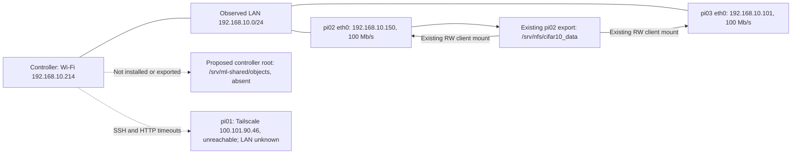

# NFS topology and readiness — Phase 2.1

Observation date: **7 November 2026**, approximately **20:18–20:20 Asia/Dhaka**
(14:18–14:20 UTC). This is a new observation, not a restatement of Phase 0.
Status: **2.1 delivered for the reachable hosts; pi01 explicitly deferred by the
user after its read-only probes failed**. Full all-three-Pi readiness is unverified.
All three configured aliases were attempted. No address was invented and no host
was reconfigured to make the observations pass.

See [raw evidence and exact probes](04-nfs-topology-evidence.json),
[architecture](01-hybrid-architecture.md), [configuration](03-configuration.md)
and [progress](implementation-progress.md). The evidence embeds the read-only
probe sources, commands, timestamps, stderr and sandbox failures.

## Current address and reachability map

| Host | Configured/SSH IPv4 | Observed LAN IPv4 | Observed reachability |
|---|---|---|---|
| Controller | Tailscale `100.73.90.91` | `wlo1` Wi-Fi `192.168.10.214/24` | Local inspection succeeded; wired `enp4s0` has no carrier/address. |
| pi01 | `100.101.90.46`; alias pi01 → user pi, port 22 | **Unknown** | SSH connection timeout; both configured HTTP probes timed out. |
| pi02 | `100.91.135.18`; alias pi02 → user pi, port 22 | `eth0` `192.168.10.150/24` | SSH succeeded; Tailscale health/resources HTTP 200; LAN health HTTP 200 with matching identity. |
| pi03 | `100.64.202.71`; alias pi03 → user pi, port 22 | `eth0` `192.168.10.101/24` | SSH succeeded; Tailscale health/resources HTTP 200; LAN health HTTP 200 with matching identity. |

Aliases were resolved using `ssh -G`; they agree with the current
[inventory](../../config/nodes.json). Worker `SSH_CONNECTION` confirms the
controller's Tailscale address and the expected server addresses. LAN addresses
were obtained from successful remote `ip -j address show`, then verified with
identity-matching HTTP `/health` requests; they were not inferred from old docs.
The unauthenticated health endpoint is observational evidence, not a security
attestation or authority to stage a student's files.

Tailscale's local status reports pi01 `Online=false`, with LastSeen
`2026-11-05T15:57:00.1Z`. Its `Active=true` field is not proof of current
reachability. A timeout/offline report does not establish whether the cause is
power, connectivity, Tailscale, SSH or a policy failure. Do not claim pi01 is
powered off or copy pi02/pi03's OS/permissions onto it. Its current LAN address,
NIC state, OS, packages, disk, mounts, exports and permissions remain unknown.
The user subsequently confirmed pi01 is offline and instructed: "its offline
leave it for now". No further pi01 probe, wake, restart or recovery was attempted.
This defers its 2.1 inspection; it does not establish its missing host details or
waive later all-three-Pi deployment acceptance.



Controller routes to both observed LAN addresses use `wlo1` with source
`192.168.10.214`; both workers route to that controller address through `eth0`.
Their default gateway is `192.168.10.1`, but these LAN routes are direct subnet
routes. This supplies a possible local input-transfer path without an Internet
data download requirement; actual controller NFS service reachability is untested
because it is not installed/listening. Physical switch/AP topology was not
inspected. **This is not currently an all-Ethernet controller-to-worker path.**

The three observed LAN addresses have dynamic/DHCP attributes. Before a later
allowlist is applied, choose a reviewed stable-address/reservation strategy and
revalidate addresses. Do not grant the whole `/24` merely to cover an unknown
pi01 address; known individual clients are the narrower starting point. No LAN
IP, DNS alias, reservation or static configuration was changed here.

## OS, NICs and local capacity

| Observation | Controller | pi01 | pi02 | pi03 |
|---|---|---|---|---|
| OS | Ubuntu 24.04.4 LTS | Unknown | Debian GNU/Linux 12 bookworm | Debian GNU/Linux 12 bookworm |
| Architecture | x86_64 | Unknown | aarch64 | aarch64 |
| Base Python | 3.12.3 | Unknown | 3.11.2 | 3.11.2 |
| Ethernet | enp4s0 DOWN/no carrier | Unknown | eth0 UP, 100 Mb/s | eth0 UP, 100 Mb/s |
| Wireless | wlo1 UP | Unknown | wlan0 DOWN/no address | wlan0 DOWN/no address |
| Root/storage filesystem | ext4 `/dev/nvme0n1p4` | Unknown | ext4 `/dev/mmcblk0p2` | ext4 `/dev/mmcblk0p2` |
| Available local bytes | 43,956,445,184 | Unknown | 12,503,453,696 | 9,307,586,560 |
| Available local GiB | 40.94 | Unknown | 11.64 | 8.67 |
| Available root-volume inodes | 10,056,839 | Unknown | 1,613,682 | 1,531,307 |
| Login UID:GID | rana 1000:1000 | Unverified | pi 1000:1000 | pi 1002:1002 |

The Pi kernel reported `6.12.25+rpt-rpi-2712` on both reachable workers; the exact
controller kernel is retained in evidence. Base Python above is the OS probe
interpreter, not proof of a job environment's compatibility or PyTorch version.
Agent health separately reports its runtime; no training dependency was imported
or installed by these probes. Capacity is a momentary sample, not a reservation
or a cache-space budget. Do not infer NFS throughput from 100 Mb/s link speed or
the agent's idle network counters; no throughput benchmark ran.

## NFS availability and current mounts

| Check | Controller | pi01 | pi02 | pi03 |
|---|---|---|---|---|
| nfs-common | Not installed | Unknown | Installed `1:2.6.2-4+deb12u1` | Installed `1:2.6.2-4+deb12u1` |
| nfs-kernel-server | Not installed | Unknown | Installed `1:2.6.2-4+deb12u1` | Not installed |
| rpcbind package | No package match | Unknown | Installed `1.2.6-6+b1` | Installed `1.2.6-6+b1` |
| NFS server unit | Not found/inactive | Unknown | active/exited | Not found/inactive |
| NFS TCP listener | No port 2049 observed | Unknown | IPv4 and IPv6 `:2049` | None observed |
| exportfs tool | Absent | Unknown | `/usr/sbin/exportfs` | Absent |
| mount.nfs tool | Absent | Unknown | `/usr/sbin/mount.nfs` | `/usr/sbin/mount.nfs` |
| Existing NFS mount | None | Unknown | `/mnt/nfs_share` | `/mnt/nfs_share` |

Both reachable workers' mount tables describe:

```text
source: 192.168.10.150:/srv/nfs/cifar10_data
target: /mnt/nfs_share
fstype: nfs4
options: rw,vers=4.2,hard,proto=tcp,timeo=600,retrans=2,sec=sys,
         rsize=1048576,wsize=1048576,local_lock=none
```

These are observed **existing** mount options, not settings selected for the new
controller export. Mount metadata does not prove current server access/write
authorization, healthy file reads, future protocol negotiation or safe outage
behavior. No NFS directory traversal, data read, write test, mount or unmount was
performed. NFS/autofs paths were intentionally excluded from statvfs/permission
traversal to avoid blocking or triggering automounts; local capacity was measured
on the backing local volume instead.

Both fstab files have the existing line:

```text
192.168.10.150:/srv/nfs/cifar10_data /mnt/nfs_share nfs defaults,_netdev 0 0
```

No automount was reported in the inspected mount tables. This old fstab entry
does not demonstrate bounded boot behavior or mount-presence admission. No new
automount/dependency strategy was drafted/applied in 2.1; that is 2.3 work.

## Exports and permission boundaries

The controller has no `/etc/exports`, `/etc/exports.d`, `/var/lib/nfs/etab` or
`/proc/fs/nfsd/exports` at observation time, no loaded NFS server unit and no
observed NFS listener. `/srv` is root:root 0755 on local ext4;
`/srv/ml-shared` and `/srv/ml-shared/objects` do not exist. No root directory was
created. The proposed server root cannot be treated as ready or writable by the
controller's unprivileged service user.

pi02's `/etc/exports` is root:root 0644 and contains:

```text
/srv/nfs/cifar10_data *(rw,sync,no_subtree_check,no_root_squash)
```

Its readable `/var/lib/nfs/etab` also records wildcard `rw` and `no_root_squash`
for that directory, with `sec=sys`. The directory itself is pi 1000:1000, 0775 on
local ext4. This configured/managed policy is incompatible with the requested
restricted read-only immutable inputs. `/proc/fs/nfsd/exports` returned headers
only, and reading its versions file was permission-denied. Therefore the complete
effective kernel export policy/version set is **not established**. A listening
server, managed table and mounted clients do not substitute for later active
policy and write-denial validation. No privileged retry or `exportfs` command was
used; even a display operation can touch exportfs lock state.

pi03 has no observed exports file/directory, managed export table or NFS server.
pi01 remains unknown. No current exports or old mounts were modified. Existing
unsafe share policy needs a separately reviewed remedy; creating a safe controller
export alone would not remove the old exposure.

| Path/role | Observed ownership/mode | Consequence for later work |
|---|---|---|
| Controller repository and `storage/` | rana 1000:1000, 0775 | Never export their broad parents as inputs. |
| Controller `controller/jobs.db` | rana 1000:1000, 0644; local ext4 | Must remain local and outside every NFS export. Only stat metadata was read; DB was not opened. |
| pi02 worker root | pi 1000:1000, 0775 | Same-user training/service trust boundary is not established. |
| pi03 worker root | pi 1002:1002, 0775 | Username equality does not imply numeric UID/GID equality. |
| Worker `worker-storage/inputs` on pi02/pi03 | Respective pi UID/GID, 0755 | Existing legacy cache is not the protected new service-owned cache. |
| `/mnt/nfs_share` | NFS mount metadata only; target permissions not traversed | Do not infer client write denial or isolation from this audit. |

Both agents are active/running as user pi and reported IDLE/one available slot at
the sample. Their mount namespace matches the SSH probe's namespace. Service
properties include `PrivateMounts=no`, `ProtectSystem=no`, `ProtectHome=no`,
`NoNewPrivileges=no`, and empty ReadOnlyPaths/InaccessiblePaths. Training therefore
does not currently have the architecture's protected NFS/cache boundary. IDLE at
one instant is not approval to disrupt mounts or jobs later. No worker was
reserved, canceled, restarted or used for a training test.

## What this means for subsequent subphases

2.2 may prepare a reviewed dry-run server setup, but cannot claim three-client
readiness with pi01 unknown. Before any application, recheck exact stable client
addresses, local input/staging ownership, exports and independent old-share
exposure. Keep `/srv/ml-shared/objects` limited to immutable input bytes and
non-sensitive input-tree metadata; owner/job authorization sidecars and SQLite
remain private as described in Phase 1. No broad `/home`, `/`, workspace or DB
export is acceptable.

2.3 must address all three client environments, boot-safe mounts and a real mount/
source/options admission check so an ordinary empty directory cannot count as
available storage. Hiding both old/new mounts and preventing student access to the
NFS endpoint remain required security work. No package install, service ordering
change, mount directory creation or fstab write is included here.

2.4/2.5 require explicit application approval and isolated testing. There is no
TEST artifact, new mount, SHA-256 transfer test, RO write-denial result, outage
trial or throughput number yet. Existing pi02 data must not be repurposed for
those tests. No runtime data transfer depends on downloading from the Internet;
package provisioning sources, if needed later, must be reviewed separately.
The controller remains a **single point of failure**.

## Checks, reproduction, rollback and acceptance

Read-only checks executed: SSH alias resolution (3/3), controller host probe,
SSH host probes (2/3 successful; pi01 timeout), configured HTTP health/resources
(4/6 successful; pi01 both timeout), LAN health (2/2 identity matched), and
filtered local Tailscale status. Initial sandbox denials were recorded separately,
then the same reads were retried with approved network access; they were not
reported as host failures. Exact scripts/arguments and raw results are in evidence.

Safe manual metadata examples, without mounting or touching data:

```bash
ip -j address show
ssh -G -o PermitLocalCommand=no pi01
ssh -T -o BatchMode=yes -o ConnectTimeout=5 -o StrictHostKeyChecking=yes -o UpdateHostKeys=no -o ControlMaster=no -o ControlPath=none pi02 'findmnt -t nfs,nfs4 -o SOURCE,TARGET,FSTYPE,OPTIONS'
ssh -T -o BatchMode=yes -o ConnectTimeout=5 -o StrictHostKeyChecking=yes -o UpdateHostKeys=no -o ControlMaster=no -o ControlPath=none pi03 'ip -j address show'
python3 -m json.tool docs/storage/04-nfs-topology-evidence.json > /dev/null
git diff --check
```

Expect the snapshot above while host state remains unchanged; pi01's timeout is
an unresolved issue, not a required permanent result. No application unit suite
was rerun for this report-only change. JSON, document links and repository-change
preservation are checked locally. No host/application rollback is necessary;
undo only the two 2.1 report/evidence files and its appended progress section if
desired. Never reset the repository or remove user data.

**2.1: PASS for the reachable-host audit with the user's explicit pi01 deferral.**
Full all-host inspection/readiness is still incomplete; the report records that
limit rather than substituting guessed pi01 details. **Overall Phase 2 acceptance
NOT PASSED**: no new RO NFS deployment/read/write-denial/outage tests have run.
STOP; no 2.2 setup work done.
