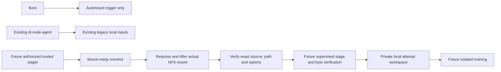

# NFS client preparation — Phase 2.3

7 November 2026, Asia/Dhaka. **Preparation only; no client deployed or changed.**
This covers pi01, pi02 and pi03 in one reviewed proposal. pi01 remains offline and
deferred at the user's request; no additional Pi probes were performed. See
[topology](04-nfs-topology.md), [server preparation](05-nfs-server-setup.md),
[architecture](01-hybrid-architecture.md), [progress](implementation-progress.md)
and [actual local evidence](06-nfs-client-validation.json).

## Scope and files

- [nfs_client.py](../../hybrid_storage/nfs_client.py): offline three-client plan,
  optional local read-only inspection, and future separately approved conditional
  package provisioning/configuration staging.
- [nfs_mount.py](../../hybrid_storage/nfs_mount.py): standalone, standard-library
  mount metadata guard. It does not authorize or launch jobs or read NFS data.
- [nfs_client_setup.py](../../tools/nfs_client_setup.py): operator entrypoint.
- [nfs-clients.json](../../config/nfs-clients.json): all-three-Pi infrastructure
  proposal, independent of unchanged legacy/default-off application flags.
- [test_nfs_client_setup.py](../../tests/test_nfs_client_setup.py): 25 fake-host/
  metadata tests, including separate idempotent setups for all three logical Pis.

The default and `--dry-run` generate all three plans **offline**, without SSH,
network queries, package commands, locks or host writes. `--node <Pi>
--inspect-local` is a separate read-only command to run on that Pi later. It
checks the selected LAN address belongs to the machine, package/helper state,
protected paths, fstab conflicts, unit overrides and existing mounts. It never
traverses an NFS/autofs input path. All three addresses must be known before
future package/configuration actions, even when configuring one client at a time.

The proposed controller LAN address is `192.168.10.214`; pi02 and pi03 addresses
are `192.168.10.150` and `192.168.10.101` from 2.1. pi01 is null. These DHCP-derived
values need stable-address review and revalidation, not inference from Tailscale.
pi02/pi03 had nfs-common installed in 2.1; pi01's OS/packages are unknown. No fresh
claim is made about their current state. Keep server/client proposal addresses
consistent; the tests/evidence check the current two proposal files agree.

## Planned client layout and service ordering

| Future path/unit | Purpose |
|---|---|
| `/srv/mlnfs` | Root-owned 0700 protected parent, inaccessible to ordinary training users. |
| `/srv/mlnfs/inputs` | Root-owned 0700 empty underlying mountpoint, never a local input fallback. |
| `/srv/mlnfs/.nfs-client-setup.json` | Root-owned 0600 setup identity marker; refuses silent node/source repurposing. |
| `/etc/systemd/system/srv-mlnfs-inputs.automount` | On-demand trigger; the only unit proposed for enabling at boot. |
| `/etc/systemd/system/srv-mlnfs-inputs.mount` | Matching input-only NFS mount; no Install section or direct boot enablement. |
| `/etc/systemd/system/ml-nfs-ready.service` | Oneshot guard with `Requires=` and `After=` the mount, not enabled at boot. |
| `/usr/local/libexec/distributed-ml/nfs_mount.py` | Reviewed standalone guard, root-owned 0644, invoked by `/usr/bin/python3 -I`. |
| `/var/backups/distributed-ml-nfs-client/<unique-run>/before.json` | Private backup journal before config/directory staging. |

Intended dependency chain, prepared but not connected to any current training:



Native automounts start the matching mount on access; do not add network ordering
to the automount itself. Only a mount operation needs the network. This avoids
turning NFS availability into an unconditional worker boot dependency.
[systemd 252 automount documentation](https://www.freedesktop.org/software/systemd/man/252/systemd.automount.html)

The mount also has `nofail`, a 15-second mount-command timeout, and no direct boot
installation. The legacy agent has no dependency/drop-in here and remains usable
with NFS down. The ready oneshot is not a cached permanent readiness flag; it has
no RemainAfterExit. A future stager must require/order after it and perform a fresh
guard check in its own namespace before input access. Native unit verification
checks syntax/dependency cycles locally, not a real Pi boot or systemd 252 runtime.
[Debian systemd.mount documentation](https://manpages.debian.org/bookworm/systemd/systemd.mount.5.en.html)

Proposed source and options:

```text
192.168.10.214:/srv/ml-shared/objects
ro,nosuid,nodev,noexec,hard,vers=4.1,proto=tcp,sec=sys,resvport,timeo=50,retrans=2,retry=0,nofail
```

NFS 4.1 is an explicit proposed version; support by the new controller server is
**untested**. There is no silent downgrade to v3 or soft mounts. `retry=0` avoids
helper-level repeated mount attempts; `timeo=50` is five seconds per initial RPC
timeout, not a total I/O deadline. Hard mounts can keep retrying after an outage;
the mount-command timeout cannot bound later kernel-blocked reads. The future
stager needs process supervision, bounded admission and cancellation/publication
fences. No NFS I/O belongs in Flask/scheduler/lease threads. Actual timeout/recovery
behavior must be measured on disposable jobs in 2.5.
[Debian NFS client manual](https://manpages.debian.org/bookworm/nfs-common/nfs.5.en.html)

## Empty-mountpoint guard and trust boundary

The guard reads `/proc/self/mountinfo`, not the data path, so a readiness query
does not itself trigger automount or wait for server I/O. It requires one exact
NFS mount at `/srv/mlnfs/inputs`, expected literal controller/export source, full
mount root, NFS 4.1/TCP/AUTH_SYS, read-only/nosuid/nodev/noexec/hard options. An
ordinary directory, autofs-only trigger, wrong source, bind-subdirectory, RW/soft
mount, duplicate/shadowed mount or nested/ancestor overmount fails closed. The
parent's root-only permissions independently protect the ordinary directory.

This is metadata admission, not byte verification, server liveness, server export
attestation or per-owner authorization. A later administrator can unmount/remount
after the check: future trusted staging must pin the validated root with a safe
directory descriptor, check its mount identity, use descriptor-relative no-follow
opens, and revalidate before publication. The 1.2 adapter is not wired to this
guard yet. No new job can bypass missing runtime integration: 1.4 keeps hybrid
execution disabled. Do not treat `mountpoint -q`, a directory's existence, an
active automount or a prior successful readiness check as launch permission.

The existing agent service is generated in `tools/cluster_setup.py` with User set
to the deploying user; `agent/agent.py` starts training with Popen without a
separate UID/mount namespace. 2.1 observed user pi and a shared namespace. This
subphase does not change that service or claim malicious-code isolation. Future
trusted staging is root-only for this infrastructure proposal; granting access
to a separate service identity requires later explicit permission/namespace work.

Training must only receive its private local workspace. The new protected parent
does not block direct NFS protocol traffic, root/capability-bearing code or access
to the old pi02 RW share. AUTH_SYS is not a student boundary. Endpoint restrictions,
old-share isolation and distinct training credentials remain required before
enablement. No root-run training is permitted by this design. Keep checkpoints,
results, SQLite and authorization sidecars outside NFS; no checkpoint API changes.

## Future approved provisioning/staging — not executed

No live sudo/systemd/fstab/package/mount actions are authorized by 2.3. Before
2.4, resolve pi01/address and server/publisher readiness, review host packages,
stable addressing, active jobs, and every generated file/digest for all three Pis.
Use an approved protected copy of the setup code; do not run root code from an
untrusted/student-writable checkout. Transfer provisioning files/packages through
the reviewed local route; worker runtime input staging never downloads Internet
data or dependencies.

Later on each Pi, `--node piNN --inspect-local` prints an observed plan/digest.
Its current proposal blocks actions while pi01 is null. Future administrator
actions require an exact fresh `--reviewed-plan-sha256` and separate explicit
approval; a digest is not approval:

- `--install-missing-package`: if nfs-common is already installed, no command.
  Otherwise all non-package blockers must be resolved before executing only
  `/usr/bin/apt-get --no-download --no-remove --assume-yes install nfs-common`.
  Missing cached packages/dependencies cause failure; no apt update/download or
  Internet fallback is performed. Package maintainer scripts may change services,
  so this step needs its own reviewed provisioning/rollback plan. It does not
  stage units. Rerun inspection/review after package changes.
- `--apply`: stage configuration only, with zero blockers, a protected lock,
  refreshed plan, private backup journal and exclusive/atomic file publication.
  It creates missing managed directories without recursive ownership changes.
  It never runs systemctl, mount, umount or modifies fstab or the old agent.
- Activation is a separate 2.4 step after server setup: review daemon-reload and
  enabling/starting **only** `srv-mlnfs-inputs.automount`. Do not enable the mount
  or readiness service, or invoke the readiness service before approving a mount.
  Readiness requests then demand the actual mount; they are not read-only probes.

Staging backs up existing target bytes/existence/SHA-256/ownership/mode plus
unchanged fstab observations before installing anything. Existing unowned files,
overrides, runtime/vendor definitions, direct mount boot links, symlinks, unsafe
permissions and mountpoint data are refused and preserved. Setup with an active
NFS/autofs input path is refused before stat/traversal; drain and review later.
Configuration publication is atomic per file, not transactional across four files.
A partial failed run retains its journal/marker and can resume without deleting
data; do not activate until all files match the reviewed plan. Same completed
inactive setup is a no-op with no new backup. Freeze manual config changes during
staging; the cooperative lock cannot stop a concurrent privileged administrator.
Backups are POSIX bytes/mode/owner records, not complete ACL/xattr/SELinux backups.

## Actual tests, safe manual checks and rollback

Executed from the project folder:

```bash
env PYTHONDONTWRITEBYTECODE=1 python3 tools/nfs_client_setup.py --dry-run
env PYTHONDONTWRITEBYTECODE=1 .controller-venv/bin/python tools/run_tests.py test_nfs_client_setup.py test_nfs_server_setup.py test_storage_config.py test_storage_backends.py
env PYTHONDONTWRITEBYTECODE=1 python3 hybrid_storage/nfs_mount.py --source 192.168.10.214:/srv/ml-shared/objects
git diff --check
```

Expect the offline preview to exit 2 with pi01 missing/local review still required;
it renders all three clients, not a deployment-ready result. Final local tests:
**85 passed, 0 failed, 0 skipped** (25 client, 19 server, 17 config, 24 backend).
The guard exits 2/ready=false on the actually unmounted controller without looking
up input files. Local systemd 255 verifier accepted all three generated unit sets
with exit 0/no diagnostics; standalone isolated guard copies also returned the
expected refusal. Exact commands, generated content, versions and logs/checksums
are in the evidence. No tests in this subphase failed before correction; a later
safe-query-environment hardening was rerun before final results were recorded.

To manually inspect unit files, save the preview's three unit strings for each
node under their exact filenames in a temporary directory, then run:

```bash
systemd-analyze verify --man=no /tmp/REVIEW/pi02/srv-mlnfs-inputs.mount /tmp/REVIEW/pi02/srv-mlnfs-inputs.automount /tmp/REVIEW/pi02/ml-nfs-ready.service
python3 -m json.tool docs/storage/06-nfs-client-validation.json > /dev/null
```

Repeat native verification for pi01 and pi03: expect exit 0 if local systemd
supports the directives. No unit is loaded/enabled by verification. Do not execute
future root package/configuration or activation commands as manual 2.3 checks.
Not run: real Pi inspection in 2.3, Python 3.11/systemd 252 runtime, package install,
root staging, NFS negotiation/mount, boot/outage/timeout, TEST SHA-256/write-denial,
lease/DDP training or throughput measurements. Pi-less evidence cannot establish
any of these outcomes; all-three-Pi acceptance remains pending.

No host rollback is needed for this repository-only preparation. The exact patch
is `/tmp/hybrid-storage-2-3.patch`; undo only seven additions and five documentation
index/progress insertions after rechecking intervening changes. Preserve all older
dirty work, DBs, jobs/checkpoints and the 2.2 implementation. Never reset/clean.

Future active rollback needs a separate approved maintenance window: fence/drain
new staging, stop/disable only the new automount and stop its mount after ensuring
no active readers. Preserve the legacy agent and `/mnt/nfs_share`; never use
forced/lazy/global unmount as automatic cleanup. Before restoring any managed
file from its journal, verify the installed hash and absence of concurrent edits;
restore only those files (or remove only verified originally absent config files).
Then review daemon-reload. Keep input directories, markers, journals and data;
never recursively delete them. Package rollback is separate because maintainer
scripts and dependency effects are not reversed by restoring unit files.

**2.3 preparation: PASS; live applicability and overall Phase 2: NOT READY.
STOP.** Central controller SPOF, stable addressing/pi01, package availability,
existing unsafe share, endpoint/process isolation and later live all-three-Pi
validation remain unresolved. No 2.4 application or 2.5 outage work was performed.
