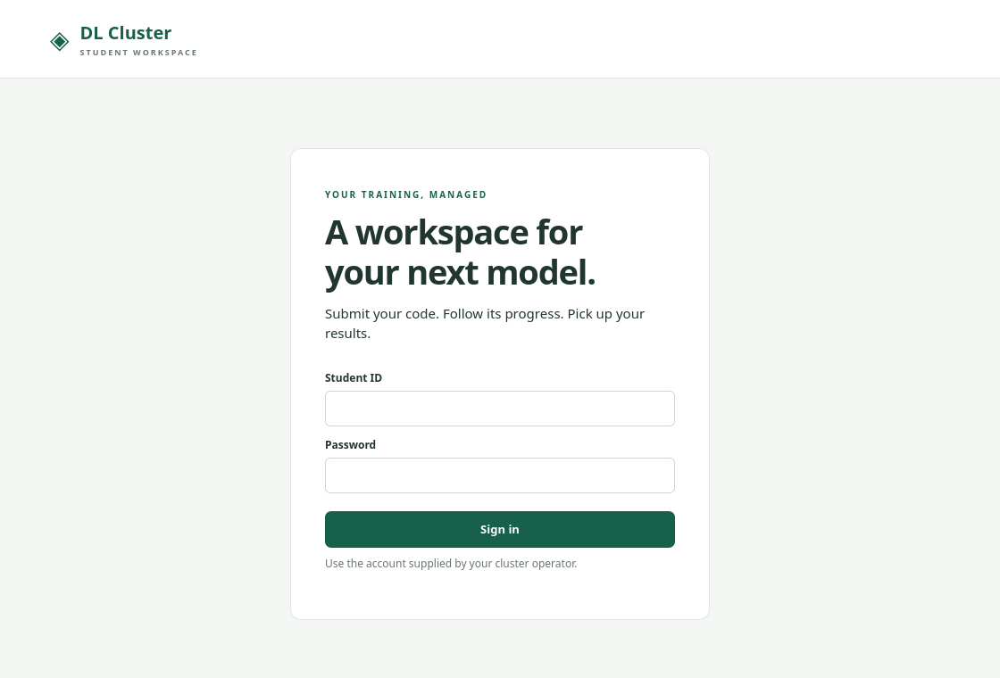

# Phase 14.4 supervisor demo

**Distributed Fault-Tolerant Machine Learning System with Resource-Aware Scheduling and Remote Power Recovery**

The demonstration uses release `pilot-20261111-074d980811f0` on the controller,
`pi02` and `pi03`. The portal runs on the private LAN. The recorded acceptance
tests cover cold and warm staging, cancellation, checkpoint recovery and
two-rank DDP. `pi01` and remote power recovery are outside the validated scope.

## Before the meeting

Use the controller terminal from the repository root and a browser on the
private LAN. Open the architecture diagram and this runbook in separate tabs.
Use a dedicated demo account if one is already provisioned in the pilot. Sign
in before sharing the screen. An approved demo window and an idle worker are
required for the optional live submission. The recorded route through the demo
works without a login or a live job. [Deployed architecture](../architecture.md#deployed-hybrid-pilot-v8)

Run the checks below. Expect two `active` lines locally and `active`, `enabled`
and an `nfs4` row with `ro` and `vers=4.1` on each worker. `HostName` pins the
two SSH aliases to their reviewed LAN endpoints. The mount query reads metadata.

```bash
systemctl is-active dl-hybrid-controller.service dl-hybrid-portal.service
ssh -n -o BatchMode=yes -o ConnectTimeout=6 -o StrictHostKeyChecking=yes -o HostName=192.168.10.150 pi02 \
  'systemctl is-active dl-hybrid-node.service && systemctl is-enabled dl-hybrid-node.service && findmnt -n -t nfs4 -T /srv/mlnfs/inputs -o SOURCE,FSTYPE,OPTIONS'
ssh -n -o BatchMode=yes -o ConnectTimeout=6 -o StrictHostKeyChecking=yes -o HostName=192.168.10.101 pi03 \
  'systemctl is-active dl-hybrid-node.service && systemctl is-enabled dl-hybrid-node.service && findmnt -n -t nfs4 -T /srv/mlnfs/inputs -o SOURCE,FSTYPE,OPTIONS'
```

Open the [pilot portal](http://192.168.10.214:8081/). The image below is the
actual unauthenticated v8 page captured from that address. For follow-up
screenshots, capture **Input preparation** on a completed demo job, the
**Attempts & workers** table, or **Distributed ranks** on a job the account
owns. If an administrator presents the storage panel, frame the worker totals
and inventory ages. Keep credentials and other students' records out of view.



## Ten-minute presenter script

| Time | Show | Say or do |
|---|---|---|
| 0:00–1:00 | Sign-in screen and the two worker names | “A student submits a job through the portal. The laptop controller schedules it, and the Pis execute it. The test cluster is on private Ethernet.” |
| 1:00–2:30 | Hybrid architecture diagram | Trace upload → immutable SHA-256 manifest → read-only NFS → verified local cache → private attempt workspace. Explain that the controller holds the SQLite DB and commits trusted checkpoints on local disk. |
| 2:30–4:30 | Optional live portal submission | Choose **Submit training**, **Example · Neural-network regression**, **Single worker**, and **PyTorch CPU**. Use a new name such as `Supervisor v8 regression` and the JSON command below. Submit, select the job, and point to **Input preparation** and **Attempts & workers**. If it finishes, show **Download results ZIP**. Continue with the saved cold-job receipt if login is unavailable, the pilot is busy, or the job is still queued. |
| 4:30–6:00 | Cold/warm table and recorded cache query | “The cold run copied 4,024 bytes. Both warm workers verified the same 4,024 bytes locally and copied zero bytes from NFS.” Explain that the inventory is advisory and locality is a tie-breaker after resource eligibility and fairness. |
| 6:00–8:00 | Saved single-worker and DDP recovery receipts | Show the failed worker, committed step and resumed attempt. Explain that a two-worker DDP group needed the failed agent back before both ranks could resume. Point out the fresh lease generations and identical final model hash. |
| 8:00–9:00 | Deployment checks and limitations | Show active services, RO NFS 4.1 and the recorded `EROFS` result. Mention the deferred Pi, the controller single point of failure and the distinction between worker-agent recovery and physical power recovery. |
| 9:00–10:00 | Research contribution and next steps | Summarize the integration claim below. Close with the Linux lab PC migration and a separately validated Wake-on-LAN plan. |

```json
["python", "train.py", "--steps", "30", "--batch-delay", "0.03"]
```

Keep one worker, the example's resource values, checkpoint recovery, and its
requirements file. A repeated example can hit the existing cache. Use the
recorded cold result for the cold part of the talk. Keep the demo independent
of transient UI states by switching to the receipts at the next time mark.
The presentation uses saved recovery evidence rather than stopping an agent.

## Measured before and after

| Live v8 observation | Worker | Copied from NFS into cache | Verified cache hit |
|---|---|---:|---:|
| First cold acceptance job | pi02 | 4,024 B | 0 B |
| Warm repeat | pi02 | 0 B | 4,024 B |
| Warm repeat | pi03 | 0 B | 4,024 B |

The byte counts describe application payload for the required inputs. Warm
jobs still verify and project local inputs. These observations compare cold and
warm application caches within v8. Phase 13 ran 72 completed A/B/C/D component
trials on one controller host. The physical-cluster A/B/C/D comparison, NFS
wire bytes, server throughput and an end-to-end speedup estimate remain
unmeasured. Linux and NFS may also cache data. [Evaluation methodology](13-experiments.md)

Single-worker recovery continued on `pi02` from `pi03`'s committed step 25.
Maximum absolute prediction error versus the uninterrupted baseline was `0.0`;
both final MSE values were `0.5538421869277954`. Two-rank DDP resumed both ranks
from step 11 and finished all 120 steps with the same final model SHA-256 as
the uninterrupted run. The tested failure was a controlled worker-agent stop.
[Live deployment and acceptance evidence](64-v8-pilot-deployment.md)

### Recorded evidence commands

These read the retained JSON receipts and print selected demo fields. Run them
on the controller where the experiment artifacts were collected. The deployment
report retains the same measurements for a copy of the repository without `reports/`.

```bash
demo_receipts=reports/phase14-3-integration
jq '{job_id, worker:.detail.job.node_id, staging:.detail.staging.metrics | {staged_bytes,cache_hit_bytes}}' \
  "$demo_receipts/acceptance-permissions-1794356546122732404.json"
jq '.observations[] | select(.cohort=="warm") | {worker, staged_bytes:.metrics.staged_bytes, cache_hit_bytes:.metrics.cache_hit_bytes}' \
  "$demo_receipts/acceptance-cold-warm-1794364158351961970.json"
jq '{failed_worker, replacement:.detail.job.node_id, resumed_from:.summary.resumed_from, max_prediction_abs_error}' \
  "$demo_receipts/acceptance-single-recovery-1794364305624607037.json"
jq '{failed_worker, old_generations, new_generations, exact_model_hash_match, ranks:[.summaries[] | {rank,resumed_from,training_steps,parameters_synchronized}]}' \
  "$demo_receipts/acceptance-ddp-recovery-1794364414306781427.json"
jq '.workers | to_entries[] | {worker:.key, version:.value.mount.version, sha256_verified:.value.public_test_object.hash_verified, write_open_errno:.value.public_test_object.write_open_errno}' \
  "$demo_receipts/service-verification-pilot-20261111-074d980811f0-1794364460439037668.json"
```

## Research contribution and scope

The contribution is the integration of verified input locality with a fair,
resource-aware, fault-tolerant training scheduler. SHA-256 manifests pin exact
inputs, workers fetch and verify misses over standard NFS, signed cache
inventory informs eligible ties, and a fresh attempt can reuse authorized
inputs while restoring a committed checkpoint. The comparison workloads test
that integration using existing NFS, SQLite and PyTorch DDP. The application
owns the cache and recovery policy. Worker isolation and job authorization are
the student security boundaries. [Design and security model](01-hybrid-architecture.md)

The pilot uses two CPU-only workers, preapproved offline environments and a
single controller. Existing Ethernet links around 100 Mbps are a deployment
constraint, and the demo records no effective link throughput. Systemd startup
and agent restarts were observed. A physical reboot, controller failover,
three-Pi training, unrestricted dependency installation and powered-off host
recovery remain outside acceptance. [Readiness and topology](60-readiness-closeout.md)

## Optional Linux lab PC migration and future Wake-on-LAN

1. Inventory the target PCs, private Ethernet reachability, Python/PyTorch
   compatibility, CPU/GPU profiles, disk reserves, service identities and
   host-specific isolation. Review the pilot's fixed worker and endpoint
   allowlists, including the protected result collector, before expanding them.
2. Build an offline capsule for each supported architecture. Enroll each host
   with its own worker identity and credential. Review the restricted RO NFS
   export, mount guard and rollback plan. Validate on an idle lab PC, then test
   at the intended DDP world size before expanding the deployment.
3. Treat Wake-on-LAN as a separate operator-controlled feature. Verify firmware,
   NIC and power-state support on each target. Keep an operator-reviewed host
   and MAC inventory and send wake requests from an approved local sender.
   Rate-limit and audit wake attempts. Keep the host ineligible until it passes
   worker authentication, health and mount checks. Validate on a spare PC with
   an independent way to restore it and record wake-to-ready time separately
   from training recovery. Leave WOL disabled until those tests pass.
