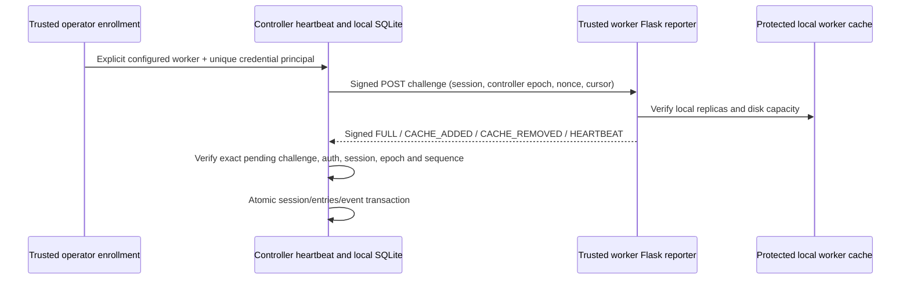

# Phase 6.2 — authenticated cache inventory on the worker HTTP channel

8 November 2026, Asia/Dhaka. **Local component/integration acceptance only.**
No live deployment or authentication upgrade of the other worker endpoints is
claimed. The central controller remains a **single point of failure**.

## 1. Implemented behavior and exact files

The starting checkout contained all eight uncommitted/untracked 6.1 files and
documentation edits. They are preserved. Last accepted subphase was 6.1; 5.4's
dedicated acceptance remains unfinished. This change implements **6.2 only**.

| File | Change |
|---|---|
| `hybrid_storage/inventory_protocol.py` | Typed per-worker credential, explicit protected local key-file loader, bounded strict JSON and domain-separated challenge/response HMAC-SHA256. |
| `hybrid_storage/inventory_reporter.py` | Explicit worker lifecycle, protected persistent cache ID/epoch, singleton ownership, local verification, full snapshots and incremental add/remove events. |
| `hybrid_storage/cache_inventory.py` | Explicit local SQLite owner/enrollment, authenticated ingestion, session/cursor/history transactions, freshness/offline checks and reconciliation. |
| `controller/cache_inventory.py` | Opt-in existing-HTTP heartbeat adapter; bounded response bytes, socket timeouts, redirect/proxy suppression and failure invalidation. |
| `agent/agent.py` | `POST /resources/cache-inventory`, disabled with 404 unless a trusted initialized reporter is explicitly installed. |
| `agent/cache_storage.py` | `install_inventory_reporter(app, reporter)` trusted bootstrap seam. |
| `controller/controller.py` | Optional `cache_inventory` argument on the existing resource heartbeat/dashboard loop. Default resource output remains unchanged. |
| `tools/cluster_setup.py` | Optional operator-injected `cache_inventory` on existing `register`; invalidate old observations before registration and explicitly enroll afterward. |
| `tests/test_cache_inventory.py` | Disposable local cache/SQLite plus actual Flask-agent and operator/heartbeat adapter tests. |
| `docs/storage/23-authenticated-cache-inventory.md`, `23-authenticated-cache-inventory-evidence.json` | Contracts, tests, preservation and rollback evidence. |
| `hybrid_storage/README.md`, `tests/README.md`, `docs/README.md`, `docs/storage/implementation-progress.md` | Navigation/progress. |

No controller/job-store startup import or live migration occurred. No NFS,
Internet-dependent worker transfer, artifact download endpoint, job state,
checkpoint format, execution lease, resource policy, fairness, reservation,
concurrency or cancellation rule changed. The scheduler does not consult this
registry yet. No live service, `/etc`, SSH, firewall or Pi operation was performed.

## 2. Actual auth boundary, API, DB and configuration

The existing enrollment was operator SSH/inventory management; resource/job HTTP
polls were unauthenticated. There was no authenticated runtime heartbeat to reuse.
This implementation reuses the actual operator `register`, worker Flask server,
stable `DL_NODE_ID`, controller `check_node` heartbeat and HTTP transport, adding
authentication **only to cache metadata**. It does not describe lease IDs,
student sessions, hostnames, NFS AUTH_SYS or an IP address as credentials.



Each operator-provisioned credential has the configured worker ID, random 32-hex
key ID and unique random 256-bit secret. Both key IDs and secret bytes must differ
between workers. SQLite stores only its `hmac-sha256:<key_id>` principal, never
the secret. `load_credential` only reads an absolute, service-owned, single-link
0600 regular file in a private owned directory on an attested local filesystem;
symlinks/unsafe permissions are rejected. There is no automatic key creation,
remote copying, enrollment, migration or environment override.

The trusted operator must provision matching worker/controller copies through
the reviewed administration channel, outside the repository, exports, student
workspaces and job payloads. No credentials were generated or installed here.
Rotation uses a new secret/key ID, explicit operator enrollment, reporter restart
and a new full handshake. Enrollment/revocation or principal changes invalidate
active sessions. Old keys cannot authorize the new binding. Re-registering a
worker with the optional registry argument invalidates its previous inventory
even if the following file/DB operation fails. Those two storage systems are
not one atomic transaction; retry explicit enrollment after a partial failure.

**Production enablement is still blocked on trainer/service isolation.** Current
same-UID legacy training could read a service key or alter cache state. An operator
must first provide a separate service identity and tested OS process/network/file
boundaries; simply injecting the reporter into today's shared-UID agent is not
an acceptable deployment. This code is not an OS sandbox. HMAC authenticates
metadata and does not encrypt it or protect the legacy launch/checkpoint/resource
endpoints. No new whole-system security or tenant-isolation claim is made.

### Wire and ingestion contracts

- Existing HTTP/Flask transport, `POST /resources/cache-inventory`. Request headers
  `X-DL-Worker-Key`, `X-DL-Inventory-MAC`; signed response header
  `X-DL-Inventory-MAC`. The MAC covers version/domain, method/path, worker/key,
  direction, exact body and the exact challenge digest for responses.
- Strict version 1 fields; reject duplicate JSON keys, nonfinite numbers, unsafe
  IDs, unexpected fields, noninteger byte/sequence values, duplicate digests,
  inconsistent disk capacity and unregistered SHA/size pairs. Maximum 1 MiB and
  4,096 inventory entries; exceeding limits fails without a partial snapshot.
  Pagination for larger lab inventories needs a future reviewed extension.
- Controller-generated random session/controller epoch/nonce, exact one pending
  challenge per worker and a 10-second acceptance deadline. Worker accepts signed
  challenges only within 30 seconds of its wall clock and rejects out-of-order
  timestamps. Operational clocks must be synchronized; skew fails closed.
- Persistent `state/inventory-identity.json` contains cache ID and increasing epoch.
  Atomic temporary-write/fsync/replace/fsync, protected local lock, no existing
  cache-DB schema change. Each reporter startup advances its epoch; malformed
  state is refused without overwriting it. It never resets pins or deletes data.
- Controller singleton lock is beside the actual local SQLite DB in its private
  directory. Startup fences all old ACTIVE sessions; no worker becomes eligible
  until a newly authenticated full snapshot. Do not run multiple inventory owners
  for the same DB. The connection factory must always target that same DB.
- First/startup/reconnect report is FULL at sequence 1. Later changes use exact
  previous sequence + 1 and base sequence; additions/removals are batched by kind,
  with removals first. FULL replaces current observations, retaining tombstones
  and append-only history. Unknown artifacts fail the entire transaction.
- Every scan checks registered local objects using cache verification/fingerprint
  rules; full scans force hashing. Missing/corrupt objects are not advertised as
  verified. Unregistered filenames are not discovered/trusted automatically.
  Stage-time hashing remains mandatory regardless of this advisory registry.
- Lost-response retries retain the exact event body; a fresh challenge binds its
  new signature. Exact response duplicates are no-ops and extend neither last
  seen nor inventory freshness. Old/nonmatching challenges, cache epochs, boot
  bindings, conflicting bodies and revoked principals cannot update observations.
- A signed unchanged HEARTBEAT updates last seen/disk only, not inventory TTL or
  event cursor. Default heartbeat freshness is 15 seconds, inventory TTL 90
  seconds. Controller explicitly requests a full reconciliation every 30 seconds;
  worker also defaults to a full scan every 30 seconds. Reconciliation must be
  configured shorter than inventory TTL. Cache freshness is distinct from job
  execution leases; no lease or reservation is granted by inventory.
- Poll/verification/authentication failure immediately invalidates live admission
  and tries to persist STALE. In-memory invalidation happens first, so a failed
  SQLite write cannot leave old observations eligible. `eligible(worker)` returns
  false on unreadable DBs, absent current sessions, expired/clock-invalid inventory,
  stale heartbeats, revocation or retired/superseded cache epochs. Periodic
  `reconcile` expires observations even without a report.

No DDL migration or version/checksum change from 6.1 is required. `CacheInventory`
requires the existing explicitly migrated artifact/cache schemas and fresh
dedicated LOCAL SQLite FULL/FK connections, never NFS. All ingestion changes are
one `BEGIN IMMEDIATE` transaction. Constructors/imports do not initialize stores.

### Opt-in composition, not a live enablement command

Trusted worker bootstrap: `load_credential(..., expected_worker=DL_NODE_ID)`;
construct `InventoryReporter` with the existing initialized `WorkerCache`;
call `initialize()` once; then `install_inventory_reporter(agent.app, reporter)`.
Retain/close the reporter for process lifetime. Do not place credentials in
Flask app config, training environment variables, manifests or student inputs.

Trusted controller bootstrap: construct `CacheInventory` with a fresh-connection
factory, credentials from protected local files, reviewed `config/nodes.json`
IDs and the DB's private parent directory; explicitly `start()` after reviewed
migration/enrollment. Supply it to operator `cluster_setup.register` for deliberate
enrollment or call its operator-only `enroll`. Create `InventoryHeartbeat` with
an explicit validated component `StorageConfig` having cache enabled, then pass
it to `controller.controller.main(cache_inventory=heartbeat)`. Neither operation
runs merely because a module is imported or an environment variable is set.

Actual `config/storage.json` remains **legacy / false / false / resource**.
The existing portal/dispatcher execution gate still rejects cache execution;
this phase does not remove it. The above composition is tested with synthetic
component settings in disposable fixtures, not a production configuration to
enable same-UID training. A later approved deployment must provide isolation and
review all pi01/pi02/pi03 credentials/topology; prior pi01 deferral is not a new
waiver. No credential material belongs in a checked-in config example.

## 3. Tests and evidence

Exact commands, raw stdout/stderr (including an initial new-code failure), counts,
source/config/DB preservation hashes and scoped diff are in
[evidence](23-authenticated-cache-inventory-evidence.json). The baseline and final
results are recorded there; no live hardware, NFS fault or throughput claim.

Baseline: **110 tests passed, 4/4 files, zero failures/skips**. Initial new
selection: 25 cases, one new-code retry error; fixed expanded selection: 32 pass.
Earlier regression: 518 pass, 25/25 files. Final current-source selection:
**523 tests passed, 25/25 files, zero failures/skips**, including **38 new inventory
tests**, in 98.6 seconds. Exact final command:

```bash
env PYTHONDONTWRITEBYTECODE=1 .controller-venv/bin/python tools/run_tests.py --isolated test_cache_inventory.py test_cache_registry_schema.py test_private_workspaces.py test_cache_fetch.py test_worker_cache.py test_legacy_registration.py test_storage_registry.py test_dataset_manifests.py test_dataset_validation.py test_artifact_registration.py test_storage_readers.py test_storage_selection.py test_storage_config.py test_job_submission.py test_job_storage.py test_student_portal.py test_queue_controls.py test_resource_allocation.py test_storage_inputs.py test_storage_health.py test_storage_backends.py test_nfs_client_setup.py test_nfs_server_setup.py test_cluster_setup.py test_execution_ownership.py
```

The initial lost-first-response test found unnecessary pending-session rotation;
the retry path was corrected and regression-tested. This was a new-code failure,
not an existing failure. Baseline selected tests had no failures. Subsequent tests
cover actual Flask routing/auth, actual operator registration and dashboard hooks,
full/add/remove/unchanged reports, corrupted/deleted/missing inventory, worker and
controller restart, stale/offline/expired state, duplicate/reordered events,
key/worker/cache spoofing, key rotation/revocation, response deadlines, bounded
HTTP bodies, concurrent duplicate SQLite writes, read-only/unavailable DBs,
singleton ownership and non-destructive identity corruption handling.

## 4. Safe manual verification

From the application root (no credentials or Pis required):

```bash
env PYTHONDONTWRITEBYTECODE=1 .controller-venv/bin/python tools/run_tests.py --isolated test_cache_inventory.py test_cluster_setup.py test_cache_registry_schema.py
env PYTHONDONTWRITEBYTECODE=1 .controller-venv/bin/python -m hybrid_storage.config
git diff --check
```

Expected: **68 tests pass** (38 inventory, 8 setup, 22 schema); config remains legacy/cache false/staging
false/resource; no whitespace errors. Test fixtures never connect to worker IPs.
Default-transport request options are mocked; Flask integration uses its local
test client, not a real network listener. Real packet loss, SSH enrollment/key
provisioning, live TLS/proxy integration, reboot and all-three-Pi validation are
untested. No whole-repository suite or overall Phase 6 PASS is claimed.

## 5. Rollback and residual risks

Scoped patch `/tmp/hybrid-storage-6-2.patch` is relative to the saved 6.2 starting
contents, including the user's uncommitted 6.1 changes, not merely Git HEAD.
From the parent Git root, review/check before any reversal:

```bash
git apply --reverse --check /tmp/hybrid-storage-6-2.patch
# Only after review and checking for subsequent overlapping edits:
# git apply --reverse /tmp/hybrid-storage-6-2.patch
```

No live DB migration/config/service/key provisioning occurred, so no host rollback
is needed. Later runtime rollback stops/closes the optional monitor/reporter,
retains registry/events/identities, cache/epoch files, jobs, checkpoints and pins,
and leaves flags off. Never drop tables/reset epochs to make old reports pass,
delete data or restore a stale DB over newer jobs. Future readers must filter
current authenticated/fresh sessions, never query raw historical VERIFIED rows
as cache eligibility. Code rollback may leave advisory rows; they are not leases.

Registry history has no automatic pruning. Full hash scans can be costly; this
phase has no benchmark or measured transfer-cost policy. Socket connect/read
timeouts are not a hard total wall-time bound for a trickling HTTP peer, and a
Python deadline does not cancel blocked local filesystem I/O. Keep the metadata
service isolated from execution lease renewal; concurrency is one reporter per
cache and one poll per worker, with bounded body/inventory sizes. Production
ingress/process limits and larger-inventory pagination need reviewed deployment
validation. Inventory never grants dataset access or proves an honest compromised
worker. Legacy endpoint authentication and OS isolation remain separate gates.

## 6. Acceptance boundary

**6.2 local component/integration acceptance PASS.** This phase provides tested authenticated metadata reporting/reconciliation and
fail-closed advisory eligibility, opt-in at actual registration/heartbeat seams.
Live enablement remains unapproved/unperformed. **STOP before 6.3.** Dataset/job/
per-rank unique-digest coverage and the exact pi01=0/pi02=2/pi03=502 MB fixture
remain 6.3/6.4 work. Existing execution resource/queue/lease rules remain authority.
