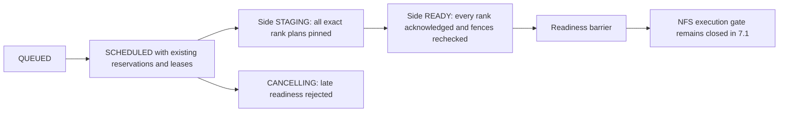

# Phase 7.1 — fenced staging side state and RUNNING guard

8 November 2026, Asia/Dhaka. **7.1 only.** No dispatch/stage/start transport,
hybrid execution enablement, cleanup orchestration or UI metrics in this turn.
Central controller remains a **single point of failure**.

## 1. Implemented behavior and exact files

Starting checkout includes earlier uncommitted/untracked 6.1–6.4 work; last
recorded acceptance is Phase 6 local registry acceptance. Preserve it all.
Dedicated 5.4 acceptance remains unfinished.

| File | Change |
|---|---|
| `hybrid_storage/staging_schema.py` | Explicit additive plan/apply migration: three tables, two indexes, nine triggers for immutable staging identity/history and rank readiness. |
| `hybrid_storage/staging_lifecycle.py` | Opt-in `StagingLifecycle.begin/record_ready`, `StagingAttempt`, and read-only `require_ready` barrier against existing attempts, reservation snapshots and execution leases. |
| `controller/input_storage.py` | Lazy `require_staged_attempt(connection,job_id)` at the existing trusted storage seam. |
| `controller/job_store.py` | NFS `mark_running` checks readiness and then retains the separate NFS execution gate; rollback/close on rejection. Legacy transition behavior is retained. |
| `tests/test_staging_lifecycle.py` | Twenty disposable metadata/migration/state/fencing/backward-compatibility cases. |
| `docs/storage/26-staging-lifecycle.md`, `26-staging-lifecycle-evidence.json` | Contracts, evidence, exact commands and rollback. |
| `hybrid_storage/README.md`, `tests/README.md`, `docs/README.md`, `docs/storage/implementation-progress.md` | Navigation/progress. |

`jobs.status` keeps its existing values. While worker inputs are being prepared,
the job remains **SCHEDULED** and a separate attempt/rank phase is **STAGING**.
This preserves active-owner quota accounting, fair queue behavior, occupied
slots, cancellation's SCHEDULED→CANCELLING behavior and existing website/API
status consumers. Existing upload-time STAGED/READY still mean central snapshot/
environment preparation; they do not mean a rank's local workspace is ready.



No live DB migration, credential provisioning, host/service/Pi/SSH, mount/export,
firewall or `/etc` operation occurred. No files, jobs, checkpoints, caches or
running services were deleted/moved. No wholesale data copy or new transport.

## 2. API, DB, configuration and security

### Explicit schema and metadata ownership

`hybrid_staging_migrations` has independent version/checksum (not `user_version`).
`hybrid_staging_attempts` binds a random stage ID to job ID, current retry count,
unchanged `job_id:retry_count` token, actual `job_attempts.attempt_id`, owner,
immutable job-input binding digest, exact world size and side phase/timestamps.
The global history attempt ID and one-based history attempt number are not
renamed or confused with zero-based retry count.

`hybrid_staging_ranks` binds each rank to worker ID, canonical workspace-plan
digest, exact existing reservation fingerprint (worker/job/resources/creation
time), existing lease ID/generation, phase and trusted receipt digest. No raw
NFS path, credential or student filename is stored in these rows. Reservation
history is a snapshot, not a FK that would prevent normal slot release. Attempt,
binding and lease history have restrictive FKs; no cascade deletes runtime data.

The migration requires already migrated immutable registry and actual job/
attempt/reservation/rank/lease tables. Use a dedicated controller-LOCAL idle
SQLite FULL/FK connection; the ordinary job-store NORMAL connection is not a
migration connection. `migration_plan` is read-only; `migrate` is explicit,
transactional and idempotent, refuses partial/unknown shapes and preserves
existing rows/user_version. Nothing migrates on import, startup or HTTP requests.

Version **1**; DDL checksum:
`7a866b1ae0018d956a60e25b44a319dfc39de1a745328403320b98ad85707fdb`.

### Service methods and barrier

Construct `StagingLifecycle(registry, settings=...)` with an existing trusted
`StorageRegistry`. Defaults are legacy/off and reject staging mutations. An
explicit component config must select NFS, storage-aware staging and worker cache.
This does not relax the portal/dispatcher's existing execution gate or change
the actual settings file.

- `begin(actor,job_id,plans)` records only an **already SCHEDULED, reserved,
  uncancelled, leased NFS custom job** with a committed owner-authorized binding.
  Validate all source/data/requirements identity through existing registry APIs.
  Require typed `WorkspacePlan` objects covering every exact rank, full committed
  source/data and unchanged attempt token/binding digest. This phase does not
  implement partial-dataset rank planning or placement/allocation.
- Existing history must contain exactly one SCHEDULED attempt for retry+1.
  Snapshot each current reservation and live lease; require matching job/token,
  nonrevoked/nonblocked lease, current controller boot and valid wall/BOOTTIME
  deadlines. The exact same enrollment is idempotent; conflicting attempts,
  plans or fences cannot overwrite it.
- `record_ready(actor,attempt,rank,plan_sha256=...,receipt_sha256=...)` is a
  **trusted coordinator-only method**. It must be called only after authenticated
  remote workspace verification in **7.2**. A digest supplied by a student is not
  proof. No route exposes this operation. Here it only records an immutable
  acknowledgment and rechecks authority/current job/placement/reservation/lease.
  A different receipt conflicts; an exact retry makes no extra timestamp change.
- Aggregate READY requires every contiguous rank and every receipt. Recheck all
  peers' leases/reservation identities at the last acknowledgment; failure rolls
  back that acknowledgment/barrier. One READY rank cannot launch a DDP group.
- `require_ready(connection,job_id)` runs inside the caller's existing transition
  transaction. Attest the actual DB path as local even on the existing NORMAL
  job-store connection. Require committed binding/owner/spec/snapshot, source
  grant/current dataset ACL, exact history attempt, all rank receipts/placement,
  current reservations and valid boot/wall/monotonic lease fences. Renewal of the
  same lease identity remains compatible. Cancellation/requeue/revocation or
  changed identity rejects late readiness; no slot/pin cleanup is performed here.

Side phase transitions and immutable identities/receipts/history are guarded in
SQLite. An explicitly installed SQL trigger prevents an NFS job's RUNNING update
without the readiness rows. This is defense in depth, not a replacement for
service authority/fence checks or a database-administrator security boundary.

### Runtime boundary: nothing starts in 7.1

Actual `job_store.mark_running` now rejects unready NFS transitions. Even when
metadata is READY, it **still calls the existing NFS execution gate and rejects
launch enablement**. Normal enqueue/reserve/dispatch and controller configuration
remain gated. No worker `/jobs/start` payload, LOCAL dataset path, staging RPC,
lease renewal policy or launch permit was added. Existing legacy jobs still use
their original path, including cancellation reconciliation/history behavior.

The NFS tests deliberately create synthetic already-reserved prerequisites in
disposable databases, then use the actual lease API and staging/barrier methods.
They do **not** claim normal hybrid dispatch or real remote workspace verification.
Receipt digests in tests are synthetic trusted acknowledgments. Cold/warm job
execution belongs to 7.2; producer cancellation/restart/pin cleanup and result
fencing orchestration to 7.3; student UI staging status/metrics to 7.4.

Actual settings remain **legacy / cache false / staging false / resource**.
Current same-UID training and legacy worker endpoint authentication remain
production gates. A staging row or ready receipt is not authority for untrusted
training to access NFS/cache, a student-supplied path, or permission to launch.

## 3. Tests and evidence

[Evidence](26-staging-lifecycle-evidence.json) retains exact commands, raw results,
counts, preservation hashes and scoped rollback. Baseline five-file selection,
initial sixteen-case suite, expanded focused suite and final regression are
recorded independently. No live migration or hardware/benchmark claim.

Baseline: **98 passed, 5/5 files**, 21.5 seconds. Initial new suite: **16 passed**,
4.8 seconds. Expanded focused: **41 passed, 3/3 files**, 9.2 seconds. Final current
source: **590 passed, 28/28 files, zero failures/skips**, 104.0 seconds, including
**20 new staging tests**. No selected baseline/new-code failure occurred.

Cases cover read-only construction/plan, explicit repeat, old rows/user_version,
partial schema, interrupted transactional DDL and concurrent migrations; disabled
defaults and HELD/unreserved rejection; history/plan/reservation/lease identity;
missing schema and actual mark_running rejection; idempotent readiness, conflicting
receipt; expiry/revocation/uncertainty/controller boot/BOOTTIME; cancellation,
retry and ACL revocation; same-identity renewal; all-three-rank barrier/peer expiry;
history immutability/FKs; remote DB refusal; legacy reserve/run/complete without
staging records. Existing queue, portal, storage and execution-ownership tests
exercise the unchanged legacy behavior.

Final command from application root:

```bash
env PYTHONDONTWRITEBYTECODE=1 .controller-venv/bin/python tools/run_tests.py --isolated test_staging_lifecycle.py test_cache_registry_acceptance.py test_cache_coverage.py test_cache_inventory.py test_cache_registry_schema.py test_private_workspaces.py test_cache_fetch.py test_worker_cache.py test_legacy_registration.py test_storage_registry.py test_dataset_manifests.py test_dataset_validation.py test_artifact_registration.py test_storage_readers.py test_storage_selection.py test_storage_config.py test_job_submission.py test_job_storage.py test_student_portal.py test_queue_controls.py test_resource_allocation.py test_storage_inputs.py test_storage_health.py test_storage_backends.py test_nfs_client_setup.py test_nfs_server_setup.py test_cluster_setup.py test_execution_ownership.py
```

This is a selected isolated suite, not all repository tests. The previously
reproduced real-DDP sandbox socket EPERM remains documented in 6.3 and is not
silently converted into a pass/skip here. No live all-three-Pi validation or real
hybrid job training is claimed.

## 4. Safe manual verification

```bash
env PYTHONDONTWRITEBYTECODE=1 .controller-venv/bin/python tools/run_tests.py --isolated test_staging_lifecycle.py
env PYTHONDONTWRITEBYTECODE=1 .controller-venv/bin/python -m hybrid_storage.config
git diff --check
```

Expected: **20 staging tests pass**, default config reports legacy/off/resource,
no whitespace errors. Only disposable source copies/DBs are used. Do not migrate
the real job DB to test this phase. A later live migration requires review and a
consistent SQLite backup including WAL state; do not overwrite newer jobs.

## 5. Rollback and residual risks

Scoped patch `/tmp/hybrid-storage-7-1.patch` is relative to saved starting
contents, including earlier uncommitted work. From the parent Git root:

```bash
git apply --reverse --check /tmp/hybrid-storage-7-1.patch
# Only after review and confirming no subsequent overlapping changes:
# git apply --reverse /tmp/hybrid-storage-7-1.patch
```

No live schema/config/service changed, so no host rollback is needed. After any
later deployment, disable hybrid execution and retain staging history, existing
jobs/DB/WAL, leases, reservations, cache epochs/pins, checkpoints and artifacts.
No DROP/reset/GC/down-migration exists. Never release a reservation or pin merely
because staging metadata looks old. Current side rows intentionally survive
cancellation/retry for diagnosis; cleanup/reconciliation is 7.3 work.

One stage enrollment per job/retry is supported; no automatic replacement of an
interrupted plan or reservation. Future restaging/revision policy must preserve
old identities and fence late acknowledgments. Metadata READY is not independent
proof that remote files exist; 7.2 must authenticate and verify workspace receipts
before recording it, and recheck before the actual launcher, not merely after a
worker starts. Security/isolation, NFS outage/space handling and explicit fallback
remain gated. Dedicated 5.4 acceptance remains unfinished. Any later deployment
requires all-three-Pi validation unless explicitly excepted; no new pi01 waiver.

## 6. Acceptance boundary

**7.1 local state/barrier acceptance PASS.** The STAGING side state preserves the existing finite state machine, captures
actual attempt/reservation/lease identities and fences readiness/RUNNING entry.
**STOP before 7.2.** No overall Phase 7 cold/warm/cancel end-to-end PASS is claimed.
