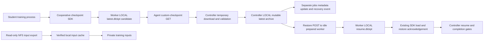

# Phase 8.1 — checkpoint audit, no runtime changes

9 November 2026, Asia/Dhaka. **8.1 audit PASS; Phase 8 implementation and
end-to-end acceptance remain pending.** Repository root:
`/home/rana/Projects/System Project/System_Development_Project`; application root
is its `distributed-dl-system/` child. Branch `main`, clean starting status, HEAD
`38d31c22bceb990166ef873f2be60b6ded1417f5`. The 7.4 progress/report and committed
code establish the previous delivered local boundary; they do not establish live
hybrid enablement. No applicable AGENTS.md was found in the checked ancestor or
application paths. Read README, prior audit/architecture/lifecycle design,
implementation progress and actual source. Earlier design prose is not treated
as implemented behavior.

Saved all 272 inventoried starting source/document files and their SHA-256 values
under `/tmp/hybrid-8-1/before/` and `before.json` before documentation edits.
Evidence: [30-checkpoint-audit-evidence.json](30-checkpoint-audit-evidence.json).
No application import against the live checkout DB, data move, schema change,
service operation, SSH/Pi probe, NFS mutation, stash, reset or commit was performed.

## Current flow and ownership



There is currently no connection from the NFS input/cache path to authoritative
checkpoint publication. Workers do not write NFS directly for checkpointing.
The SDK writes an untrusted candidate in its job-local output area; trusted
agent/controller code validates/transfers it. Actual OS privilege separation is
not established by a filename or an SDK checksum. Reviewed hybrid isolation,
termination and quiescence providers remain deployment prerequisites.

| Lane | Writer and contents | Worker / controller names |
|---|---|---|
| Dummy | `training/demo_job.py:10` saves JSON job_id, progress, duration, completed, hostname, updated_at; no model or RNG | Worker `checkpoints/<job>.json`; controller `checkpoints/<job>.json` via `controller/checkpoint_store.py` |
| Built-in PyTorch | `training/pytorch_job.py:86` writes torch checkpoint_version 2: job_id, epoch, next_batch_index, global_step, model_state_dict, optimizer_state_dict, loss, completed, save_reason, hostname, timestamp. No general RNG/scheduler state | Worker `checkpoints/<job>.pt`; controller `checkpoints/<job>.pt` |
| Custom single | `agent/dl_checkpoint.py:62` writes ZIP_STORED format_version 1, exactly metadata.json and state.pt | Worker `worker-storage/jobs/<job>/checkpoints/latest.dlckpt`; controller `<job.storage_path>/checkpoints/latest.dlckpt` |
| Custom DDP | `agent/dl_checkpoint.py:273` publishes one ZIP_STORED format_version 2/kind ddp with metadata.json and rank-N.pt for every logical rank | Rank-zero worker uses the same `latest.dlckpt` name; controller uses `<job.storage_path>/checkpoints/latest.ddpckpt` |

Worker paths above are relative to agent BASE_DIR; controller global paths are
relative to the application root. `job.storage_path` is the existing controlled
job workspace. Restore archives use worker `checkpoints/resume.dlckpt`; trainer
acknowledgement uses `checkpoints/resume-status.json`. These directories are
outside the narrow NFS input export. `WorkspaceReceipt.checkpoints` exists in
`hybrid_storage/workspaces.py`, but the current launcher still supplies the
existing prepared job's checkpoint directory, not that receipt directory.

## Custom archive contents and save boundaries

Single-worker state contains model, optimizer, optional scheduler, global_step,
application-defined progress, extra_state, Torch CPU RNG, all available CUDA RNG
states, Python RNG and optional global NumPy RNG. Metadata binds job_id,
**original** `storage_manifest_sha256`, attempt_token (`job_id:retry_count`),
compatibility_key, step, completed, state SHA-256 and creation time; leased runs
also embed the producer lease_fence. `extra_state` supports tensors/builtins,
not arbitrary pickled classes (`safe_state:28`). The application must supply a
consistent post-update save boundary and the next unprocessed position.

`CheckpointManager.save` creates unique `.sdk-state-*` and `.sdk-archive-*`
files in the same local directory, torch-saves/fsyncs state, builds/fsyncs archive,
validates it and rechecks `sdk_fence()` before `os.replace` to latest. It fsyncs
the parent directory. Save throttling uses monotonic time; force/completed bypass
the interval. Initialization cleans its own matching interrupted-save names.

DDP is currently **CPU Gloo**, not GPU/NCCL checkpointing
(`DistributedCheckpointManager.__init__:179`). Every rank captures model including
rank-local buffers, optimizer, optional scheduler, progress, extra_state, Torch,
Python and optional NumPy RNG. Rank/world_size are in each state. No CUDA RNG is
captured in this lane. Application generators/sampler position/scaler state must
be explicitly supplied; prefetched DataLoader state is not automatically saved.

`_capture:198` compares a shared-state hash of parameters/optimizer/scheduler;
buffers and RNG remain rank-local. `save:273` broadcasts the save decision,
gathers all complete rank snapshots at rank zero, verifies a common boundary,
job/manifest/attempt/environment/group/world size/completed/shared hash, and
prepares `.ddp-stage-*` with a fresh checkpoint_id. A proposal is broadcast; every
rank acknowledges its own state hash/checkpoint/group and rechecks its fence.
Only exact agreement of all acknowledgements permits rank-zero replacement of
latest and directory fsync. The result is broadcast to the group. A partial group
does not publish through the cooperative SDK. Rank-zero memory includes gathered
serialized states; this is not a bounded-memory streaming DDP writer.

## Validation, selection, retention and sync

`agent/checkpoint_protocol.py:21` (`validate`) and `:62` (`validate_group`) perform
standard-library structure/identity/hash checks without controller torch loading:
exact names with no duplicates, ZIP_STORED only, metadata at most 64 KiB,
nonempty state up to 10 GiB (aggregate across DDP ranks), valid step/completed/
timestamp, expected manifest/job/attempt when provided, environment identity,
state hashes, optional fence structure, and complete DDP rank acknowledgements.
Group IDs hash job, attempt, manifest, compatibility and rendezvous world size/
address/port (`group_identity:55`). DDP additionally validates checkpoint/group/
shared-state IDs and distinct worker fences when present.

Validation does not prove honest training, valid application progress or actual
tensor content: structural sync does not unpickle `state.pt`. Custom trainer load
uses `torch.load(..., map_location='cpu', weights_only=True)`. JSON metadata uses
ordinary json.loads; it is not a canonical/duplicate-key-rejecting manifest
parser. Archive member limits apply **after** HTTP temporary-file download; the
current collectors and restore upload handler do not impose a total streaming
checkpoint-byte cap or disk quota before receiving all bytes.

The built-in workload's trainer-side `pytorch_job.load_checkpoint:147` still uses
weights_only=False and supports older epoch-only checkpoints, whereas controller
`read_valid_checkpoint:1126` uses weights_only=True. Preserve this legacy lane;
do not copy its unrestricted trainer load into a trusted new-mode publisher.
The dummy loader also falls back to zero on missing/invalid JSON; it is not the
new-mode fail-closed recovery contract.

| Actual interface / call chain | Behavior |
|---|---|
| `agent/custom_runner.py:51` `run` -> existing trainer | Supplies DL_CHECKPOINT_DIR, original manifest/environment/attempt, interval, optional lease path, exact resume SHA/path and resume-status path. No NFS checkpoint mount is passed |
| `agent/agent.py:1054` `custom_checkpoint`, GET | Selects validator from prepared execution mode; verifies worker archive/environment/count and requested attempt, then send_file. No trainer tensor deserialization |
| `controller/dispatcher.py:431` `sync_checkpoint` / `:817` `monitor_running_jobs` | Single custom checkpoint mode -> `custom_checkpoints.sync`; normal cadence defaults to one-second checkpoint-due gate; completion forces final sync |
| `controller/custom_checkpoints.py:31` `sync` | GET with execution params; timeouts (2,10); unique controller temp, streaming 1 MiB writes/fsync; validate current attempt, previous step/completed, environment, embedded fence; replace latest/fsync; separately UPDATE jobs metadata, separately log CHECKPOINT_SYNC |
| `controller/distributed_dispatch.py:220` `progress` -> `group_checkpoints.py:29` `sync` | Fetch only rank zero with timeouts (2,15); one-second monotonic throttle unless forced; validate complete archive plus every reserved rank/environment/count/rendezvous/fence; replace central latest/fsync; separately UPDATE jobs and log DDP_CHECKPOINT_COMMITTED |
| `custom_checkpoints.py:21` / `group_checkpoints.py:24` `metadata` | Derive the fixed latest path from the job and validate that file. No directory scan, mtime-based search, immutable commit history or COMMITTED head lookup |
| `controller/dispatcher.py:270` built-in `sync_pytorch_checkpoint` | HTTP checkpoint endpoint, ETag/hash dedup, .tmp download/file fsync, controller weights_only=True structure check and ownership recheck, then replace and separate metadata/event updates |

Custom sync rejects step regression, completed -> non-completed regression,
wrong attempt and duplicate identical archive bytes. A distinct valid archive
at the same step is currently allowed. There is one mutable latest snapshot per
lane/job, not retained immutable versions. A newer accepted snapshot overwrites
the prior name. Worker custom start removes old latest.dlckpt and resume-status;
SDK cleanup removes its scratch names; uploaded resume.dlckpt is a separate
mutable file. No multi-version retention policy or garbage collector was found
in these paths. Existing files must not be removed/migrated automatically.

SQLite jobs stores checkpoint_path/checkpoint_updated_at/checkpoint_size_bytes
and ordinary recovery events record hashes/progress. There is **no implemented
checkpoint commit journal/head table** in the audited hybrid schemas.
DDP_CHECKPOINT_COMMITTED is a legacy event name and SDK message, not proof of the
future SQLite COMMITTED state machine. A crash after replace but before DB/event
update leaves a mismatch. There is no cross-filesystem/SQLite atomic commit.

## Restore and completion gates

Single dispatch (`dispatcher.dispatch_one_job:623`) loads metadata before resource
selection and narrows prepared workers by compatibility. After reservation,
`custom_checkpoints.restore:76` validates latest, uploads multipart to the idle
destination, sends original manifest/whole-archive SHA headers and checks returned
SHA. The agent fsyncs a unique local temp, validates format/environment/worker
count/SHA, then replaces resume.dlckpt and fsyncs its directory. Start checks this
uploaded identity against its payload. The SDK restores model/optimizer/scheduler
and RNG after constructors, then writes a PID/attempt-bound acknowledgement.
`extra_state` and progress are returned to the single-worker application; the
acknowledgement does **not** prove the application applied extra_state. Single
SDK load has no explicit earlier-attempt inequality check.

`dispatcher.record_confirmed_resume:1141` checks original job, PID, attempt,
expected checkpoint SHA/step and model/optimizer/RNG flags; it deduplicates by
observed start time. Successful process exit is insufficient: the controller
requires a validated completed=True checkpoint from the **current** attempt
before collecting results/completing, with three final-sync polls before failure.

DDP `group_checkpoints.resume_metadata:116` requires a known existing earlier
checkpoint, fixed world size and persisted source rendezvous group. Dispatch
freezes source identity in distributed_attempts.context_json, reserves a compatible
group and uploads the same full archive to **every** rank before any launch
(`distributed_dispatch.progress:220`). A persisted restore_prepared flag avoids
re-uploading to busy workers after a controller restart. Each logical rank loads
its own member with weights_only=True. Nonempty extra_state requires restore_extra;
callbacks run before RNG restore/shared-state comparison and all-rank agreement.
Acknowledgement writing is itself checked across the group. `restore_confirmed:355`
requires all-rank restoration, correct source checkpoint/group/step, new group,
rank/world-size/attempt/PID and application-state flags. DDP_RESUMED is deduplicated
by retry_count. All ranks and a complete current final group checkpoint must pass
before result collection and completion.

**Known legacy asymmetry:** single metadata returns None if its expected latest
file is missing, even when jobs.checkpoint_path records one; restore can therefore
mean restart from zero. DDP rejects that known-missing case before allocation.
Neither latest-only helper implements immutable COMMITTED source selection.
These are audit findings, not changes made here.

## Fencing, authentication and hybrid integration gaps

* `controller/execution_leases.py:46` `ensure` durably records generation,
  lease_id, attempt and greatest possibly delivered deadline against reservation.
  `safe_to_replace:84` includes clock-skew/stop margins and controller-boot hold.
  Worker `execution_lease.sdk_fence:119` checks local lease/authority before saves;
  `lease_runner.main:30` stops leased process groups independently of SDK calls.
* `execution_leases.current:107`, `response:179`, `checkpoint:166` reject stale
  retry/worker-generation/lease IDs and embedded producer fences where issued.
  The legacy current check allows SCHEDULED/RUNNING/CANCELLING and does not impose
  the hybrid all-rank live-lease/cancel gate. Older unleased jobs remain compatible;
  missing fences in an archive are not globally rejected by the format validator.
* `agent.fence_downloads:1134` fences downloads only when generation query params
  are supplied. Those params and response headers establish execution identity,
  **not cryptographic caller authentication**. GET without generation is not
  protected by this hook. Restore POST requires an idle worker and manifest/SHA
  headers, not an authenticated controller or fresh destination lease.
* Existing hybrid HMAC authentication covers staging/start/control and inventory,
  **not checkpoint streams**. Installed `agent/staging.py:274`
  `install_staging_service` rejects other POST paths, including checkpoint restore.
  Its bounded JSON control envelope cannot simply carry a multi-GiB archive.
  Reuse HTTP/streaming and per-worker credentials through a reviewed adapter;
  do not label the existing unsigned multipart checkpoint route authenticated.
* `execution_leases.publication:138` serializes hybrid final **results** against
  cancel/retry with BEGIN IMMEDIATE. Current checkpoint sync does not use it;
  its ownership check, filesystem replace, SQLite update and event are distinct
  steps. A check-before-replace is not an atomic fenced metadata commit.
* `controller/staging_dispatch.py:49` `authorize` explicitly rejects recovery mode
  other than restart. `staging_recovery.reconcile:144` consequently reconciles
  restart-mode completion/results, not checkpoint synchronization/resume.
  Keep this gate until the actual publisher, committed reader and recovery path
  exist. Normal controller startup/config remains gated as documented in 7.4.
* Format identity uses original storage_manifest_sha256. New source/dataset
  hashes and dataset versions live in `storage_job_inputs`/registry bindings
  (`hybrid_storage/registry.py:405` `_job_inputs`). Future commit metadata must
  bind that immutable input version **in addition to** preserving the archive's
  original manifest identity; rewriting old archive fields would break resume.

## Immediately next seam: 8.2, not implemented

Follow the existing [1.3 checkpoint design](02-manifests-and-lifecycle.md), rather
than mistake it for an installed migration. Add an explicit trusted publication
interface beside the legacy collectors. Receive through bounded authenticated
existing HTTP streaming into a private attempt-specific controller-local temp;
validate the unchanged single/DDP format, current job/input binding, every
producer fence, names, sizes and hashes. Publish new immutable snapshot names
outside the NFS input export, then conditionally commit a controller-local SQLite
head/record with current fences and expected previous head rechecked under the
same transaction discipline as cancel/retry. Keep previous committed snapshots.
Handle file-before-DB and DB-before-compatibility-mirror crash windows explicitly;
latest becomes a compatibility view, not commit authority. Reuse standard-library
archive validation; do not unpickle student state in a privileged publisher.

Concrete seams are `custom_checkpoints.sync/metadata`, `group_checkpoints.sync/
metadata/resume_metadata`, agent `custom_checkpoint` plus hybrid auth hook,
`execution_leases.checkpoint/publication`, `storage_job_inputs`, and the existing
local migration conventions. Input `ArtifactRegistrar` configured at the exported
objects root must **not** be reused to expose private checkpoints in the global
read-only input share. No new transport or trainer NFS RW privilege is needed.
Keep old job lanes and checksums unchanged; no automatic data copy or deletion.

This section identifies the next implementation boundary only. It does not
implement 8.2, select a production authentication adapter, lift the checkpoint
gate or claim 8.3/8.4 recovery acceptance.

## Tests, unknowns, manual verification and rollback

Executed only safe existing tests from an isolated source copy:

```bash
env PYTHONDONTWRITEBYTECODE=1 .controller-venv/bin/python tools/run_tests.py --isolated test_custom_checkpoint.py test_execution_ownership.py test_staging_lifecycle.py test_storage_selection.py
git diff --check
```

**57 tests PASS, 4/4 files, zero failures/errors/skips, 20.4 seconds.** Counts:
custom checkpoint 4, execution ownership 12, staging lifecycle 20, storage selection
21. Log `/tmp/hybrid-8-1-tests.log` with SHA-256 in evidence. No new tests are
needed for this documentation-only subphase. `test_custom_checkpoint` includes
real stochastic CPU training: 80 Adam updates with dropout, StepLR and global RNG
use; interrupted process exits after step 23 with saved cut at step 21, resumes
in a fresh process from that cut, and exactly matches final model, Adam, scheduler
and Torch RNG using torch.equal/recursive equality (zero numerical tolerance).
It also checks stale/corrupt/regressing transfers, corrupt restore and missing
final-checkpoint failure. This is an existing baseline, **not new NFS recovery**.

Observed installed metadata: Python 3.12.3, PyTorch 2.14.1, Flask 3.1.3, requests
2.34.2, NumPy 2.5.3. Worker versions/hardware were not re-probed. The reviewed
`test_group_checkpoint.py` (8 tests) and `test_group_recovery.py` (7) use local TCP
and actual Gloo processes; prior evidence records sandbox socket EPERM, so they
were not rerun/escalated or counted as skips/passes. The additional standalone
`test_checkpoint_recovery.py` covers built-in .pt resume but was inspected, not
run in this subphase. No live demo, reboot, power action, NFS fault injection,
benchmark or all-three-Pi test was run. Physical deployment validation still
requires pi01, pi02 and pi03; the earlier two-Pi exception is not a new waiver.

Unknown without future work/probes: production privilege/network containment,
authenticated streaming adapter, installed commit schema (none added here),
on-disk contents/corruption of real jobs, disk admission for simultaneous input/
checkpoint copies, cross-platform deterministic tolerances and live controller/
NFS failure behavior. The central controller, SQLite and authoritative storage
remain a **single point of failure**. Caches do not provide controller HA.

Manual local verification: rerun the exact isolated command and expect 57 passing
tests; inspect listed functions and the evidence symbol map; expect shipped
config legacy/false/false/resource. Do not start services or run live demos for
this audit. A file's existence, legacy COMMITTED log message or passing SDK test
does not establish the Phase 8 authoritative commit contract.

Changed files: only this report, adjacent evidence JSON and the appended 8.1
entry in implementation-progress.md. Source/data/API/DB/config unchanged.
Rollback is documentation-only: preserve any later edits, reverse the scoped
`/tmp/hybrid-8-1/8.1.patch` from the Git root after
`git apply --reverse --check /tmp/hybrid-8-1/8.1.patch`. No rollback was applied.
Never reset/clean the repository or remove DBs/jobs/checkpoints for this rollback.
The /tmp snapshot is session-local; retain it separately if needed later.

**8.1 PASS: actual writers, contents/formats, latest/retention/sync, restore,
authentication and attempt fencing traced; safe baseline documented. STOP before
8.2. Overall Phase 8 authoritative checkpoint acceptance remains pending.**
