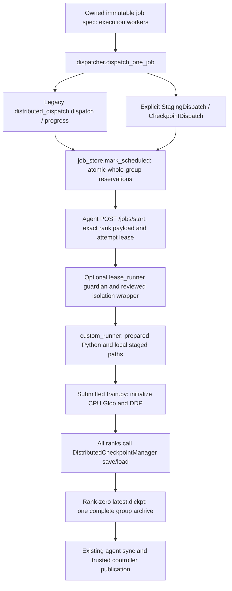

# Phase 9.1 — actual DDP launcher, inputs and checkpoint audit

9 November 2026, Asia/Dhaka. **9.1 audit PASS; STOP before 9.2.** Documentation
only. Phase 9.2–9.4 implementation and physical pi01/pi02/pi03 acceptance are not
claimed. No launcher, job/world-size rule, checkpoint format, API, DB schema,
configuration, service or data was changed. Central controller/LOCAL SQLite and
authoritative checkpoint storage remain a single point of failure.

Repository root: `/home/rana/Projects/System Project/System_Development_Project`;
application: its `distributed-dl-system` directory. Branch `main`, HEAD
`de297dc7d99eb80e52498145fe05b033e5afdaad`, starting status clean. The committed
progress and 8.4 report establish the previous **local** boundary; they do not
establish physical deployment or isolation. The existing distributed-training
guide's historical “Step 9” describes earlier legacy recovery, not completion of
this project's new hybrid-storage Phase 9.

Read README, architecture/progress and actual controller/agent/workload code.
Snapshot: 293 inventoried source/document files with SHA-256 under
`/tmp/hybrid-9-1/before` and `before.json`, before edits. No stash/reset/commit,
live DB import, SSH/Pi probe, mount, export/fstab/firewall/systemd change or
runtime package transfer. Tests use disposable source/DB/workspace copies.

## Decision: retain the working mechanism

The supported custom DDP path is **one logical training rank per reserved worker,
CPU Gloo, fixed world size per job/recovery, custom version-2 ZIP checkpoint
written by rank zero containing every rank's serialized state**. It does not use
`torchrun`, PyTorch elastic launch or PyTorch Distributed Checkpoint (DCP).
Per-rank ZIP members are not separate worker-owned checkpoint files. Preserve
this mechanism. Do not replace it with DCP, make an elastic group, change worker
count on recovery or assume a rank-zero model-only result is a recovery snapshot.

## Launcher and ownership trace



| Interface | Actual behavior and source |
|---|---|
| Route selection | `controller/dispatcher.py::dispatch_one_job` sends explicitly installed NFS runtime jobs to `storage_runtime.dispatch`; legacy distributed custom jobs use `controller/distributed_dispatch.py::dispatch`. Default bootstrap is unchanged. |
| Candidate/group selection | `distributed_dispatch.py::select_group` groups resource-eligible, idle, prepared, compatible workers; honors exclusions/reservations/lease capability. Ordered chosen workers get contiguous logical ranks `0..N-1`. Rank zero need not always be pi01. |
| Reservation and history | `controller/job_store.py::mark_scheduled` uses BEGIN IMMEDIATE, one reservation per distinct worker, `distributed_attempts(job_id,retry_count)` and `job_ranks(job_id,retry_count,rank)`. A DDP job occupies one owner active-job quota entry but N worker slots. |
| Exact launch payload | `distributed_dispatch.py::payload` supplies job ID, attempt `job_id:retry_count`, original manifest SHA, prepared environment key, per-worker resources, `ddp={rank,world_size,master_addr,master_port}`, optional lease/resume metadata. `launch_context` preserves the three common rendezvous fields. |
| Rendezvous | Controller chooses rank zero's configured IP and a port `20000 + secrets.randbelow(30000)` for the attempt. No new network topology or verified physical address was inferred here. |
| Agent process creation | `agent/agent.py::start_job` builds a `custom_runner.py` argv, optionally wraps reviewed staging isolation and `lease_runner.py`, then Popen with `start_new_session=True`. There are guardian/wrapper/child processes; “one rank per worker” does not mean one total OS process. |
| Launcher and interpreter | `agent/custom_runner.py::run` validates the prepared job/environment, maps a `python`/`python3` entrypoint to its prepared interpreter, then `subprocess.call(..., cwd=source_path, env=...)`. It does not use torchrun or locally spawn N training ranks. |
| Training environment | `RANK`, `WORLD_SIZE`, `LOCAL_RANK=0`, `MASTER_ADDR`, `MASTER_PORT`, `DL_DDP_BACKEND=gloo`, route-selected `GLOO_SOCKET_IFNAME`, and `DL_DDP_GROUP_ID`. CPU/GPU resource validation is retained. Thread pools follow reserved CPU count. |
| Actual backend | `examples/ddp_project/train.py::main` explicitly calls `dist.init_process_group('gloo', timeout=120s)` and wraps its model with `DistributedDataParallel`. `DistributedCheckpointManager.__init__` requires initialized CPU Gloo and matching rank/world environment. GPU/NCCL is not an enabled equivalent. |

Lease ID/generation, attempt, reservation and immutable input binding remain
execution authority. A job's group ID hashes job, attempt, manifest, compatibility
key, world size and rendezvous address/port (`checkpoint_protocol.group_identity`).
Physical placement can change across retries, while logical rank identity and
saved world size must remain consistent.

### World-size rules: preserve, do not infer a new limit

* `controller/job_spec.py::validate_spec` requires one worker for single mode and
  at least two for distributed mode. It currently gives distributed worker count
  **no explicit numeric maximum**. Available compatible prepared workers still
  limit allocation.
* `custom_runner.validate_execution` checks exact rank/world/spec agreement,
  CPU allocation, rank bounds, IPv4 rendezvous and port bounds. The `1..3` check
  elsewhere in `agent.py` belongs to the separate benchmark route; it is not the
  custom DDP worker-count limit.
* `checkpoint_protocol.validate_group` accepts world sizes **2..256**. This is an
  existing mismatch between broad submission validation and the narrower
  checkpoint-format bound, not a promise that arbitrary large groups work.
  Metadata/header/memory bounds and available workers can constrain it further.
* Both shipped distributed manifests request two workers. For a newly submitted
  three-worker classifier, its global batch must be divisible by three, e.g. 96;
  the default 64 is invalid. Changing batch/world size changes the workload and
  update count; do not silently make that change to an existing job.
* `group_checkpoints.resume_metadata`, `CheckpointDispatch.recovery_source`,
  worker restore validation and `DistributedCheckpointManager.load` all require
  the saved world size. There is no elastic resharding or 2-to-3 resume support.

This subphase changes none of those rules. Current physical support on all three
Pis is unverified; historical guide claims and local rank tests are not current
hardware evidence.

## Dataset/sampler audit and artifact-set decision

The primary website DDP preset points to `examples/job.distributed-checkpoint.json`
and `examples/ddp_project/train.py`. Both restart/checkpoint DDP manifests use the
same trainer and full `binary-classification.csv` input.

`train.py` opens `DL_DATASET_PATH` on **every rank**, reads the entire CSV into
`rows`, builds full input/label tensors and `TensorDataset`, then creates
`DistributedSampler(..., num_replicas=world_size, rank=rank, seed=123)`.
`DataLoader` uses per-rank batch size `global_batch_size // world_size`,
`num_workers=0` and a rank-specific generator. Each epoch calls `set_epoch(epoch)`.
The trainer also evaluates `underlying(inputs)` against the complete dataset on
every rank after training. Consequently sample sharding is not file sharding.

A read-only probe using the installed sampler and the actual 256-row example
found, for three ranks: **86 sample indices per rank, 258 total including padding,
256 unique input rows**, and different sample membership between epochs 0 and 1
for **all three ranks**. Probe output and installed PyTorch sampler source hash
are in the evidence. This is a local sampler probe, not a three-Pi run.

**Required storage decision:** every rank needs the entire authorized immutable
source tree (including requirements) and entire dataset manifest/objects. Do not
stage only the initial sampler indices or invent row/sample-level cache objects.
No application contract for immutable partitioned input files is present in this
trainer. Future shard support needs an explicit application-defined whole-file
mapping and recovery semantics; it cannot be inferred from rank number.

Current `controller/staging_dispatch.py::plans` already creates a distinct
`WorkspacePlan/AttemptIdentity` for each rank using the same source and dataset
manifests. `hybrid_storage/workspaces.py::WorkspacePlan.inputs` lists all source
files and all dataset files. Rank identity/plan hashes differ; required content
sets are currently equal. `cache_coverage.RankRequirements` is an advisory
whole-file diagnostic declaration, explicitly not a runtime shard plan or grant.
Do not treat it as authorization to truncate a staging manifest.

Other lanes must remain distinct:

| Workload | Actual access / recovery implication |
|---|---|
| `examples/student_project/train.py` | Reads the complete CSV, then slices tensors by rank. Requires equal nonempty shards; its small dataset can reject certain worker counts. It is not a partitioned-file contract or the group-checkpoint example. |
| `training/reference/resnet18_train.py`, `tiny_cnn_train.py` | Separate benchmark/reference paths use local CIFAR/cache locations, DistributedSampler and rank-zero final model weights. They do not use the coordinated checkpoint SDK. Some reference code has `download=True` and default pretrained weights, so missing caches can imply Internet access. Do not run it or classify it as offline hybrid-ready without separately provisioning authorized immutable inputs/weights/dependencies. |
| Arbitrary student trainers | Sampler, dataset, transforms and application-state behavior are unknown until inspected. The existing SDK does not automatically make arbitrary scripts exactly resumable or give them DCP support. |

## Actual checkpoint format and publication

`agent/dl_checkpoint.py::DistributedCheckpointManager` calls `torch.save` to
serialize **each rank's complete state into bytes**, gathers those objects at
rank zero and writes one uncompressed ZIP artifact. Its layout for N ranks is:

```text
latest.dlckpt  (one rank-zero file, format_version=2, kind=ddp)
  metadata.json
  rank-0.pt
  rank-1.pt
  ...
  rank-(N-1).pt
```

The `.pt` names above are ZIP members. Other ranks do not independently publish
one filesystem checkpoint per rank. All ranks must participate in the save
collectives. The trainer's rank-zero `results/model.pt` is a separate final
model/optimizer/scheduler result and lacks the complete group resume contract.
Reference rank-zero model-weight files likewise must not become recovery inputs.

The SDK's `_capture` records rank/world size, global step/progress, full model
including buffers, optimizer, optional scheduler, CPU Torch/Python/NumPy RNG and
application `extra_state`. Shared parameter/optimizer/scheduler hashes must agree;
model buffers and RNG can legitimately differ by rank. The example saves sampler
seed/epoch/rank/world and DataLoader generator state, validates the cursor through
`restore_application`, and restores iterator/generator behavior for its deterministic
TensorDataset. Other DataLoaders/prefetch/transforms need their own strategy.

`save` broadcasts rank zero's interval decision, gathers all snapshots, verifies
the common cut, creates a private `.ddp-stage-*` archive/proposal, collects every
rank's exact acknowledgement and rechecks source fences. Only rank zero then
replaces `latest.dlckpt` and fsyncs the directory; commit/error is broadcast.
Metadata includes checkpoint ID, group ID, original manifest/environment, source
attempt, world size, shared-state SHA, per-rank state hashes/ACKs and lease fences.
`validate_group` checks exact member names, ZIP_STORED, 64 KiB metadata bound,
whole-file/per-rank SHA, all-rank ACKs and positive state sizes with 10 GiB aggregate
state bound. It does not deserialize tensors in a privileged publisher.

`load` validates the original job/environment/archive/source attempt/world size,
loads only the destination rank's member with `weights_only=True`, invokes
application restoration, restores RNG and performs coordinated all-rank proof
before returning. It does not change world size or convert checkpoint versions.

| Storage lane | Authoritative representation |
|---|---|
| Worker candidate | Rank zero `worker-storage/jobs/<job_id>/checkpoints/latest.dlckpt`; attempt workspace `resume.dlckpt` and SDK ACKs are separate inputs/control files. |
| Legacy controller | `controller/group_checkpoints.py` validates the complete archive from rank zero and retains `storage/jobs/<job_id>/checkpoints/latest.ddpckpt`; same bundle format. Existing legacy sync/restore is not replaced here. |
| Explicit hybrid controller | `LocalCheckpointPublisher` verifies the complete bundle and all current rank fences, writes one immutable `commits/<publication_id>.dlckpt` on controller-local disk, and atomically commits one publication metadata record/head. `metadata_json` is the logical committed manifest; this is not DCP metadata or N separate rank publications. |
| Hybrid recovery | Trusted service streams the entire committed archive to each destination's private local workspace; each SDK reads its own rank member. Workers do not write checkpoint NFS exports and trainers get no arbitrary NFS RW path. |

The rank-zero gather temporarily holds all serialized rank states and transport/
archive overhead in RAM. The 10 GiB format ceiling is not a feasible-memory
promise for an 8 GB Pi. No checkpoint throughput, memory peak or live Pi version
was measured in this subphase. Local versions: Python 3.12.3, torch 2.14.1,
Flask 3.1.3, NumPy 2.5.3, requests 2.34.2. Prepared compatibility checks remain
required on replacement workers; installed worker versions are unknown here.

## Boundaries for the next subphase, not implementation

`StagingDispatch.stage_group` currently sends stage RPCs **sequentially**. Each
worker cache fetcher serializes its own NFS producer per local cache root.
`require_ready` checks every rank's READY receipt, immutable binding/ACL,
reservation and fresh lease before launch; `start` repeats the complete-group
barrier. Jobs remain SCHEDULED while staging, with side-table phases; there is no
existing job-status literal `STAGING_READY` to introduce casually.

9.2 should extend those actual interfaces for bounded parallel staging of the
full required file sets. It must keep SQLite registry/lease mutations on their
owning connection/thread or use explicit separate connections; the shared
`registry.db` must not simply be used concurrently by pool threads. A controller
concurrency bound is distinct from the existing per-worker NFS transfer lock.
Partial failure must stop the whole group and reconcile in-flight/possibly
completed RPCs before release; cancelling a future does not prove a remote copy
or trainer is stopped. Existing `ownership.block`, cleanup/quiescence and lease
expiry rules retain uncertain reservations rather than reuse a live slot.

9.3 should retain the all-rank SDK writer and existing complete-bundle commit/
head fencing instead of adding a second checkpoint format or DCP migration.
9.4 still needs its requested missing-data/pre-training-crash/world-size cases
and all-three-Pi validation. No parallel staging, new shard contract, format
migration, new production bootstrap or physical deployment is implemented here.

## Checks, manual verification and rollback

Actual existing checks, from disposable source/DB/workspace copies:

```bash
env PYTHONDONTWRITEBYTECODE=1 .controller-venv/bin/python tools/run_tests.py --isolated test_distributed_dispatch.py test_group_checkpoint.py
git diff --check
```

Result: **7 + 8 = 15 tests PASS, 2/2 files, no failures/errors/skips**; real local
CPU Gloo ranks included. Log `/tmp/hybrid-9-1-baseline.log`. The local test run used
reviewed `require_escalated` permission for localhost sockets in this sandbox;
no Pi, Internet transfers or service changes. Twenty-two inspected Python files
parsed successfully; exact function lines and SHA-256 values are in the evidence.
A literal/module-use scan found no torchrun/elastic/DCP calls in the inspected
project runtime/workload/tool source; that is not a restriction on arbitrary
student-uploaded code. The sampler probe only instantiated local samplers and
read the example CSV; it did not initialize a process group or change data.

For manual verification, rerun the two-file command (expect 15 PASS), inspect the
listed functions and bundle layout, and compare runtime hashes with the adjacent
evidence. Do not run benchmark/deployment/reboot commands from the historical
training guide as part of this audit. The 8.4 evidence's local three-rank result is
historical evidence, not a fresh 9.1 hardware or three-rank run.

Changed files: this report, `34-ddp-audit-evidence.json`, and an appended progress
entry only. No API/DB/config/security behavior changes. Complete turn-only diff:
`/tmp/hybrid-9-1/9.1.patch`. From the Git root:

```bash
git apply --reverse --check /tmp/hybrid-9-1/9.1.patch
# After reviewing later edits:
# git apply --reverse /tmp/hybrid-9-1/9.1.patch
```

Rollback affects audit docs only; retain all job data, DBs, checkpoints, code and
prior work. No live rollback or migrations are needed. Runtime/source hashes
remain unchanged. Unknowns: deployed controller/agent versions and credentials,
current Pi availability/OS/PyTorch/storage/network, production isolation, actual
NFS limits and performance, and arbitrary student application semantics. Physical
pi01/pi02/pi03 validation remains required and was not waived or performed.
**9.1 PASS; full Phase 9 acceptance pending. STOP before 9.2.**
