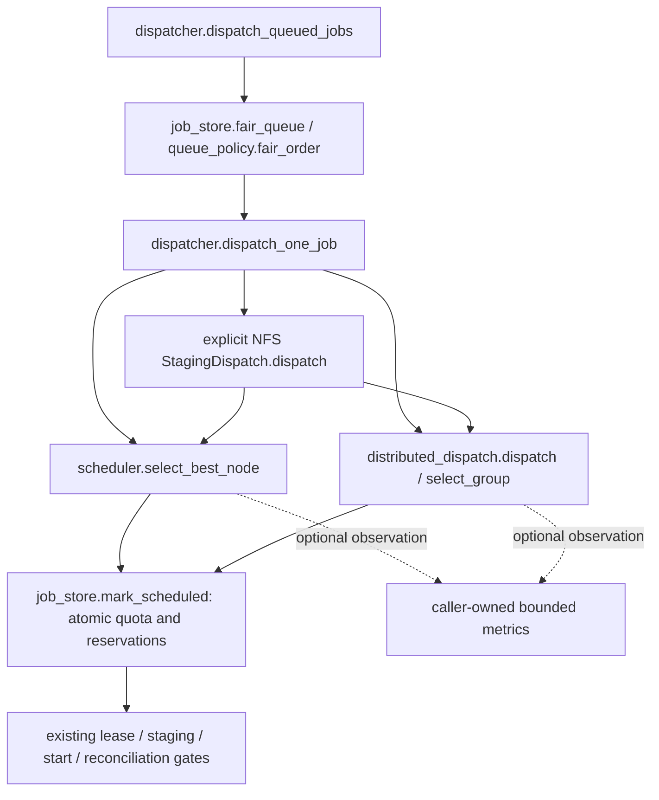

# Phase 10.1 — observe the existing resource scheduler

9 November 2026. **10.1 local PASS; STOP before 10.2.** This change instruments
the existing selectors. It does not implement locality placement, inventory
queries, bandwidth prediction, new policy enablement or a replacement scheduler.
The [evidence](38-resource-scheduler-metrics-evidence.json) records source hashes,
commands and actual results. Phase 9's physical acceptance remains pending as
recorded in [9.4](37-ddp-acceptance.md); local scheduler tests do not clear it.

## 1. Baseline and changed files

Application root: `/home/rana/Projects/System Project/System_Development_Project/distributed-dl-system`.
Git root is its parent. Branch `main`, starting HEAD
`7edef1ccd8e3264d9716a3482cbd214188d009b6`; initial tracked and untracked status
was clean. A pre-edit snapshot of 304 inventoried files is retained under
`/tmp/hybrid-10-1/before`, with hashes in `/tmp/hybrid-10-1/before.json`.
No stash, reset, commit, deployment or service operation was performed.

| File, relative to application root | Change |
|---|---|
| `controller/scheduler_metrics.py` | New bounded, caller-owned metrics and scoped opt-in observer |
| `controller/scheduler.py` | Counters around existing single-worker filtering and unchanged selection |
| `controller/distributed_dispatch.py` | Counters around existing compatible-group filtering and unchanged selection |
| `tests/test_scheduler_metrics.py` | Ten tests, including 25 frozen decision scenarios in three observation modes |
| `tests/fixtures/resource-scheduler-v1.json` | Full pre-edit results, stdout, query order and source provenance |
| `tests/README.md` | Safe local verification command and scope |
| `docs/storage/38-resource-scheduler-metrics.md` | This report, call graph, acceptance and rollback |
| `docs/storage/38-resource-scheduler-metrics-evidence.json` | Machine-readable evidence |
| `docs/storage/implementation-progress.md` | Append-only subphase record |

The public selector/dispatch signatures and returned objects retain their existing
contracts. No student API/UI, DB schema/migration, job state, checkpoint format,
transport, NFS configuration, storage binding, auth or config key changes.
`storage_backend=legacy`, cache/staging OFF and `scheduler_policy=resource` retain
their existing defaults/gates. The diagnostic observer is separately OFF unless
explicitly entered by trusted controller code; it does not read a new config key.

## 2. Existing rules, verified from current code



### Worker and group ordering

`controller/scheduler.py::select_best_node` iterates `config/nodes.json` order.
Its skip order is: not allowed, reserved, temporarily excluded, unavailable
resource request, non-IDLE, insufficient resources. `/resources` has the existing
1.5-second request timeout; failures return no snapshot. `resources_fit` requires
IDLE, available CPU cores (falling back to logical cores), available RAM and
available GPUs to meet requested values. No new thermal or cache filter exists.

Eligible candidates are stably sorted by `(CPU usage ascending, available RAM
descending)`. Exact ties retain **inventory order**, not lexical node ID. The
full winning candidate dictionary retains its node and resource object identities.

`controller/distributed_dispatch.py::select_group` skips reserved, excluded and
unprepared nodes in that order before querying resources. It applies the same
hard resource fit; ownership capability when requested; and checkpoint environment
compatibility when resuming. Workers are bucketed by prepared environment
`compatibility_key`; an incomplete bucket cannot supply a group.

Within each bucket, the first required world-size workers are sorted by CPU
ascending, RAM descending, **node ID ascending**. Complete buckets are compared
by **sum of selected CPU usage only**. Equal sums retain the bucket first
encountered in inventory order, even if another bucket has more RAM or a smaller
compatibility key. Returned order is rank order; no rank/world-size change occurs.

Placement constraints come from existing callers: prepared/allowed nodes,
checkpoint compatibility, unhealthy-node cooldowns, durable reservations and
job resource requirements. Hybrid staging reuses these selectors, then verifies
authorization, manifests and attempt/group leases through its existing gates.
DDP hybrid selection requires ownership capability. Single-worker lease capability
is checked **after** selection by existing legacy/hybrid dispatch code; a selected
unsupported worker can withhold that placement rather than retry another candidate
in the same call. That existing limitation is documented, not changed in 10.1.
Metrics themselves certify neither worker authentication nor telemetry freshness.

### Fairness, quotas and reservations

`controller/queue_policy.py::fair_order` groups custom jobs by owner; bundled
legacy jobs share the `__legacy__` compatibility lane. It preserves FIFO within
owners using queued/created time then job ID. Owner turns sort by aged-first,
active-job count, persisted last-dispatch time, oldest waiting time, then owner
name; it returns round-robin turns. Aging threshold is 300 seconds. Custom owners
at their active limit are withheld. Infeasible jobs have no unconditional start
guarantee, but they do not stop other jobs from being attempted in that pass.

The **checked-in** `config/queue_policy.json` allows three active and twenty
pending jobs per student, with no owner overrides. The missing-file code fallback
is **one** active, twenty pending, 300 seconds. Do not mistake that fallback for
the shipped configuration. ACTIVE is SCHEDULED/RUNNING/CANCELLING; pending covers
RECEIVED/STAGED/READY/QUEUED/HELD. Hybrid STAGING is attempt metadata beneath the
existing job state, not a new fairness bucket.

`job_store.add_job` checks pending admission inside `BEGIN IMMEDIATE`;
`job_store.mark_scheduled` rechecks active quotas and QUEUED status under a write
transaction, then inserts exclusive worker reservations. DDP requires all
distinct workers at the specified world size; reservations, group/rank rows,
attempt history and SCHEDULED state commit together. **One DDP job consumes one
student active-job slot and reserves every selected worker.** `owner_service`
persists actual last dispatches across restarts.

`dispatcher.dispatch_queued_jobs` recomputes fair turns after each placement and
uses an attempted set to avoid retry loops/head-of-line blocking within one pass.
Uncertain starts and lease/cancellation reconciliation retain reservations until
existing safety conditions allow release. A resource snapshot or diagnostic record
cannot free a reservation, bypass a quota, authorize input access or start training.

## 3. Metrics interface and limits

`SchedulerMetrics(max_decisions=128)` accepts integer bounds 1–4096, retains the
newest immutable records, and exposes total recorded/dropped counts. Each completed
selection records monotonic duration in nanoseconds, selector kind, examined nodes,
resource query count, eligible count, compatible/complete group counts, first
filter reason counts, selected node IDs and actual selected count. Group counts
are zero for single-worker placement. Empty completed selections are recorded;
selectors raising an original exception are not represented as completed decisions.

`observe_scheduling(collector)` scopes collection to the current execution context.
`observe_scheduling(None)` disables it inside that scope; nesting restores the
previous observer even on exceptions. New threads/processes do not automatically
inherit the observer. A trusted existing dispatcher bootstrap may wrap its own
dispatch invocation with this context; no additional dispatcher should be started.
There is no automatic bootstrap enablement or persistence/export endpoint here.

Outside the context the selector reads no measurement clock, allocates no record
and performs no metrics I/O. Enabled observation uses fixed counters, a monotonic
clock and a bounded history protected by a lock. Clock/recording failures do not
replace a valid selection; the selector's own exceptions retain their behavior.
No callbacks, extra resource probes, registry reads or sort keys were added.
Timing covers selection including existing resource requests, not staging, training,
queue delay or NFS throughput; no speedup/overhead benchmark is claimed.

Snapshots/documents contain no job/user IDs, filenames, NFS paths or credentials.
They remain trusted operator data, not a student route. Selected IDs are bounded
to 256 IDs of at most 256 characters for diagnostics; long/invalid IDs omit the
record. Actual selection/world size is never truncated. The JSON document declares
`selected_nodes_truncated` when relevant and `policy=resource`. Future locality
choice explanations/freshness belong to 10.2–10.4, not this observation schema.

## 4. Actual tests and evidence

Environment: existing `.controller-venv`, Python 3.12.3, PyTorch 2.14.1,
Flask 3.1.3, requests 2.34.2, numpy 2.5.3. No packages installed.
All commands below were run from the application root; each runner uses a
disposable source tree, excludes live databases/runtime roots and prevents bytecode
writes. Network calls are mocked except the existing native localhost Gloo test.

Before edits:

```bash
env PYTHONDONTWRITEBYTECODE=1 .controller-venv/bin/python tools/run_tests.py --isolated test_resource_allocation.py test_queue_controls.py test_storage_config.py
```

**33 PASS, 3 files**. Log `/tmp/hybrid-10-1/baseline-tests.log`.

After implementation:

```bash
env PYTHONDONTWRITEBYTECODE=1 .controller-venv/bin/python tools/run_tests.py --isolated test_scheduler_metrics.py test_resource_allocation.py test_queue_controls.py test_storage_config.py test_ddp_staging.py
env PYTHONDONTWRITEBYTECODE=1 .controller-venv/bin/python tools/run_tests.py --isolated test_distributed_dispatch.py
```

**59 + 7 = 66 distinct PASS, 6 files, zero final failures/errors/skips.** The
second command used approved sandbox escalation for localhost rendezvous sockets;
no Pi/deployment/service access was involved. Logs are
`/tmp/hybrid-10-1/final-tests.log` and `/tmp/hybrid-10-1/ddp-tests.log`.
The new suite was subsequently strengthened to assert zero clock calls in both
OFF modes, then rerun: **10 PASS**, `/tmp/hybrid-10-1/metrics-final.log` (already
included in the 66 distinct tests, not added again).

The frozen fixture was generated by executing the **pre-edit** selectors from
the snapshot in a disposable controller/agent/config tree. It records 25 scenarios:
single ties/inventory order, CPU/RAM ordering, all hard resource limits,
logical-core fallback, allowed/reserved/excluded precedence, unavailable/busy nodes,
empty inventory; DDP CPU/RAM/node-ID ordering, full/incomplete compatibility buckets,
group ties versus lower total CPU, three workers, preparation/lease/resume filters.
Tests compare full output objects, object identity, stdout and probe order in
default-OFF, explicitly disabled and enabled modes. Further checks cover metrics
counters, bounded immutable snapshots, JSON copies, nested context restoration,
thread isolation, observer failures, original selector exceptions, diagnostic
truncation and actual dispatch retaining an uncertain-start reservation.

Development history: initial golden-generation harness omitted the copied agent
dependency and failed its import; the first new-suite run consequently had one
missing-fixture error. The harness was corrected to include pre-edit agent sources,
the fixture was generated, and all checks above passed. These were new harness
errors, not baseline regressions. Initial log `/tmp/hybrid-10-1/metrics-tests.log`;
corrected generation program `/tmp/hybrid-10-1/freeze_golden.py`.

No physical Pi, live NFS/outage, production workload or throughput test was run.
No workload locality simulation/activation is claimed. Existing regression tests
cover fairness/quota/reservation/cancel/OFF rules; the frozen cases establish exact
selection equivalence for these inputs, not a proof over arbitrary malformed input.

## 5. Manual verification, rollback and acceptance

Safe repeat verification, from the application root:

```bash
env PYTHONDONTWRITEBYTECODE=1 .controller-venv/bin/python tools/run_tests.py --isolated test_scheduler_metrics.py test_resource_allocation.py test_queue_controls.py test_storage_config.py
git diff --check
git status --short
```

Expect 43 PASS across four files, no whitespace errors, and only the nine intended
files above in status (assuming no subsequent user edits). The fixture test checks
both OFF modes, unchanged choices and enabled diagnostics without contacting Pis.
Do not run a second controller or call live dispatch solely to inspect metrics.

Scoped unified diff: `/tmp/hybrid-10-1/10.1.patch`, paths relative to the Git root.
Review it and preserve subsequent changes before source rollback. From the Git root:

```bash
git apply --reverse --check /tmp/hybrid-10-1/10.1.patch
git apply --reverse /tmp/hybrid-10-1/10.1.patch
```

Only the reverse **check** was executed. This rollback removes just 10.1 source,
tests and documentation additions; no schema rollback, data copy/deletion or service
operation is needed. The default observer is already OFF; an operator who wrapped
an existing bootstrap can remove that context to stop collection. Never discard
later edits to force patch application. `/tmp` evidence/patch is session-local;
retain a copy if needed beyond temporary-file cleanup.

| Acceptance for this subphase | Result |
|---|---|
| Metrics observe both existing resource selectors, default OFF | PASS |
| Pre-edit decisions, probe order, returned identity and stdout preserved | PASS — 25 frozen scenarios |
| Tie rules, filters, fairness, quotas, reservations and lease gates traced | PASS |
| Existing resource/queue/config/DDP/staging regressions | PASS |
| Prior source/data preserved; no unintended live or remote mutation | PASS |
| Locality/registry/policy activation or full Phase 10 | NOT IMPLEMENTED — later subphases |
| All-three-Pi physical validation | NOT RUN / still required before cluster acceptance |

Residual risks: opt-in measurements add unbenchmarked clock/counter/lock overhead;
bounded records can be dropped and are not an audit log. Resource telemetry is
advisory and can change after selection; existing reservation/lease/agent admission
remains authoritative. Local tests do not prove physical isolation, NFS durability
or Pi capacity. Read-only input exports, protected worker cache/workspaces, trusted
checkpoint publication and controller-LOCAL SQLite remain required. The controller,
its LOCAL SQLite and authoritative storage remain a **single point of failure**.
**10.1 local PASS. STOP; 10.2 requires the next user instruction.**
