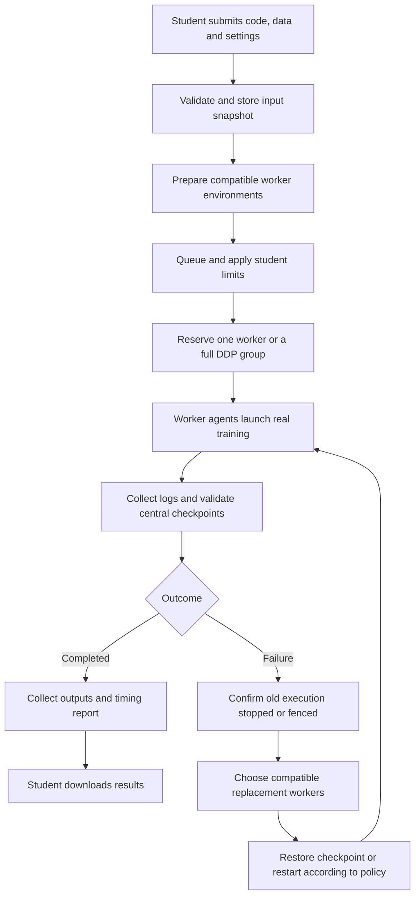

# Website initialization, usage and training integration

This guide covers startup, every website control, custom uploads, checkpoint
integration and an interactive explanation of the project. Use the existing
[deployment guide](deployment.md) for machine installation and lab migration,
[single-worker SDK guide](checkpoint-integration.md) for checkpoint details and
[DDP guide](distributed-training.md) for distributed training integration.

Quick navigation:

- [Explain the architecture](#1-explain-the-project)
- [Initialize and start the website](#2-start-the-existing-installation)
- [Run a local server manually](#run-the-local-server-manually-without-installed-services)
- [Dashboard controls](#3-explain-the-dashboard) and [submission fields](#4-submit-a-built-in-example)
- [Upload custom code and data](#5-upload-custom-code-and-data)
- [Integrate checkpoint recovery and DDP](#6-add-checkpoint-recovery-or-ddp-to-custom-training)
- [Interactive demonstration](#7-explain-and-demonstrate-the-system-interactively)
- [Results and timing](#8-results-and-time-measurements)
- [Troubleshooting](#9-troubleshooting) and [current scope](#11-present-the-current-scope-accurately)

## 1. Explain the project

You can introduce it like this:

> “My project is a fault-tolerant distributed deep-learning execution system.
> Students submit training code, dependencies and datasets through this website.
> The controller prepares the environment, queues jobs, selects compatible
> available workers and starts training. It collects logs, checkpoints and
> results. If a worker fails, it safely replaces that execution and resumes
> supported training from the last valid central checkpoint. The Raspberry Pis
> demonstrate the architecture we can later deploy on our lab computers.”

Your contribution is submission, scheduling, execution management and recovery.
The neural networks are real workloads used to verify that system.

| Capability | Meaning | Evidence to show |
|---|---|---|
| Concurrent independent jobs | Different jobs run on different available workers | Two jobs RUNNING on separate Pis |
| Distributed data parallelism (DDP) | One job uses multiple ranks, data partitions and synchronized gradients | One job ID, multiple ranks, synchronized final weights |
| Checkpoint recovery | A supported trainer restores saved learning state after failure | Central checkpoint, failed attempt, nonzero restored step and completed replacement |

Two independent jobs running together are not one DDP model. Selecting multiple
workers does not automatically convert ordinary Python code into DDP.

### End-to-end flow



The website requests operations and displays progress. The controller makes
scheduling and recovery decisions. Worker agents run and monitor the training
processes. Closing the browser does not cancel an accepted job. Keep the
controller powered on, connected and awake; worker recovery does not make the
controller itself highly available.

| Component | Responsibility | Source |
|---|---|---|
| Portal | Login, uploads, controls, dashboard and downloads | [student_portal.py](../controller/student_portal.py), [browser code](../controller/portal_static/portal.js) |
| Job database | Durable jobs, attempts and runtime records | [job_store.py](../controller/job_store.py) |
| Scheduler | Resource/compatibility selection, queues and reservations | [scheduler.py](../controller/scheduler.py) |
| Dispatcher | Launch, monitor, collect and retry | [dispatcher.py](../controller/dispatcher.py), [DDP dispatch](../controller/distributed_dispatch.py) |
| Worker agent | Resource reports and local process management | [agent.py](../agent/agent.py), [custom runner](../agent/custom_runner.py) |
| Checkpoint SDK | Save/restore training state provided by the application | [dl_checkpoint.py](../agent/dl_checkpoint.py) |
| Execution ownership | Fence expired attempts before accepting replacement work | [ownership guide](execution-ownership.md) |
| Timing collector | Record controller and trainer durations | [job_timing.py](../controller/job_timing.py) |

## 2. Start the existing installation

On the controller laptop:

```bash
cd "/home/rana/Projects/System Project/System_Development_Project/distributed-dl-system"
systemctl --user start dl-dispatcher dl-student-portal
systemctl --user status dl-dispatcher dl-student-portal --no-pager
python3 tools/cluster_setup.py check
```

Open [http://127.0.0.1:8080/](http://127.0.0.1:8080/) and use your existing login.
Both services should show `active (running)`. The cluster check reports reachable
workers, identities, resources, runtime versions and clock agreement.

One healthy Pi is sufficient for single-worker training. Two-worker DDP needs
two healthy, free, compatible workers. To replace one failed Pi in a two-worker
DDP job while that Pi stays offline, prepare at least three compatible candidates.
With only two available workers, DDP must wait until two are available again.

Worker services start automatically at boot. Inspect the powered-on workers:

```bash
ssh pi02 'systemctl is-enabled dl-node-agent; systemctl is-active dl-node-agent'
ssh pi03 'systemctl is-enabled dl-node-agent; systemctl is-active dl-node-agent'
```

Use `pi01` too when it is online. Inspect controller logs:

```bash
journalctl --user -u dl-dispatcher -n 80 --no-pager
journalctl --user -u dl-student-portal -n 80 --no-pager
```

Add `-f` to follow new messages. Ctrl+C exits the log viewer without stopping the
service. Do not also start terminal dispatcher/portal processes while the
services are running; both enforce single-process ownership.

### Create an account only when needed

```bash
.controller-venv/bin/python controller/student_portal.py --create-user student01
```

Enter a password of at least ten characters twice. The operator assigns IDs;
students cannot claim another student's job owner. Repeating this command for
an existing ID changes its password. It is not a routine startup command.
Retain `storage/portal/`, which holds password hashes and the session signing key.
An account can see earlier terminal jobs submitted with the same owner ID.

### Run the local server manually without installed services

Use this route for local development or a fresh checkout. It starts the same
Python application directly in terminals. On the already installed laptop,
the service commands above are simpler. Choose one method at a time.

**Step 1 — Open a terminal in the project folder.** On Rana's laptop:

```bash
cd "/home/rana/Projects/System Project/System_Development_Project/distributed-dl-system"
python3 --version
```

On another PC, replace the `cd` path with that checkout's actual location. These
instructions target Linux with Python 3.11 or 3.12, `venv` and pip available.
If `python3 -m venv` reports missing venv support, install the matching Python
venv package using your Linux distribution's package manager, then retry.

**Step 2 — Prepare Python dependencies once.** On a fresh checkout:

```bash
python3 -m venv .controller-venv
.controller-venv/bin/python -m pip install -r config/runtime-requirements.txt
```

If this checkout already has its working `.controller-venv`, skip creating it.
Package installation needs network access unless dependencies are cached. The
explicit interpreter path means you do not need to activate the environment.
There is no `npm install` or frontend build step. Worker training packages are
prepared separately when jobs are submitted.

**Step 3 — Create a login if you do not already have one.**

```bash
.controller-venv/bin/python controller/student_portal.py --create-user student01
```

Enter a password of at least ten characters twice; password input is hidden.
This command exits after creating the account. It does not start the server.
Skip this step for an existing account unless you intend to reset its password.

**Step 4 — Avoid duplicate processes.** If switching from installed services,
first finish/cancel active training and wait for preparation to finish, then:

```bash
systemctl --user stop dl-student-portal dl-dispatcher
```

Skip this command on a machine where those services were never installed.
Also stop any manually started copies before launching new ones.

**Step 5 — Terminal A: start scheduling and recovery.**

```bash
cd "/home/rana/Projects/System Project/System_Development_Project/distributed-dl-system"
.controller-venv/bin/python -u controller/dispatcher.py
```

Leave this terminal running. It monitors workers and manages job execution.
The dispatcher is necessary for training, scheduling and recovery; the website
can open without it but will display a dispatcher-stopped warning.

**Step 6 — Terminal B: start the local website.** Open another terminal:

```bash
cd "/home/rana/Projects/System Project/System_Development_Project/distributed-dl-system"
.controller-venv/bin/python controller/student_portal.py --host 127.0.0.1 --port 8080
```

Leave this terminal running too. Look for `Running on http://127.0.0.1:8080`.
This manual command uses Flask's development server without debug mode. The
installed services use Waitress. To run Waitress manually, add `--production`
to the same command instead; do not run both portal commands simultaneously.

**Step 7 — Open the browser and verify.** Visit
[http://127.0.0.1:8080/](http://127.0.0.1:8080/), sign in and check that the dashboard
appears. In a third terminal, optionally verify the HTTP response:

```bash
curl -I http://127.0.0.1:8080/
```

Expect `HTTP/1.1 200 OK`. If `curl` is unavailable, opening the login page is
sufficient for this website check. To check the configured workers, run from
the project folder:

```bash
python3 tools/cluster_setup.py check
```

A working login page confirms the web server is running, not that worker setup
is complete. Actual training also needs registered, reachable worker agents,
controller SSH access for preparation and enough compatible resources. Follow
the worker installation instructions below before submitting on a fresh cluster.

**Step 8 — Stop or restart the local server.** After jobs/preparation finish,
press Ctrl+C in Terminal B to stop the website and Terminal A to stop the
dispatcher. Restart by repeating steps 5 and 6. Closing those terminals stops
the manual processes; closing only the browser does not.

On an installed laptop, return to background services after stopping both manual
processes with:

```bash
systemctl --user start dl-dispatcher dl-student-portal
```

If startup reports **Another student portal is already running**, **another
dispatcher**, or **Address already in use**, inspect the existing service or
terminal instead of launching duplicates. If another application owns port 8080,
use `--port 8081` for the portal and open `http://127.0.0.1:8081/` instead.
For other failures, read the traceback in the terminal and the troubleshooting
table in section 9.

### First installation on a new controller

Start with a Linux source checkout, Python/venv support, systemd user services
and configured SSH aliases for the workers. From the project root:

```bash
python3 tools/cluster_setup.py install-controller
.controller-venv/bin/python controller/student_portal.py --create-user student01
python3 tools/cluster_setup.py check
```

The installer creates the controller environment, installs runtime dependencies,
installs/enables dispatcher and Waitress portal services, enables lingering and
starts the services. There is no frontend build or Node.js requirement.
If lingering needs administrator assistance, follow
[controller installation](deployment.md#6-install-the-controller-on-another-linux-machine).

Installing the website does not install the workers. For registered idle workers,
finish/cancel active jobs, then install with the actual machine IDs:

```bash
systemctl --user stop dl-student-portal dl-dispatcher
python3 tools/cluster_setup.py install-workers --nodes pi02 pi03
python3 tools/cluster_setup.py check
systemctl --user start dl-dispatcher dl-student-portal
```

See [adding lab PCs](deployment.md#5-add-a-lab-pc) for SSH, sudo, network,
interpreter and registration requirements. Use only one active controller for
this cluster, and follow the deployment guide when migrating existing history.

### Open the website from another computer

`127.0.0.1` means the computer running the browser. For access from the trusted
LAN, finish active jobs, then run on the controller:

```bash
systemctl --user stop dl-student-portal dl-dispatcher
python3 tools/cluster_setup.py install-controller --host 0.0.0.0
hostname -I
```

The installer starts the services again. Use `http://CONTROLLER_LAN_IP:8080/`
on the other computer, replacing the placeholder with the actual LAN address.
Firewall/network access must permit the port. Keep worker APIs within the
trusted cluster network. University-wide untrusted deployment needs the work
listed in section 11.

## 3. Explain the dashboard

| Screen/control | Meaning |
|---|---|
| Sign in | Associates operations and visible jobs with a student account |
| Worker cards | Live state, CPU usage, free RAM and free execution slots; not a job's percentage complete |
| IDLE / BUSY / UNREACHABLE | Available / occupied / no current response; unreachable alone does not prove a hardware fault |
| Your jobs | The signed-in student's submissions and their current status |
| Show filter | All jobs, in progress or finished |
| Student limits | Maximum active and pending submissions for that account |
| Submit training | Choose an example or upload custom code and data |
| Job detail | Job ID, execution mode, attempt number, central checkpoint and controls |
| Training logs | Preparation output, live training output or collected attempt logs |
| Training rank | Choose a DDP rank's live log; for saved logs choose the corresponding file under Log source |
| Attempts & workers | Failed, retried and successful executions of the same job |
| Distributed ranks | Each rank's assigned worker/status by attempt |
| Recovery history | Reservation, failure, fencing and confirmed restore events |
| Checkpoint and execution ownership | Detailed checkpoint and lease records |
| Training time | Finished-job measurements explained in section 8 |
| Download results ZIP | Collected output files for a finished job |

The page refreshes about every three seconds; fast transitions can occur between
refreshes. The central checkpoint can lag the log because it must be transferred
and validated before publication.

### States and actions

```text
STAGED / PREPARING → READY → QUEUED → SCHEDULED → RUNNING → COMPLETED
                              ↕
                             HELD
```

`PREPARING` is a portal preparation state shown over the stored job state.
`STAGED` means inputs are stored. `READY` means enough compatible environments
exist. `QUEUED` means eligible for scheduling. `SCHEDULED` means workers have been
reserved and startup/reconciliation is underway. Failures may create another
attempt of the same job or end in `FAILED`. Cancellation goes through
`CANCELLING` until termination/fencing is confirmed, then `CANCELLED`.

- **Hold** pauses a queued job before dispatch; **Release** makes it eligible again.
- **Cancel job** requests termination; wait for the terminal cancellation state.
- **Retry preparation** retries setup after a preparation problem. Fix the disk,
  package or connectivity issue first.
- Queue position is an ordering indication, not a promised start time. Resources,
  free workers, compatibility and student quotas affect which job can start.

## 4. Submit a built-in example

1. Click **Submit training**.
2. Choose regression, binary classifier, CNN or distributed classifier (DDP).
3. Give the job a descriptive name and inspect the training command.
4. Expand **Resources, environment and recovery** and check the settings.
5. Click **Submit & prepare**.
6. Select the job and follow preparation, running logs and checkpoint progress.
7. Once completed, download its results.

The controller snapshots inputs and prepares registered candidates. Preparation
is serialized across portal submissions to avoid competing package installations;
already prepared jobs can run concurrently. Enough compatible successful
candidates allow queueing even if another worker is unavailable. First preparation
can take minutes. Matching verified caches are reusable, but source/dependency
changes can cause a new environment build.

### Every submission field

| Field | How to use it |
|---|---|
| Training source | Bundled example or **Upload my project** |
| Project ZIP | Custom source package, including its requirements file |
| Dataset file or ZIP | Optional single data file or ZIP of a directory |
| Load job definition | Fill settings from JSON; still select uploads and the Environment profile yourself |
| Job name | Human-readable label; the system creates a separate unique job ID |
| Training command | JSON argument list, e.g. `["python","train.py","--steps","800"]` |
| Execution | Single worker or distributed training |
| Workers | One for single execution; at least two for DDP |
| CPU cores per worker | Requested cores on each worker; launcher applies CPU affinity and common tensor thread settings |
| RAM per worker (GB) | Admission requirement; not a hard operating-system memory cap |
| GPUs per worker | Use 0 for the current CPU Pi system |
| Requirements path | Relative to the project root, normally `requirements.txt` |
| Environment | Package installation profile, explained below |
| Recovery | Restart from the beginning or resume through the checkpoint SDK |
| Checkpoint interval (s) | Minimum SDK save interval; code must call save at safe boundaries |
| Maximum retries | Replacement attempts after the initial attempt; 2 permits at most 3 attempts |

The command is an argument list, not a shell command. Do not enter
`source venv/bin/activate && python train.py`. The executor substitutes the
prepared interpreter for an entrypoint beginning with `python` or `python3`.
Your script must implement every option you put after its filename.

Built-in regression, binary and CNN examples use a single worker. The DDP
example uses distributed checkpoint recovery. Its global batch size must divide
evenly by worker count: default 64 works for two; add
`"--global-batch-size","96"` for three. Three workers also require three
compatible free slots. Single-worker benchmarking of the DDP example uses
restart recovery; its group-checkpoint mode requires distributed execution.

### Environment options

| Website choice | Profile | Use |
|---|---|---|
| PyTorch CPU | `pytorch-cpu` | Tested Pi examples; isolated environment using the PyTorch CPU package index |
| Isolated Python | `isolated` | Separate environment using the normal package index; useful for other dependencies |
| Worker base | `worker-base` | New environment inheriting a curated worker baseline; intended for operator-managed setups |

Packages must be available from the selected index and compatible with the
worker's Python version and architecture. Requirements can configure package
sources. Do not copy laptop virtual environments into uploads. See
[environment profiles](environments.md#profiles), including the known Pi
worker-base limitation. Dependency environments do not sandbox student code.

## 5. Upload custom code and data

### Route A: use the downloadable example

1. Select regression in **Submit training**.
2. Click **Download source, dataset and job definition**.
3. Extract `regression-submission.zip`. It contains `project.zip`, `dataset.csv`
   and `job.json`.
4. To change the model, extract the inner `project.zip`, edit `train.py`, then
   recreate `project.zip` with the source files at its root.
5. Choose **Upload my project** in the website.
6. Select the inner `project.zip` as **Project ZIP**, and `dataset.csv` as the
   dataset. Do not upload the outer submission bundle as the project.
7. Select `job.json` under **Load job definition**.
8. Choose **PyTorch CPU**, check all fields, rename the job and submit.

Importing a definition fills settings; it does not choose local files or set the
Environment profile. Check those controls explicitly. The browser replaces the
JSON's `project` and `dataset` paths with the actual uploads; it cannot select
arbitrary controller filesystem paths.

### Route B: make an editable upload from this repository

Run from the project root. These commands copy the working regression trainer
into a separate folder. Choose a different folder name if the destination already
contains work you want to retain.

```bash
mkdir -p "$HOME/dl-custom-upload/project"
cp examples/checkpoint_project/train.py "$HOME/dl-custom-upload/project/train.py"
cp examples/checkpoint_project/requirements.txt "$HOME/dl-custom-upload/project/requirements.txt"
cp examples/dataset.csv "$HOME/dl-custom-upload/dataset.csv"

python3 - <<'PY'
import json
from pathlib import Path
folder = Path.home() / "dl-custom-upload"
spec = json.loads(Path("examples/job.integration.json").read_text())
spec.update(name="my-custom-regression", project="project.zip", dataset="dataset.csv")
(folder / "job.json").write_text(json.dumps(spec, indent=2) + "\n")
PY
```

Edit the copied source/data as needed. Package it with this command, repeating
the packaging after every source edit:

```bash
python3 - <<'PY'
from pathlib import Path
from zipfile import ZipFile, ZIP_DEFLATED
folder = Path.home() / "dl-custom-upload"
with ZipFile(folder / "project.zip", "w", ZIP_DEFLATED) as archive:
    for path in sorted((folder / "project").rglob("*")):
        if path.is_file() and "__pycache__" not in path.parts:
            archive.write(path, path.relative_to(folder / "project"))
print(folder / "project.zip")
PY
```

Optionally validate the package without submitting or executing it:

```bash
.controller-venv/bin/python controller/submit_job.py \
  --spec "$HOME/dl-custom-upload/job.json" --validate-only
```

Upload the files using Route A steps 5–8:

```text
dl-custom-upload/
├── project/            Editable local source
│   ├── train.py
│   └── requirements.txt
├── project.zip         Project ZIP upload
├── dataset.csv         Dataset upload
└── job.json            Load job definition
```

Inside the ZIP, use `train.py` and `requirements.txt` at the root, not
`project/train.py` and `project/requirements.txt` for this command. Additional
modules and configuration files can be included.

The regression code expects this CSV format:

```csv
x,y
0,1
1,3
2,5
3,7
```

It trains an MLP with hidden layers and dropout, MSE loss, Adam and a learning-rate
scheduler. In [train.py](../examples/checkpoint_project/train.py), data loading
creates tensors; model construction defines layers; `load` restores an attempt;
the loop samples batches, computes loss, backpropagates and updates parameters;
`save` records progress; the final block saves completion, evaluates and exports
model, summary and timings. This is real training with an intentionally small dataset.

### Complete job definition

```json
{
  "schema_version": 1,
  "name": "my-custom-regression",
  "project": "project.zip",
  "dataset": "dataset.csv",
  "entrypoint": ["python", "train.py", "--steps", "800", "--batch-delay", "0.08"],
  "execution": {"mode": "single", "workers": 1},
  "resources_per_worker": {"cpu_cores": 1, "memory_gb": 1, "gpus": 0},
  "environment": {"requirements": "requirements.txt"},
  "recovery": {"mode": "checkpoint", "interval_seconds": 1, "max_retries": 2}
}
```

`schema_version` selects the definition format. Input paths are relative to the
JSON file for terminal submission; browser uploads replace them. `entrypoint`
is the script invocation. Resource values apply to each worker. Requirements
are relative to the project root. Recovery controls retries and checkpointing.
The Environment profile is selected separately and is not stored in this JSON.

### Adapt your own or another student's training script

The launcher runs the script in its working source directory and supplies:

| Environment variable | Meaning |
|---|---|
| `DL_DATASET_PATH` | Managed data file or extracted data directory; absent when no dataset is supplied |
| `DL_OUTPUT_DIR` / `DL_RESULTS_DIR` | Directory whose files are collected as results |
| `DL_SOURCE_DIR` | Job's working source directory |
| `DL_JOB_ID` | Unique job identity |
| `DL_ATTEMPT_TOKEN` | Execution attempt identity |
| `DL_CHECKPOINT_INTERVAL_SECONDS` | SDK interval from recovery settings |

Replace hard-coded laptop paths with these values:

```python
import os
from pathlib import Path

dataset = Path(os.environ["DL_DATASET_PATH"])
output = Path(os.environ["DL_OUTPUT_DIR"])
output.mkdir(parents=True, exist_ok=True)
# Load your data, train, then save model/results under output.
```

If a data ZIP contains `images/train/...`, use `dataset / "images" / "train"`.
The script must understand that layout; the portal does not transform input data.
For generated data, leave the dataset upload empty and do not require its variable.

List third-party packages in `requirements.txt`; an empty file works for
standard-library-only code. Pin compatible versions for repeatable environments.
Include local imports, avoid interactive input/GUI windows and print progress
with `flush=True`. Outputs written outside the result directory may not be collected.

Start an ordinary custom program using **Single worker → Restart training**.
On failure it reruns from the beginning within its retry budget. If the script
already requires the checkpoint SDK, follow that integration's settings instead.
For continuation from saved progress, use section 6.

Upload limits: 256 MiB per HTTP request, 512 MiB expanded and 10,000 entries per
ZIP. Links and escaping paths are rejected. Larger datasets require a separate
storage/upload design; Step 12 does not remove these limits. Do not package
virtual environments, caches, credentials or unrelated files.

## 6. Add checkpoint recovery or DDP to custom training

Selecting **Resume checkpoint** does not capture arbitrary process memory.
The training code must cooperate with the SDK. After creating model, optimizer
and optional scheduler, use this integration pattern. `train_one_update` and the
model setup stand for your application code; this snippet is not a full trainer.

```python
from dl_checkpoint import CheckpointManager

checkpoints = CheckpointManager()
restored = checkpoints.load(model, optimizer, scheduler=scheduler)
next_step = restored["progress"]["next_step"] if restored else 0

for step in range(next_step, total_steps):
    train_one_update(model, optimizer, scheduler)
    # Save after the update; progress points to the next unprocessed update.
    checkpoints.save(
        model, optimizer, scheduler=scheduler,
        global_step=step + 1, progress={"next_step": step + 1},
    )

# Required even if the restored checkpoint already reached total_steps.
checkpoints.save(
    model, optimizer, scheduler=scheduler,
    global_step=total_steps, progress={"next_step": total_steps},
    completed=True, force=True,
)
```

The executor supplies `dl_checkpoint`; do not install an unrelated package with
that name. PyTorch must be installed in the training environment. Omit
`scheduler` from load/save if your trainer has none.

The SDK saves model, optimizer, optional scheduler, supported global random
states and application progress. Custom generators, samplers, gradient scalers
and other application state need explicit integration. Do not reseed after
restoring or initialize over the restored model. DataLoader prefetching and
worker RNGs, gradient accumulation and external streams need suitable save/replay
boundaries. See [the SDK integration guide](checkpoint-integration.md#integrate-your-own-pytorch-training-script).

Completion requires a final valid completed checkpoint and successful execution.
Failure before the first central checkpoint can only restart from the beginning.
Updates after the last committed checkpoint may be replayed during recovery.

### Custom DDP

Start from the downloadable DDP example. Retain its distributed initialization,
sampler and checkpoint handling while changing the model/data. Select distributed
execution and the desired fixed worker count.

The controller starts one process per worker and supplies `RANK`, `WORLD_SIZE`,
`LOCAL_RANK=0`, `MASTER_ADDR`, `MASTER_PORT` and `DL_DDP_BACKEND=gloo`.
Your script must initialize the process group, wrap the model in DDP, partition
inputs and execute matching collective operations. Do not launch a second Slurm
allocation or nested multi-worker launcher inside the submitted job.

Checkpoint-enabled DDP uses `DistributedCheckpointManager`. Every rank must
call load/save in the same order, including the final forced completed save.
On failure, the whole group is stopped/fenced and recreated with the same world
size; each logical rank restores its saved state. See the
[complete trainer](../examples/ddp_project/train.py) and
[DDP restore guide](distributed-training.md#integrate-restore-into-another-trainer).

A friend's Slurm Python trainer may be reusable, but `sbatch/srun` scripts and
`SLURM_*` environment assumptions need adaptation. Uploading a script does not
automatically give it DDP or exact checkpoint resume.

## 7. Explain and demonstrate the system interactively

Use the website for submissions and progress. Use terminals for service checks,
rebooting the selected test worker and comparing results. Have two compatible
online workers for single-worker failover, or three for two-worker DDP replacement
while one worker remains offline. Finish unrelated jobs before fault injection.

### A. Run a normal job

1. Show the worker cards: “These are the available execution machines.”
2. Select regression. Open its downloaded source to show model construction,
   loss, backward pass and optimizer update.
3. Name it `regression-baseline` and use:

   `["python","train.py","--steps","2000","--batch-delay","0.08"]`

4. Keep single worker, PyTorch CPU, checkpoint recovery, interval 1 second and
   maximum retries 2. Explain that the delay leaves time to observe progress;
   it is not needed for learning and is not a compute benchmark setting.
5. Show preparation, selected Pi, running logs, increasing central checkpoint,
   completed status and downloaded model/summary/timings.
6. Save its job ID and let it finish before the recovery comparison.

Say: “The student declared requirements; the scheduler selected the worker.”

### B. Run two independent jobs

Submit binary classifier and CNN jobs close together, with enough steps/delay
to overlap. Show them RUNNING on different workers when capacity and quotas permit.
Preparation may still be serialized. Finish/cancel them before recovery testing.

Say: “Different students or experiments can train concurrently on separate machines.”

### C. Interrupt training and verify checkpoint recovery

1. Submit identical regression source, data, command and settings; change only
   the name to `regression-recovery`.
2. Wait for RUNNING and a **nonzero central checkpoint** while training is still
   in progress. Copy the job ID and note its actual assigned Pi.
3. Confirm a compatible prepared replacement is free, using preparation logs or
   `job_status.py` to inspect candidate environments.
4. Reboot only the assigned test worker. Replace `pi03` below with that actual ID:

```bash
NODE_TO_REBOOT='pi03'
ssh "$NODE_TO_REBOOT" 'sudo -n reboot'
```

5. Keep the website open. Show the failed attempt and recovery history. The
   controller must confirm termination or wait for execution lease fencing;
   replacement is deliberately not instantaneous.
6. Show the replacement worker and a confirmed nonzero restored step in events
   and logs, then wait for COMPLETED. Do not submit the job again.
7. Compare both completed job IDs:

```bash
BASELINE_ID='paste-baseline-job-id'
RECOVERY_ID='paste-recovery-job-id'
.controller-venv/bin/python controller/job_status.py "$RECOVERY_ID"
.controller-venv/bin/python tools/compare_regression_jobs.py \
  "$BASELINE_ID" "$RECOVERY_ID"
```

Show `pass: true`, exact model/optimizer/scheduler match, matching MSE/predictions,
and separately verify the recovered `resumed_from` is greater than zero. Matching
final outputs alone do not prove a checkpoint was restored. The comparison tool
is for this example's output format, not arbitrary models.

Say: “The same job continued from stored learning state after a machine failure.
The final state comparison verifies this example's recovery trajectory.”

A rebooted Pi may return before replacement starts. Placement depends on available
compatible candidates. If the job waits, inspect its queue reason, preparation
and ownership records; do not promise an immediate switch to another Pi.
A software reboot is also different from an electrical power-loss experiment.

### D. Show distributed training

Submit the DDP example with two workers. Show one job ID, ranks 0 and 1 on
separate Pis, a common checkpoint step and per-rank logs. At completion, inspect
rank summaries: `parameters_synchronized: true`, equal final model hashes and
final hashes different from initial hashes. The example's dataset indices help
inspect its data partitions.

Say: “Each rank processes a data partition and synchronizes gradients; together
they train one model.”

For DDP recovery, first complete an identical baseline, then reboot one rank in
a second run only after a group checkpoint exists. Show the complete group being
safely recreated/restored. Compare with
`tools/compare_training_jobs.py BASELINE_ID RECOVERY_ID`. With only two available
Pis for two ranks, the missing Pi must return unless another compatible candidate
becomes available. With three prepared candidates, a two-rank group can replace
one failed machine while it remains offline.

## 8. Results and time measurements

The **example download** is an input bundle: code ZIP, dataset and job definition.
The **results download** contains files collected from the output directory.

Typical single-worker example:

```text
model.pt
summary.json
system-timing.json
```

Typical DDP example:

```text
rank-0/model.pt
rank-0/summary.json
rank-1/model.pt
rank-1/summary.json
system-timing.json
```

Custom code controls its output filenames. Failed/cancelled jobs can have partial
outputs and a timing report; a downloadable ZIP does not mean successful training.
Source, dataset, attempt logs and recovery checkpoints remain under
`storage/jobs/JOB_ID/` and are not automatically included in the results ZIP.
A checkpoint is recoverable training state; `model.pt` is the trainer's exported
output. Their roles differ even when they contain some of the same tensors.

| Measurement | Meaning |
|---|---|
| Training loop · final attempt | Trainer-reported loop duration, including in-loop saves, synchronization, logs and deliberate delays |
| Training program · final attempt | Built-in trainer time from before PyTorch import through setup, loop, final save, evaluation and model export; before summary writing |
| Full training · including recovery | First recorded attempt start to final recorded finish, including interruptions/retries after that start |
| Submission to completion | Submission to finish, including preparation, initial queue and startup attempts |
| Preparation and initial queue | Submission to first recorded attempt start; available in the JSON report |

All durations are seconds. DDP uses the slowest rank, not the sum of rank times.
Attempts without a recorded start fall before the full-training interval; use
submission-to-completion to include initial launch delays too.

Loop/program values after recovery cover only the final attempt. Lost compute
on a failed machine cannot be reconstructed exactly. The JSON records attempts,
timestamps and definitions. Trainer durations use a monotonic clock; controller
intervals require synchronized wall clocks. JSON timestamps use UTC; the website
shows dates in the browser's local timezone.

Older/uninstrumented code shows unavailable measurements as `null` / **Not recorded**.
For custom timing, measure real durations using `time.perf_counter()` and write
`summary.json` with this structure (the numbers below are only an illustration):

```json
{
  "timing": {
    "training_loop_seconds": 12.5,
    "training_program_seconds": 15.2
  }
}
```

Follow the built-in trainer for placement of the timers. The root filename
`system-timing.json` is reserved for the controller. Exact model comparisons
exclude timing values.

For speed comparison, keep model, data, update/global-batch convention, hardware
and delay settings comparable. Disable artificial delays for compute benchmarks.
Speedup = single-worker time / DDP time using the same measurement scope.
Above 1 means faster; below 1 means slower. Small Pi models may spend more time
communicating than they save computing. Successful DDP does not guarantee speedup.

## 9. Troubleshooting

| Symptom | Check/action |
|---|---|
| Website unavailable | Portal service status/journal and correct address/port |
| Dispatcher stopped warning | Start dispatcher; portal alone cannot schedule/recover |
| Worker unreachable | Power, address, LAN/SSH and worker service |
| Preparation slow | Read preparation.log; offline candidates, transfers and package builds take time |
| No space left | Inspect disk; reclaim only unused rebuildable caches with operator review while idle |
| Dependency error | Requirements, package index, Python/ARM compatibility, disk and connectivity |
| Missing script/requirements | ZIP root and declared paths; use inner project.zip, not the whole example bundle |
| Dataset error | File/directory handling, paths and expected column/layout format |
| Job queued | Wait reason, slots, RAM, compatible prepared workers, requested group size and quotas |
| Three-worker DDP rejected | Example global batch must divide evenly, e.g. 96; also need three candidates |
| Checkpoint completion fails | SDK integration and explicit final completed checkpoint |
| Recovery waits | Old process stop/fencing and sufficient replacement capacity |
| HTTP 409 or launch timeout | Inspect controller/worker logs, ownership, resources and clocks; these errors have multiple possible causes |
| Login failure | ID/password; operator can reset using --create-user |
| Time not recorded | Trainer did not emit supported fields or job predates instrumentation |

Useful commands:

```bash
JOB_ID='paste-job-id'
.controller-venv/bin/python controller/job_status.py "$JOB_ID"
ssh pi02 'df -h /; systemctl is-active dl-node-agent'
ssh pi03 'df -h /; systemctl is-active dl-node-agent'
```

Do not delete the database, portal credentials, input snapshots, checkpoints or
results to free cache space. These are operational data, not unnecessary files.
See deployment instructions before moving the controller: stored paths are absolute.

## 10. Verify website changes

Tests use isolated temporary data:

```bash
.controller-venv/bin/python -m py_compile controller/student_portal.py
.controller-venv/bin/python tests/test_student_portal.py -v
.controller-venv/bin/python tests/test_job_timing.py -v
```

After a code update, let preparation finish and follow the maintenance procedure
before restarting affected services. Then check login, a small job, progress,
outputs and downloads in the browser. Unit tests do not replace live reboot tests.

## 11. Present the current scope accurately

The prototype implements owner-scoped submissions, compatible environments,
fair queues, exclusive worker slots, concurrent independent jobs, fixed-world-size
CPU/Gloo DDP, cooperative checkpoint recovery, leases, downloads and timing.

It is not a full Slurm replacement. Thirty-PC load testing, GPU/NCCL, elastic
world-size changes, controller high availability, large-dataset infrastructure,
HTTPS and untrusted-code isolation remain separate deployment work. Login protects
job access; a virtual environment does not isolate code from the worker OS.
Exact numerical equivalence depends on the trainer and complete state/replay
integration, not just a checkbox.

Show evidence in this order: submitted code → assigned workers → live learning →
central checkpoint → failed/replacement attempt → confirmed nonzero restore →
final state comparison. This directly supports the scheduling and recovery claims.
